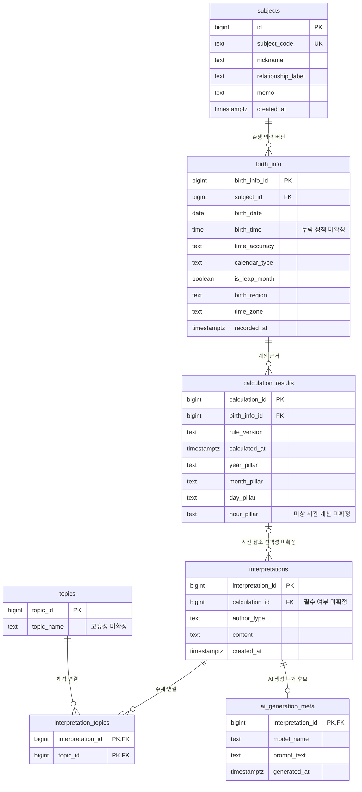

# Chapter 07 확장 실습 답안 — 온라인 강의 수강신청 DB 완성하기

> **작성 상태:** 스키마 생성, Seed 기준 상태, 변경 결과, 경계·실패 테스트와 실패 후 공식 Validation 재검증을 확인했다. 실행 캡처 4장을 첨부했다. Seed는 간소화 입력 SQL을 사용해 별도 seed passed 메시지는 출력하지 않았다. 초기화 재현성 실험은 수행하지 않았다. 개인 프로젝트 설계·AI 판단·성찰은 제출 전 본인이 최종 확인한다.

공식 자료: [답안 템플릿](https://github.com/GilbertMoon/ai-database-book/blob/main/assignments/chapter07/chapter07_answer_template.md), [프로젝트 결정 기록](../../code/chapter07/PROJECT_DECISIONS.md), [실행 안내](../../code/chapter07/README.md). SQL은 공식 저장소의 Chapter 07 파일을 가져왔으며 실행 결과를 대신하지 않는다.

```text
GitHub 계정 또는 별칭: ssossocoder
과제 작성일: 2026-10-12
사용한 AI 도구: ChatGPT (Codex) 
```

비밀번호, 전체 접속 URL, API Key와 실제 개인정보는 답안과 캡처에 남기지 않는다. 예제 이름과 이메일은 공식 Seed의 가상 데이터다.

---

# 1. 시작 환경 확인

```sql
SELECT current_database();
SELECT current_user;
SELECT current_schema();
SHOW search_path;
SHOW transaction_read_only;
SELECT to_regnamespace('course_project');
```

| 확인 항목 | 실제 결과 | 의미 |
| --- | --- | --- |
| current_database() | ai_database_book | SQL을 실행하는 DB |
| current_user | postgres | 현재 권한을 가진 역할 |
| current_schema() | public | 스키마를 생략했을 때 우선 사용하는 스키마 |
| search_path | "$user", public | 스키마 이름 탐색 순서 |
| transaction_read_only | off | 쓰기 가능한 연결인지 확인 |
| to_regnamespace('course_project') | 최초 생성 전 없음(시작 검사 통과), 현재 존재 | 기존 프로젝트 존재 여부 |

- [x] 현재 DB가 ai_database_book이다.
- [x] 쓰기 가능한 연결과 CREATE 권한을 확인했다.
- [x] 실행할 SQL 범위와 시작 상태를 확인했다.
- [x] SQL 클라이언트의 Auto-commit 상태를 확인했다.

### 프로젝트 SQL을 실행하기 전에 시작 상태를 확인해야 하는 이유

같은 SQL도 다른 DB나 이미 데이터가 있는 상태에서 실행하면 결과가 달라진다. 공식 01은 기존 course_project가 있으면 중단하고, 02와 03도 시작 상태를 검사한다. 모든 테이블명을 스키마와 함께 쓰므로 current_schema()가 course_project일 필요는 없다. 01~03은 명시적 트랜잭션으로 실행하고 오류가 나면 실패 상태를 확인한 뒤 ROLLBACK한다.

---

# 2. 프로젝트 범위와 요구사항 읽기

## 2-1. 포함 범위

1. 학생의 이름·이메일·가입일과 강사의 이름·이메일·전문 분야를 관리한다.
2. 강의의 현재 정보와 담당 강사 한 명을 관리한다.
3. 학생의 수강신청 사건에 신청일·현재 상태·신청 시 기록 금액을 저장한다.
4. Seed, 상태 변경, 경계·실패 테스트와 최종 Validation으로 결과를 검증한다.

## 2-2. 제외 범위

1. 결제 승인·실패·환불 거래와 회계 매출 계산.
2. 정원 제한, 대기열과 동시 신청 인원 제어.
3. 전체 상태 변경 이력과 모든 상태 전이의 DB 강제.
4. 강의 콘텐츠·진도·수료, 수강평·쿠폰·할인 이력.

### 범위를 명확하게 정해야 하는 이유

신청 기록을 저장하는 일과 결제·진도를 관리하는 일은 필요한 데이터와 완료 기준이 다르다. 범위를 정해야 이번 DB가 보장하는 내용을 검증하고 후속 기능을 미완성 버그와 구분할 수 있다.

## 2-3. 요구사항 / 프로젝트 결정 / 미확정 질문 구분

| ID | 종류 | 내용 요약 | DB 구조/규칙에 미치는 영향 |
| --- | --- | --- | --- |
| P07-R01 | 요구사항 | 학생은 이름·이메일·가입일을 가진다 | students의 필수 열 |
| P07-R05 | 요구사항 | 신청은 학생·강의·신청일·상태·신청 시 기록 금액을 가진다 | enrollments와 두 FK |
| P07-R07 | 요구사항 | 학생·강사 이메일은 각각 공백과 동일 문자열 중복을 금지한다 | 테이블별 CHECK·UNIQUE |
| P07-D02 | 프로젝트 결정 | 할인 없는 현재 범위에서는 신청 시 강의 가격을 복사해 보존한다 | INSERT ... SELECT로 recorded_amount 저장 |
| P07-D03 | 프로젝트 결정 | 같은 학생·강의의 신청·수강중 행은 최대 한 건이다 | 활성 행만 부분 고유 인덱스 적용 |
| P07-Q01 | 미확정 질문 | 학생과 강사 사이에서도 이메일이 전역 고유해야 하는가? | 현재는 테이블별 UNIQUE; 통합 계정 모델은 보류 |

### 미확정 질문을 바로 제약조건으로 만들면 안 되는 이유

학생이 강사 역할도 가질 수 있는데 전역 이메일 고유성을 먼저 강제하면 정상적인 등록을 막을 수 있다. 요구사항은 필요한 업무, 프로젝트 결정은 이번 구현에서 선택한 규칙, 미확정 질문은 추가 확인할 정책으로 구분한다.

---

# 3. 네 테이블의 한 행 의미와 관계

## 3-1. 한 행 의미

```text
course_project.students 한 행 = 학생 한 명의 현재 기본 정보
course_project.instructors 한 행 = 강사 한 명의 현재 기본 정보
course_project.courses 한 행 = 한 강사가 담당하는 강의 하나의 현재 정보
course_project.enrollments 한 행 = 한 학생이 한 강의에 신청한 사건 한 건
```

## 3-2. 키와 중요 규칙

| 테이블 | PK | FK | 중요 규칙 |
| --- | --- | --- | --- |
| students | id | 없음 | 이름·이메일·가입일 필수, 이름·이메일 공백 금지, 이메일 UNIQUE |
| instructors | id | 없음 | 이름·이메일·전문 분야 필수·공백 금지, 이메일 UNIQUE |
| courses | id | instructor_id → instructors.id | 담당 강사 필수, 설명 NULL 가능, 제목 공백 금지, level 허용값, price ≥ 0 |
| enrollments | id | student_id → students.id, course_id → courses.id | 신청일·상태·금액 필수, 상태 허용값, recorded_amount ≥ 0, 활성 중복 금지 |

level은 basic/intermediate/advanced, status는 신청/수강중/완료/취소다. 금액은 NUMERIC(12,0), 모든 FK의 삭제 동작은 RESTRICT다.

## 3-3. 관계를 양방향 문장으로 작성

```text
instructors ↔ courses: 강사 한 명은 강의 0~N개를 담당하며 강의 하나는 강사 정확히 한 명을 참조한다.
students ↔ enrollments: 학생 한 명은 신청 0~N건을 가지며 신청 한 건은 학생 정확히 한 명을 참조한다.
courses ↔ enrollments: 강의 하나는 신청 0~N건을 가지며 신청 한 건은 강의 정확히 하나를 참조한다.
```

### 학생과 강의의 N:M 관계가 enrollments를 통해 어떻게 바뀌는지 설명

학생 하나가 여러 강의에 신청하고 강의 하나에 여러 학생이 신청하므로 N:M이다. enrollments에 양쪽 FK를 두면 students→enrollments와 courses→enrollments의 두 1:N 관계로 표현된다.

### enrollments가 사건 테이블이라고 볼 수 있는 이유

연결쌍 외에도 사건 ID·신청일·상태·당시 금액을 가진다. 완료·취소 후 같은 학생이 같은 강의에 다시 신청할 수 있으므로 전체 이력에 UNIQUE(student_id, course_id)를 적용하지 않는다.

---

# 4. recorded_amount의 의미 이해

```text
courses.price = 현재 강의 기준 가격
enrollments.recorded_amount = 신청 시점에 신청 행에 기록한 금액
```

### 두 값이 처음에는 같아도 같은 의미가 아닌 이유

현재 가격은 강의의 사실이고 기록 금액은 신청 사건의 사실이다. 예를 들어 강의 302의 가격이 이후 130000으로 바뀌더라도 이전 신청 1002·1005의 120000을 덮어쓰지 않는다. 이 복사는 신청 생성 SQL의 책임이며 FK나 CHECK가 자동으로 수행하지 않는다.

### recorded_amount를 실제 결제 성공액이나 회계 매출로 해석하면 안 되는 이유

결제 승인·실패·환불 정보가 없기 때문이다. 취소 행의 기록 금액도 원래 값으로 남긴다. 전체 금액과 취소 제외 금액은 신청 기록의 집계일 뿐 실제 수입이나 환불 후 매출이 아니다.

---

# 5. STEP 01 — 스키마와 테이블 생성

실행 파일: [01_course_project_schema.sql](../../code/chapter07/01_course_project_schema.sql)

## 5-1. 실행 전 예상

```text
course_project 스키마: 최초 시작 시 없음
예상 테이블 수: 4
예상 데이터 행 수: 0/0/0/0
명명 제약조건: 15개 (공식 검사 목록; PK 4개 제외)
NOT NULL 열: 20개 (PK id 4개 포함)
부분 고유 인덱스: uq_course_enrollments_active
```

## 5-2. 실행 결과

| 항목 | 기대값 | 실제 결과 |
| --- | --- | --- |
| 테이블 수 | 4 | 4  |
| 명명 제약조건 수 | 15 | 15  |
| NOT NULL 열 수 | 20 | 20  |
| 활성 신청 인덱스 | uq_course_enrollments_active 존재 | 존재  |
| students/instructors/courses/enrollments 행 수 | 0/0/0/0 | 0/0/0/0|
| 통과 메시지 | Chapter 07 course project schema creation passed | Chapter 07 course project schema creation passed |

### 예상과 실제 비교

실행 결과는 예상과 일치했다. 공식 스키마 생성 SQL의 `Chapter 07 course project schema creation passed` 메시지와 네 테이블 및 활성 신청 인덱스의 존재를 확인했다. 명명 제약조건 15개, NOT NULL 열 20개, 각 테이블의 행 수 0건은 공식 SQL이 통과 메시지를 출력하기 전에 검사하는 기준에 근거하여 기록했다.

### 증거 화면


---

# 6. STEP 02 — Seed 데이터 입력

실행 파일: [02_course_project_seed.sql](../../code/chapter07/02_course_project_seed.sql)

## 6-1. 실행 전 예상 / 6-2. 실제 결과

| 항목 | 실행 전 예상 | 실제 결과 |
| --- | --- | --- |
| students | 3 | 3 |
| instructors | 2 | 2 |
| courses | 3 | 3 |
| enrollments | 4 | 4  |
| recorded_amount 합계 | 470000 | 470000 |
| 학생 101 신청 건수 | 2 | 2 |
| 강의 301 신청 건수 | 2 | 2 |
| 강사 201 담당 강의 수 | 2 | 2 |
| 활성 중복 신청 | 0 | 0 |
| 1001 상태 | 수강중 | 수강중  |
| 1004 상태 | 신청 | 신청  |
| 1005 존재 여부 | 없음, 0행 | 없음, 0행 |
| 통과 메시지 | Chapter 07 course project seed passed | 간소화 Seed 입력 SQL을 사용하여 해당 메시지는 출력되지 않음 |

Seed 입력 후의 기준 상태와 통과 메시지 출력 여부를 구분했다. 변경 전 행 수, 금액 합계, 1001·1004의 상태와 1005의 부재는 공식 변경 SQL의 시작 상태 검사 통과를 근거로 확인했다. 따라서 Seed 기준 데이터는 확인했으나, 공식 Seed SQL의 통과 메시지를 확인한 것으로 기록하지 않았다.

### Seed 데이터를 검증 데이터라고 볼 수 있는 이유

학생 101의 여러 신청, 강의 301의 여러 학생, 강사 201의 여러 강의를 포함해 관계를 확인한다. 특정 ID의 이전 상태와 금액도 정해 두어 변경 시나리오의 시작 조건을 자동 검사할 수 있다. 명시적 ID 입력 후 identity의 다음 값도 조정한다.

---

# 7. STEP 03 — 변경 시나리오 실행

실행 파일: [03_course_project_changes.sql](../../code/chapter07/03_course_project_changes.sql)

## 7-1. 실행 전에 상태 변화를 예상

| 신청 ID | 변경 전 예상 상태 | 변경 후 예상 상태 | 예상 recorded_amount |
| ---: | --- | --- | ---: |
| 1001 | 수강중 | 완료 | 100000 유지 |
| 1004 | 신청 | 취소 | 150000 유지 |
| 1005 | 행 없음 | 신청 (학생 102·강의 302 신규) | 120000 |

```text
변경 후 enrollments 행 수: 5
전체 recorded_amount 합계: 590000 = 470000 + 120000
취소 제외 건수: 4
취소 제외 recorded_amount 합계: 440000 = 590000 - 150000
```

## 7-2. 실제 결과

```text
1001 상태 / recorded_amount: 완료 / 100000
1004 상태 / recorded_amount: 취소 / 150000
1005 상태 / recorded_amount: 신청 / 120000
최종 enrollments 행 수: 5
전체 recorded_amount 합계: 590000
취소 제외 건수: 4
취소 제외 recorded_amount 합계: 440000
활성 중복 신청: 0
통과 메시지: Chapter 07 course project changes passed
```


### 조건부 UPDATE에서 예상 이전 상태를 확인해야 하는 이유

id만 검사하면 이미 취소되거나 완료된 행을 의도와 다르게 바꿀 수 있다. `WHERE id = 1001 AND status = '수강중'`으로 예상 상태를 함께 검사하고 RETURNING과 최종 검증을 확인한다. 영향 행 수가 0이면 성공으로 넘기지 않고 시작 상태를 조사한다.

### 증거 화면


---

# 8. STEP 04 — 최종 완료 게이트 실행

실행 파일: [04_course_project_validation.sql](../../code/chapter07/04_course_project_validation.sql)

## 8-1. 최종 검증 결과

| 검증 항목 | 기대값 | 실제 결과 |
| --- | --- | --- |
| 최종 students/instructors/courses/enrollments | 3/2/3/5 | 3/2/3/5 |
| 서비스 JOIN 결과 행 수 | 5 | 5 |
| 학생 101 신청 수 | 2 | 2 |
| 강의 301 신청 수 | 2 | 2 |
| 강사 201 강의 수 | 2 | 2 |
| 고아 관계 수 (학생/강의/강사) | 0/0/0 | 0/0/0 |
| 공백·허용값·금액 범위 오류 | 각 0 | 각 0 |
| 활성 중복 신청 수 | 0 | 0 |
| 전체 recorded_amount | 590000 | 590000 |
| 취소 제외 건수 / recorded_amount | 4 / 440000 | 4 / 440000 |
| 통과 메시지 | Chapter 07 course project validation passed | Chapter 07 course project validation passed |


### SQL 파일 4개 실행과 프로젝트 검증 PASS가 다른 이유

파일 실행만으로 전체 문장이 성공했거나 올바른 DB에 반영됐다고 단정할 수 없다. Validation은 구조·관계·상태·금액을 기대값과 비교한다. 다만 이 PASS도 정해진 예제 기준을 만족한다는 뜻이며 제외 기능까지 구현됐다는 의미는 아니다.

### 증거 화면


---

# 9. 무결성 테스트

실행 파일: [05_course_project_integrity_tests.sql](../../code/chapter07/05_course_project_integrity_tests.sql)


## 9-1. 허용되어야 하는 경계값 1개

무료 강의·무료 신청·선택 설명 NULL을 함께 확인한다. 임시 행은 롤백하여 기준 상태를 유지한다.

```sql
BEGIN;
INSERT INTO course_project.courses
    (id, instructor_id, title, description, level, price, opened_at)
VALUES (1801, 202, '무료 체험 강의', NULL, 'basic', 0, '2026-05-01');
INSERT INTO course_project.enrollments
    (id, student_id, course_id, enrolled_at, status, recorded_amount)
VALUES (1802, 103, 1801, '2026-05-02', '신청', 0);
SELECT c.price, c.description, e.recorded_amount
FROM course_project.courses c
JOIN course_project.enrollments e ON e.course_id = c.id
WHERE e.id = 1802;
ROLLBACK;
```

```text
기대 결과: INSERT 각각 1행 성공, SELECT 1행 (0 / NULL / 0)
실제 결과: SELECT 1행 (0 / NULL / 0) 성공. 이후 ROLLBACK과 조회로 임시 강의·신청 각각 0건 확인.
허용 이유: 무료는 확정된 0원이며 price·recorded_amount의 >= 0 경계값이다.
          description은 선택 열이므로 NULL을 허용한다.
```

## 9-2. 실패해야 하는 테스트 1 — 잘못된 참조

```sql
INSERT INTO course_project.enrollments
    (id, student_id, course_id, enrolled_at, status, recorded_amount)
VALUES (1908, 999, 303, '2026-05-02', '신청', 150000);
```

```text
기대 결과: 존재하지 않는 학생 999의 신청을 FK 오류로 거절
실제 오류 핵심: SQL Error [23503], violates foreign key constraint "fk_course_enrollments_student"
예상 단서: violates foreign key constraint "fk_course_enrollments_student"
동작할 규칙: fk_course_enrollments_student
실패 이유: 부모 학생이 없는 고아 신청을 저장하면 신청 주체를 추적할 수 없다.
```

## 9-3. 실패해야 하는 테스트 2 — 활성 중복 신청

```sql
INSERT INTO course_project.enrollments
    (id, student_id, course_id, enrolled_at, status, recorded_amount)
VALUES (1910, 101, 302, '2026-05-03', '수강중', 120000);
```

```text
기대 결과: 이미 신청 상태인 1002와 학생·강의 조합이 같아서 거절
실제 오류 핵심: SQL Error [23505], duplicate key value violates unique constraint "uq_course_enrollments_active"; Key (student_id, course_id)=(101, 302) already exists.
예상 단서: duplicate key value violates unique constraint "uq_course_enrollments_active"
동작할 규칙: uq_course_enrollments_active 부분 고유 인덱스
실패 이유: 신청·수강중 상태를 묶어 같은 조합의 활성 신청을 최대 한 건으로 제한한다.
```

## 9-4. 실패 후 기준 상태 재검증

```sql
SELECT COUNT(*) AS temporary_rows
FROM course_project.enrollments
WHERE id IN (1802, 1908, 1910);
SELECT COUNT(*) AS temporary_courses
FROM course_project.courses WHERE id = 1801;
```

```text
임시 행 조회: 임시 신청 0건, 임시 강의 0건
04 validation 재실행 결과: Chapter 07 course project validation passed
기준 데이터 유지 여부: 유지됨. 3/2/3/5행, 전체 5건·590000, 취소 제외 4건·440000
```

### 실패 테스트가 프로젝트 품질 검증에 필요한 이유

정상 입력의 성공만으로 잘못된 참조·활성 중복을 거절하는지 알 수 없다. 의도한 제약조건 때문에 실패했는지 확인해야 한다. PK 충돌 등 다른 오류가 발생하면 원하는 규칙을 검증한 것으로 보지 않는다.

### 증거 화면


---

# 10. 재현성 실험

본인의 실습 DB에서 course_project에 보존할 데이터가 없음을 확인한 경우에만 수행한다. reset은 프로젝트 데이터를 삭제한다.

```text
reset_course_project.sql
→ 01_course_project_schema.sql
→ 02_course_project_seed.sql
→ 03_course_project_changes.sql
→ 04_course_project_validation.sql
```

```text
처음 실행의 최종 결과: 3/2/3/5행, 1001 완료·1004 취소·1005 신청,
                       전체 590000·취소 제외 440000, validation passed
재실행의 최종 결과: 초기화 후 재구성 실험은 수행하지 않음
두 결과 일치 여부: 비교하지 않음
중간 수동 수정 필요 여부: 재구성 실험을 하지 않아 해당 없음
주의: 실패 테스트 후 Validation 재실행 PASS는 확인했으나,
      reset → 생성 → Seed → 변경의 재현성 실험과는 구분한다.
```

### 같은 순서로 같은 결과를 얻는 것이 중요한 이유

수동 수정에 의존하면 다른 사람이 DB를 재구성하기 어렵다. 시작 상태, 실행 순서, Seed와 검증을 함께 제공하면 오류가 발생한 단계를 구분하고 동일 기준으로 개선 여부를 확인할 수 있다.

---

# 11. Chapter 01~06 개인 프로젝트를 중간 프로젝트 초안으로 확장

기존 [Chapter 05](../chapter05/chapter05_answer.md)와 [Chapter 06](../chapter06/chapter06_answer.md)의 **사주 기록 노트**를 계승한다. 아래는 설계 초안이며 개인 서비스 구현·실행 완료 기록이 아니다.

## 11-1. 프로젝트 기본 정보

```text
프로젝트 이름: 사주 기록 노트
해결하려는 문제: 대상자별 출생 정보 버전, 계산 기준과 결과, 사람·AI 해석을
                 구분해 저장하고 과거 기록의 근거를 다시 확인하기 어렵다.
주요 사용자: 본인·가족·지인의 사주 기록을 정리하는 개인 사용자
```

## 11-2. 포함 범위 / 제외 범위

```text
[포함]
1. 대상자 코드·별칭·관계 메모 관리
2. 대상자의 출생 정보 버전과 계산 결과 참조 관리
3. 사람·AI 해석과 AI 생성 근거 후보 관리
4. 해석의 주제 연결과 가상 Seed·검증 기준 설계

[제외]
1. 실제 사주 계산 엔진과 해석 정확성의 보장
2. 유료 상담·결제·예약과 공개 공유
3. 다중 사용자 계정·권한, 자동 AI 호출·재시도 기능
```

## 11-3. 요구사항

| ID | 요구사항 | 관련 테이블/관계 | 검증 방법 후보 |
| --- | --- | --- | --- |
| P07-MR01 | 대상자를 코드와 별칭으로 관리한다 | subjects | 두 대상자 조회, 같은 별칭 허용 |
| P07-MR02 | 대상자 기본 정보와 출생 조건을 분리한다 | subjects → birth_info | 별칭 변경 시 출생 입력 불변 확인 |
| P07-MR03 | 한 대상자의 출생 정보 수정 버전을 구분한다 | birth_info | 같은 subject_id의 서로 다른 입력 2행 |
| P07-MR04 | 계산 결과에서 사용한 출생 입력을 추적한다 | calculation_results.birth_info_id | JOIN으로 당시 입력 조회 |
| P07-MR05 | 계산 결과에 계산 기준 버전을 기록한다 | calculation_results.rule_version | 같은 입력의 v1·v2 결과 조회 |
| P07-MR06 | 계산 결과 하나에 여러 해석을 저장한다 | interpretations.calculation_id | 한 결과의 해석 2행 조회 |
| P07-MR07 | 사람 해석과 AI 해석을 구분한다 | interpretations, ai_generation_meta | 작성 유형과 생성 근거 조회 |
| P07-MR08 | 해석 하나에 여러 주제를 연결한다 | interpretation_topics | 해석 하나의 주제 2개 조회 |
| P07-MR09 | 같은 주제를 여러 해석에 사용한다 | topics → interpretation_topics | 주제 하나의 해석 2개 조회 |
| P07-MR10 | 새 출생 입력으로 계산해도 기존 결과의 참조를 임의 변경하지 않는다 | birth_info, calculation_results | 기존 calculation_id의 birth_info_id 전후 비교 |

## 11-4. 프로젝트 결정

아래 결정은 이번 답안의 제안안이며 제출자가 최종 확인한다.

| ID | 이번 프로젝트에서 내린 결정 | 이유 | 구현 후보 |
| --- | --- | --- | --- |
| P07-MD01 | 내부 PK와 업무 코드 분리, 별칭 중복 허용 | Ch04의 식별·표시 역할 계승 | subjects.id PK, subject_code NOT NULL·UNIQUE |
| P07-MD02 | 출생 정보 수정은 새 행으로 표현 | 과거 계산의 입력 근거 보호 | birth_info_id로 버전 구분, 과거 결과 FK 유지 |
| P07-MD03 | 동일 해석·주제 연결은 한 건만 저장 | 같은 연결의 중복 방지 | interpretation_topics 복합 PK |
| P07-MD04 | AI 생성 근거를 별도 테이블에 둔다 | 사람 해석에 AI 속성을 요구하지 않음 | ai_generation_meta의 interpretation_id PK/FK; 0~1행 후보 |

## 11-5. 미확정 질문

```text
P07-MQ01. 출생 시간을 모를 때 어떤 값·정확도 표시를 저장하며 계산은 어디까지 허용할까?
P07-MQ02. 달력·윤달·시간대 변환과 계산 기준 버전은 어떤 규칙을 사용할까?
P07-MQ03. 대상자 삭제 시 입력·계산·해석의 보관 기간과 익명화는 어떻게 처리할까?
P07-MQ04. 계산 결과 없는 자유 해석을 허용할까? 허용하면 FK는 NULL 가능해야 할까?
P07-MQ05. AI 재시도별 생성 근거를 여러 행으로 저장할까? AI 근거의 필수 범위는 어디까지일까?
P07-MQ06. 주제 이름의 중복과 현재 출생 버전 선택은 어떻게 관리할까?
```

---

# 12. 개인 프로젝트 ERD와 한 행 의미

## 12-1. 테이블 후보

| 테이블 | 한 행의 의미 | PK 후보 | FK 후보 | 주요 규칙 |
| --- | --- | --- | --- | --- |
| subjects | 대상자 한 명 | id | 없음 | 코드 고유, 별칭 중복 허용 |
| birth_info | 대상자의 출생 입력 버전 하나 | birth_info_id | subject_id | 출생 시간 정책 미확정 |
| calculation_results | 특정 입력·기준으로 계산한 결과 한 건 | calculation_id | birth_info_id | rule_version 기록, 입력 FK 유지 |
| interpretations | 작성자가 남긴 해석 한 건 | interpretation_id | calculation_id | 계산 참조 필수성 미확정 |
| topics | 분류 주제 하나 | topic_id | 없음 | 주제 이름 고유성 미확정 |
| interpretation_topics | 해석과 주제의 연결 한 건 | (interpretation_id, topic_id) | 양쪽 id | 연결쌍 중복 금지 |
| ai_generation_meta | AI 해석의 생성 근거 한 건 | interpretation_id | interpretation_id → interpretations.interpretation_id | 해석당 최대 1행 후보; 재시도 정책 미확정 |

## 12-2. 관계 문장

1. 대상자 한 명은 출생 입력 0~N개를 가지며 입력 하나는 정확히 한 대상자를 참조한다.
2. 출생 입력 하나는 계산 결과 0~N개에 사용되며 계산 결과 하나는 정확히 한 입력을 참조한다.
3. 계산 결과 하나에 해석 0~N개가 연결된다. 해석의 계산 결과 참조는 0~1 후보이며 필수성은 MQ04에서 확인한다.
4. 해석과 주제는 N:M이고 연결 행은 각각 정확히 한 해석과 한 주제를 참조한다.
5. 해석 하나는 AI 메타데이터 0~1행 후보를 가지며 메타데이터 하나는 정확히 한 해석을 참조한다. AI 해석의 메타데이터 필수 여부는 MQ05에서 확인한다.

## 12-3. ERD



GitHub에서 Mermaid로 표시되는 ERD이며 실제 DB 적용 화면은 아니다.

### Chapter 05~06 ERD에서 이번에 바꾼 점

Chapter 06의 7개 테이블 후보와 사실의 주인을 유지했다. 이번에는 각 관계를 MR 요구사항과 완료 기준에 연결하고, 출생 정보 새 버전 생성 시 기존 결과의 입력 FK를 유지하는 검증을 추가했다. 시간 누락·계산 없는 해석·AI 재시도·삭제 정책은 계속 미확정으로 표시했다.

---

# 13. 개인 프로젝트 완료 기준 만들기

다음은 개인 서비스 구현 후 사용할 검증 계획이다. 아래 가상 Seed 수량은 실제 실행 결과가 아니다. 계산 값·해석 본문은 관계 검증용 가상 값이며 실제 사주 계산의 정확성을 검증하지 않는다.

가상 시나리오: 대상자 A·B, A의 입력 A1·수정 A2와 B의 입력 B1, A1의 v1·v2 결과 C1·C2와 A2의 결과 C3, C1의 사람·AI 해석 I1·I2, 주제 진로·관계, I1의 두 주제와 I2의 진로 연결, I2의 AI 생성 근거 한 건.

| 번호 | 완료 기준 | 자동 SQL 검증 가능? | 검증 방법 |
| ---: | --- | --- | --- |
| 1 | Seed 후 subjects/birth_info/calculation_results/interpretations/topics/interpretation_topics/ai_generation_meta가 2/3/3/2/2/3/1행이다 | 예 | 각 COUNT(*)를 기대값과 비교 |
| 2 | 출생 입력·계산·해석·주제 연결·AI 근거의 고아 참조가 모두 0건이다 | 예 | FK별 LEFT JOIN과 부모 PK IS NULL 검사 |
| 3 | 같은 subject_code 입력은 실패하고 다른 코드·같은 별칭은 성공한다 | 예 | UNIQUE 실패와 허용 경계 테스트 후 롤백 |
| 4 | 같은 해석·주제 연결 재입력은 실패한다 | 예 | 복합 PK 오류 확인 후 기준 상태 재검증 |
| 5 | C1·C2는 A1을, C3는 A2를 참조하며 C1·C2의 입력 FK는 수정 후에도 유지된다 | 예 | calculation_id별 birth_info_id와 rule_version 비교 |
| 6 | C1에서 I1·I2 두 해석이 조회되고 I1의 주제는 2개, 진로의 연결 해석은 2개다 | 예 | JOIN·GROUP BY로 개수 확인 |
| 7 | 사람 해석 I1의 AI 근거는 0행, AI 해석 I2의 근거는 Seed 기준 1행이다 | 예 | 작성 유형과 메타데이터 JOIN 확인; 일반 필수 규칙은 MQ05 확정 후 |
| 8 | 경계·실패 테스트 후 Seed 수량과 기존 참조가 유지된다 | 예 | ROLLBACK 후 동일 Validation 재실행 |
| 9 | 시간 누락·삭제·계산 없는 해석의 정책이 결정 기록에 확정/미확정으로 표시된다 | 일부 | 문서 검토 후 확정 규칙만 DDL·테스트에 연결 |

---

# 14. AI를 프로젝트 리뷰어로 사용

사주 기록 노트의 대상자 정보, 출생 입력 버전, 계산 결과, 사람·AI 해석을 구분하여 저장하는 구조를 검토했다. 출생 정보를 수정해도 과거 계산의 입력 근거가 유지되는지, 해석과 주제의 연결에 중복이 생기지 않는지, 미확정 정책이 제약조건으로 임의 반영되지 않았는지를 중심으로 검토 내용을 정리했다.

## 14-1. AI에게 전달한 핵심 자료

| 구분 | 핵심 자료와 검토 내용 |
| --- | --- |
| 요구사항 | 대상자를 코드와 별칭으로 관리하고, 출생 정보의 수정 버전별로 계산 결과를 저장한다. 계산 기준 버전을 기록하며, 하나의 계산 결과에 여러 사람·AI 해석을 연결하고 해석별 주제를 분류한다. |
| 테이블 및 ERD | subjects, birth_info, calculation_results, interpretations, topics, interpretation_topics, ai_generation_meta의 일곱 테이블 후보와 각 행의 의미, PK·FK 및 관계를 제시했다. |
| 프로젝트 결정 | 대상자 코드와 별칭을 구분하고 별칭 중복을 허용한다. 출생 정보 수정은 새 행으로 저장하여 과거 계산의 참조를 유지한다. 동일 해석·주제 연결은 한 건만 저장하며, AI 생성 근거는 해석 본문과 분리한다. |
| 미확정 질문 | 출생 시간을 모르는 경우의 저장 방식, 양력·음력·윤달·시간대와 계산 기준, 대상자 삭제 시 이력 보관, 계산 없는 자유 해석 허용 여부, AI 재시도별 생성 근거 저장, 주제 이름 중복 및 현재 출생 버전 선택 정책을 제시했다. |
| 완료 기준 | 동일 대상자의 출생 입력 두 버전 조회, 동일 입력의 계산 기준별 결과 조회, 새 출생 입력 저장 후 과거 계산의 FK 유지, 한 계산 결과에 여러 해석 연결, 해석과 주제의 N:M 조회, 중복 연결 및 잘못된 참조 거절을 검증 기준으로 제시했다. |

## 14-2. 내가 사용한 프롬프트

```text
사주 기록 노트의 데이터베이스 설계를 검토해 주세요.
이 서비스는 대상자의 출생 정보를 버전별로 저장하고, 각 입력에 따른 계산 결과와
사람 또는 AI가 작성한 해석을 기록하여 과거 해석의 근거를 다시 확인하는 서비스입니다.

검토 대상은 다음 일곱 테이블입니다.
subjects, birth_info, calculation_results, interpretations,
topics, interpretation_topics, ai_generation_meta

다음 항목을 중심으로 요구사항, ERD, 프로젝트 결정과 완료 기준을 검토해 주세요.
1. 대상자의 코드·별칭과 출생 정보가 분리되어 있는지 확인해 주세요.
2. 출생 날짜나 시간이 수정될 때 새 입력 버전을 저장하고,
   기존 계산 결과가 당시의 출생 입력을 계속 참조할 수 있는지 확인해 주세요.
3. 같은 출생 입력에 서로 다른 계산 기준 버전의 결과를 저장할 수 있는지 확인해 주세요.
4. 계산 결과 하나에 여러 해석을 연결하고 사람 해석과 AI 해석을 구분할 수 있는지 확인해 주세요.
   AI 생성 근거를 별도 테이블에 저장할 때 사람 해석에 불필요한 AI 정보를 요구하지 않는지도 확인해 주세요.
5. 해석과 주제의 N:M 관계를 연결 테이블로 표현하고,
   동일한 해석·주제 조합의 중복을 막을 수 있는지 확인해 주세요.
6. 출생 시간 누락, 달력·윤달·시간대 처리, 삭제·보관, 계산 없는 해석,
   AI 재시도와 주제 이름 중복은 미확정 정책으로 구분해 주세요.
   확인되지 않은 정책을 NOT NULL·UNIQUE·CASCADE로 임의 확정하지 말아 주세요.
7. 각 개선 제안에 관련 요구사항 ID, 수정 이유와 검증 방법을 제시해 주세요.
   출생 입력 수정 전후의 FK 비교, 관계별 JOIN 조회, 중복 연결과 잘못된 참조의 실패 테스트처럼
   결과를 확인할 수 있는 기준을 제안해 주세요.

제안은 수용·수정·보류·거절을 판단할 수 있도록 항목별로 정리해 주세요.
설계 검토만으로 실제 데이터베이스 검증이 통과했다고 판단하지 말아 주세요.
```

## 14-3. AI 제안 검토

사주 기록 노트의 요구사항과 이력 보존 원칙을 기준으로 각 설계 제안의 반영 여부를 정리했다.

| AI 제안 | 수용 / 수정 / 보류 / 거절 | 실제 근거 | 반영 내용 |
| --- | --- | --- | --- |
| 과거 출생 입력을 덮어쓰지 않고 새 행으로 저장한다 | 수용 | MR03·MR10, Ch05 출생 버전 후보 | MD02와 C1·C2 참조 유지 기준 |
| '잘 동작함'을 고정 Seed·JOIN 수량으로 검증한다 | 수정 | MR04~MR09, 13절 가상 시나리오 | 7개 테이블 기대 행 수와 관계별 개수 명시 |
| AI 생성 근거를 해석 본문과 분리한다 | 수용 | MR07, Ch06 ai_generation_meta 후보 | 사람 해석의 AI 속성 강제 방지 |
| 트리거로 AI 해석의 메타데이터 존재와 전체 상태 전이를 강제한다 | 보류 | MQ05·공식 Q03의 정책 미확정 | 우선 문서·저장 로직·검증 계획, 정책 확정 후 구현 검토 |
| 모든 부모 삭제를 CASCADE로 처리한다 | 거절 | MR10, MQ03 미확정, 공식 D06의 이력 보호 근거 | 일괄 삭제 미반영; 개인 서비스 삭제 정책은 별도 확인 |
| 출생 시간을 필수로, 주제 이름을 고유하게 만든다 | 보류 | MQ01·MQ06 | 확인 없이 NOT NULL·UNIQUE를 추가하지 않음 |

### AI가 미확정 정책을 임의로 확정하려 한 부분이 있었나요?

출생 시간을 필수값으로 지정하거나 주제 이름에 고유 제약조건을 두는 방안은 정책 확인이 필요하다고 판단했다. 출생 시간을 모르는 대상자도 기록할 수 있어야 하는지, 같은 이름의 주제를 서로 다른 분류에서 허용할지는 아직 결정하지 않았기 때문이다. 대상자 삭제 시 관련 기록을 모두 CASCADE로 삭제하는 방안도 과거 출생 입력·계산·해석의 근거를 잃을 수 있어 일괄 적용하지 않기로 했다. 이러한 항목은 미확정 질문으로 남겨 두고, 저장 및 보관 정책을 정한 뒤 제약조건을 결정한다.

### 아직 배우지 않은 기능이라 보류한 것이 있나요?

AI 해석을 저장할 때 ai_generation_meta의 존재를 트리거로 강제하는 기능은 보류했다. 트리거의 동작과 실패 시 처리 방식을 더 학습해야 하며, AI 재시도별 생성 근거를 한 행으로 관리할지 여러 행으로 관리할지도 먼저 결정해야 한다. 현재는 사람 해석과 AI 해석의 구분, 해석과 생성 근거의 참조 관계, 생성 근거 누락 여부를 확인하는 조회 기준을 정리하는 데 집중했다.

### AI 활용 후 실제로 좋아진 부분

출생 입력 버전과 계산 결과의 참조 관계를 명확히 정리했다. 사람 해석과 AI 해석의 공통 정보는 interpretations에 두고, AI 생성 근거는 별도로 관리하는 이유를 설명할 수 있게 되었다. 해석·주제 연결의 중복 방지와 과거 계산 참조 유지도 구체적인 조회 및 실패 테스트 계획으로 연결했다.

---

# 15. 최종 성찰

1. 사주 기록 노트는 테이블을 만드는 것만으로 완성되는 것이 아니라, 대상자의 출생 입력부터 계산 결과와 해석까지 근거를 추적할 수 있어야 한다. 특히 출생 정보가 수정되어도 과거 계산이 당시 입력을 계속 참조하는지를 완료 기준으로 확인해야 한다는 점을 배웠다.
2. Seed는 관계를 검증할 수 있도록 구성해야 한다. 동일 대상자의 출생 입력 두 버전, 같은 입력의 계산 기준별 결과, 한 결과에 연결된 사람·AI 해석을 포함하면 버전 관리와 관계가 의도대로 표현되는지 비교할 수 있다.
3. 정상 데이터의 조회뿐 아니라 잘못된 참조와 중복 연결을 거절하는지도 확인해야 한다. 사주 기록 노트에서는 존재하지 않는 출생 입력을 참조하는 계산 결과와 동일한 해석·주제 연결의 중복을 실패 테스트로 검증하도록 계획했다.
4. 요구사항과 설계 결정을 구분하면서 업무상 필요한 규칙과 구현을 위해 선택한 방식을 구별할 수 있었다. 과거 계산의 입력 근거를 보존하는 것은 요구사항이고, 출생 정보 수정 시 새 행을 저장하는 것은 이를 충족하기 위해 선택한 설계 방식이다.
5. 다음으로 가장 먼저 확인할 정책은 출생 시간을 모르는 경우의 저장 방식과 계산 허용 범위다. 시간을 모르는 상태를 임의의 시각으로 저장하면 실제 입력과 추정값을 구분하기 어렵기 때문에, 시간의 확인 여부를 어떻게 표현하고 어떤 계산까지 허용할지 결정한 뒤 입력 모델과 검증 기준에 반영하겠다.

---

# 16. 제출 체크리스트

- [x] chapter07_answer.md를 본인 저장소에 만들었다.
- [x] 시작 환경과 현재 DB를 확인했다.
- [x] 포함/제외 범위를 설명했다.
- [x] 요구사항/결정/미확정 질문을 구분했다.
- [x] 네 테이블의 한 행 의미와 관계를 설명했다.
- [x] 01 스키마 생성 결과를 확인했다.
- [x] 02 Seed 기준 상태를 확인했다.
- [x] 03 변경 전후 상태를 비교했다.
- [x] 04 Validation PASS를 확인했다.
- [x] 허용 경계값 1개 이상을 실행했다.
- [x] 실패 테스트 2개 이상을 각각 실행했다.
- [x] 실패 후 Validation을 다시 실행했다.
- [x] 개인 프로젝트 요구사항 8개 이상을 작성했다.
- [x] 결정 3개 이상과 미확정 질문 3개 이상을 작성했다.
- [x] 개인 프로젝트 ERD를 작성했다.
- [x] 검증 가능한 완료 기준 6개 이상을 작성했다.
- [x] AI 제안을 수용/수정/보류/거절로 구분한 초안을 작성했다.
- [x] AI 판단·개인 프로젝트 결정·성찰을 본인이 최종 확인했다.
- [x] 핵심 캡처 3~4장을 첨부했다.
- [x] 캡처에 비밀번호나 개인정보가 없는지 확인했다.
- [x] GitHub에서 Markdown과 이미지 표시를 확인했다.
- [x] 최종 파일을 commit/push했다.

---

# 17. LMS 제출 URL

push 후 아래 **작성 답안 파일 화면 URL**을 LMS에 제출한다. 현재 원격 반영과 LMS 제출은 확인하지 않았다.

```text
https://github.com/ssossocoder/ai-database-study/blob/main/assignments/chapter07/chapter07_answer.md
```
