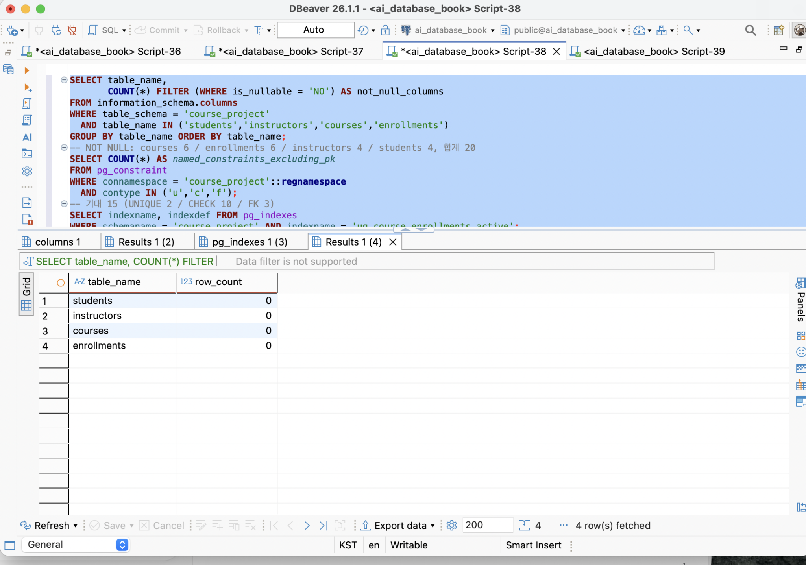
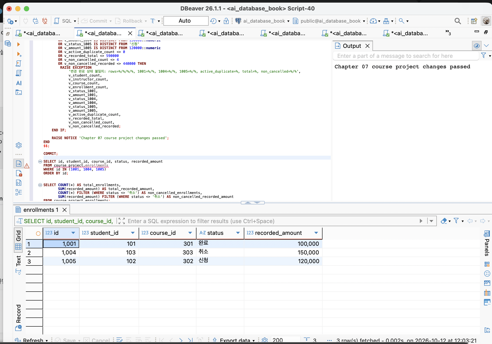
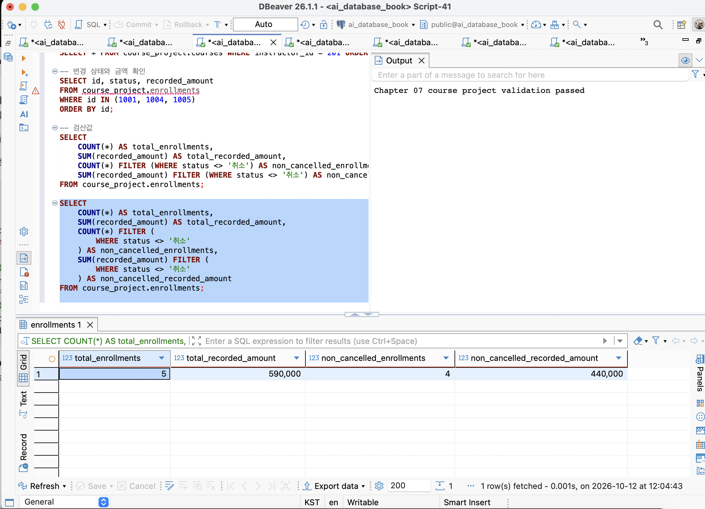
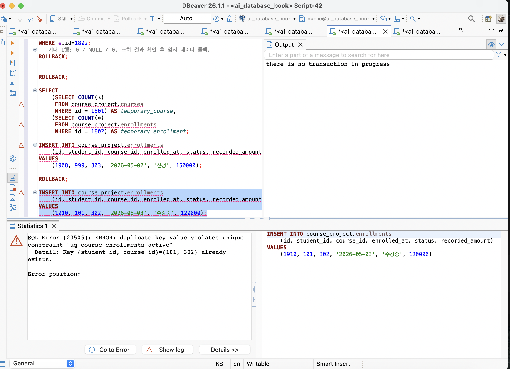

# Chapter 07 — 실행할 SQL과 실제 첨부할 캡처

Chapter 06 답안의 **실행 SQL → 기대 결과 → 실제 결과 → 증거 화면** 순서에 맞춰 정리했다. 아래 SQL은 코드 블록 하나씩 복사한다. DBeaver에는 ` ```sql `과 ` ``` ` 표시를 넣지 않는다.

**촬영 위치:** DBeaver 위쪽 SQL 편집창과 아래쪽 실제 결과 표, 필요하면 오른쪽 Output 메시지가 함께 보이도록 찍는다. 코드만 보이는 화면은 실행 증거가 아니다. 아래 표·문구는 기대값이며 직접 실행한 결과를 촬영해야 한다.

## 첨부할 화면 4장

| 답안 위치 | 저장 이름 | 화면에 반드시 보여야 할 부분 |
| --- | --- | --- |
| 5절 | step05_schema.png | 네 테이블·인덱스가 존재하는 결과와 schema creation passed |
| 7절 | step07_changes.png | 1001·1004·1005의 변경 후 상태·기록 금액 3행 |
| 8절 | step08_validation.png | validation passed와 최종 5 / 590000 / 4 / 440000 집계 |
| 9절 | step09_integrity.png | 활성 중복 INSERT와 uq_course_enrollments_active 오류 메시지 |

모든 이미지는 `assignments/chapter07/images/`에 저장한다. Seed·무료 경계값·첫 번째 FK 오류는 실제 결과를 답안에 기록한다. 이들도 실행해야 하지만 첨부용 대표 화면은 위 4장으로 정리한다. 두 번째 실패까지 끝낸 뒤 Validation을 다시 실행하고 **step08_validation.png를 그 재검증 화면으로 저장하면 기준 상태 유지 증거도 함께 남길 수 있다.**

## 먼저 현재 상태 확인 — 촬영할 필요 없음

이 조회만 복사해서 실행한다. 데이터를 바꾸지 않는다.

```sql
SELECT
    (SELECT COUNT(*) FROM course_project.students) AS students,
    (SELECT COUNT(*) FROM course_project.instructors) AS instructors,
    (SELECT COUNT(*) FROM course_project.courses) AS courses,
    COUNT(*) AS enrollments,
    COALESCE(SUM(recorded_amount), 0) AS recorded_total
FROM course_project.enrollments;
```

| 실제 결과 | 다음 행동 |
| --- | --- |
| 0 / 0 / 0 / 0 / 0 | 아래 '준비: Seed 입력' 전체 실행 |
| 3 / 2 / 3 / 4 / 470000 | Seed를 건너뛰고 캡처 2의 변경 전 조회로 진행 |
| 3 / 2 / 3 / 5 / 590000 | 이미 변경됐다면 재변경하지 않고 캡처 2의 변경 후 SELECT만 실행 |
| 다른 값 또는 오류 | 결과를 확인하고 중단; 임의 초기화하지 않음 |

이미 오류가 난 같은 편집 탭에서 조회도 실패하면 아래 **한 문장만 먼저 실행**한다. ROLLBACK은 명시적 트랜잭션의 미커밋 변경도 취소하므로, Seed·변경 블록이 COMMIT까지 끝났는지 구분한다.

```sql
ROLLBACK;
```

## 캡처 1 — step05_schema.png (답안 5절)

**이미 보낸 schema creation passed + 객체 조회 화면을 사용하면 된다.** 다시 스키마를 만들거나 0행을 만들려고 삭제하지 않는다.

객체 확인만 다시 하려면 아래 한 SELECT를 실행한다.

```sql
SELECT
    to_regclass('course_project.students') AS students_table,
    to_regclass('course_project.instructors') AS instructors_table,
    to_regclass('course_project.courses') AS courses_table,
    to_regclass('course_project.enrollments') AS enrollments_table,
    to_regclass('course_project.uq_course_enrollments_active') AS active_index;
```

**어느 부분을 찍나:**

1. 아래 Results 표에서 5개 열의 값이 보이게 한다. active_index가 잘리면 열 너비를 조정한다.
2. 스키마 생성 때 출력된 오른쪽 Output의 `Chapter 07 course project schema creation passed`도 함께 보이면 좋다. 단순 객체 SELECT는 이 메시지를 새로 출력하지 않는다.
3. 위쪽에는 실행한 SELECT, 아래쪽에는 객체 이름 1행이 보이게 캡처한다.
4. 기존 PASS 화면을 유지하고, 수치 결과는 답안 표에 기록한다. 이미 Seed를 넣었다면 현재 행 수를 '생성 직후 0행'의 증거로 사용하지 않는다.

문법: `to_regclass()`는 테이블·인덱스가 있으면 객체 이름을, 없으면 NULL을 돌려준다. `AS`는 결과 열의 이름을 정한다.

## 준비: Seed 입력 — 현재 모두 0행일 때만, 첨부용 촬영 없음

공식 `02_course_project_seed.sql`에 해당한다. 복사붙여넣기 파일에서는 **03. Seed 입력**이라는 제목이다. 두 이름은 같은 작업을 뜻한다.

아래 코드 **전체를 한 번만 스크립트로 실행**한다. 오류가 나면 중단하고 ROLLBACK을 별도로 실행한다. 코드 일부만 실행하거나 성공한 Seed를 다시 실행하지 않는다.

```sql
-- Chapter 07. 02 온라인 강의 프로젝트 기본 샘플 입력
-- 시작 상태: 프로젝트 객체 존재, 네 테이블 모두 비어 있음
-- 완료 상태: students 3 / instructors 2 / courses 3 / enrollments 4
-- 전체 입력과 IDENTITY 조정을 하나의 트랜잭션으로 실행합니다.

SELECT current_database();
SELECT current_user;
SELECT current_schema();
SHOW search_path;

BEGIN;

DO $$
DECLARE
    v_student_count bigint;
    v_instructor_count bigint;
    v_course_count bigint;
    v_enrollment_count bigint;
BEGIN
    IF current_database() <> 'ai_database_book' THEN
        RAISE EXCEPTION
            '샘플 입력 중단: 현재 데이터베이스는 %입니다. ai_database_book에 연결하세요.',
            current_database();
    END IF;

    IF current_setting('transaction_read_only')::boolean THEN
        RAISE EXCEPTION
            '샘플 입력 중단: 현재 연결이 읽기 전용입니다.';
    END IF;

    IF to_regclass('course_project.students') IS NULL
       OR to_regclass('course_project.instructors') IS NULL
       OR to_regclass('course_project.courses') IS NULL
       OR to_regclass('course_project.enrollments') IS NULL
       OR to_regclass('course_project.uq_course_enrollments_active') IS NULL THEN
        RAISE EXCEPTION
            '샘플 입력 중단: 01_course_project_schema.sql 실행 결과를 확인하세요.';
    END IF;

    IF NOT EXISTS (
        SELECT 1
        FROM information_schema.columns
        WHERE table_schema = 'course_project'
          AND table_name = 'enrollments'
          AND column_name = 'recorded_amount'
          AND data_type = 'numeric'
          AND numeric_precision = 12
          AND numeric_scale = 0
    ) THEN
        RAISE EXCEPTION
            '샘플 입력 중단: enrollments.recorded_amount NUMERIC(12,0) 열이 없습니다.';
    END IF;

    SELECT COUNT(*) INTO v_student_count FROM course_project.students;
    SELECT COUNT(*) INTO v_instructor_count FROM course_project.instructors;
    SELECT COUNT(*) INTO v_course_count FROM course_project.courses;
    SELECT COUNT(*) INTO v_enrollment_count FROM course_project.enrollments;

    IF v_student_count <> 0
       OR v_instructor_count <> 0
       OR v_course_count <> 0
       OR v_enrollment_count <> 0 THEN
        RAISE EXCEPTION
            '샘플 입력 중단: 테이블이 비어 있지 않습니다. students=%, instructors=%, courses=%, enrollments=%',
            v_student_count,
            v_instructor_count,
            v_course_count,
            v_enrollment_count;
    END IF;
END
$$;

INSERT INTO course_project.students (id, name, email, joined_at)
VALUES
    (101, '김민지', 'minji@example.com', '2026-03-01'),
    (102, '이준호', 'junho@example.com', '2026-03-03'),
    (103, '박서연', 'seoyeon@example.com', '2026-03-05');

INSERT INTO course_project.instructors (id, name, email, specialty)
VALUES
    (201, '문길래', 'gilbert@example.com', 'Database'),
    (202, '홍길동', 'hong@example.com', 'Python');

INSERT INTO course_project.courses (
    id,
    instructor_id,
    title,
    description,
    level,
    price,
    opened_at
)
VALUES
    (301, 201, '데이터베이스 입문', '관계형 데이터베이스와 SQL 기초', 'basic', 100000, '2026-04-01'),
    (302, 201, '정규화 실습', '좋은 테이블 설계와 정규화', 'basic', 120000, '2026-04-05'),
    (303, 202, '파이썬 데이터 분석', 'Pandas 기반 데이터 분석 입문', 'basic', 150000, '2026-04-10');

INSERT INTO course_project.enrollments (
    id,
    student_id,
    course_id,
    enrolled_at,
    status,
    recorded_amount
)
VALUES
    (1001, 101, 301, '2026-04-02', '수강중', 100000),
    (1002, 101, 302, '2026-04-06', '신청',   120000),
    (1003, 102, 301, '2026-04-03', '수강중', 100000),
    (1004, 103, 303, '2026-04-11', '신청',   150000);

ALTER TABLE course_project.students
    ALTER COLUMN id RESTART WITH 104;

ALTER TABLE course_project.instructors
    ALTER COLUMN id RESTART WITH 203;

ALTER TABLE course_project.courses
    ALTER COLUMN id RESTART WITH 304;

ALTER TABLE course_project.enrollments
    ALTER COLUMN id RESTART WITH 1005;

DO $$
DECLARE
    v_student_count bigint;
    v_instructor_count bigint;
    v_course_count bigint;
    v_enrollment_count bigint;
    v_recorded_total numeric;
    v_student_101_enrollments bigint;
    v_course_301_enrollments bigint;
    v_instructor_201_courses bigint;
    v_active_duplicate_count bigint;
    v_status_1001 text;
    v_status_1004 text;
    v_id_1005_count bigint;
BEGIN
    SELECT COUNT(*) INTO v_student_count FROM course_project.students;
    SELECT COUNT(*) INTO v_instructor_count FROM course_project.instructors;
    SELECT COUNT(*) INTO v_course_count FROM course_project.courses;

    SELECT COUNT(*), COALESCE(SUM(recorded_amount), 0)
    INTO v_enrollment_count, v_recorded_total
    FROM course_project.enrollments;

    SELECT COUNT(*) INTO v_student_101_enrollments
    FROM course_project.enrollments
    WHERE student_id = 101;

    SELECT COUNT(*) INTO v_course_301_enrollments
    FROM course_project.enrollments
    WHERE course_id = 301;

    SELECT COUNT(*) INTO v_instructor_201_courses
    FROM course_project.courses
    WHERE instructor_id = 201;

    SELECT COUNT(*) INTO v_active_duplicate_count
    FROM (
        SELECT student_id, course_id
        FROM course_project.enrollments
        WHERE status IN ('신청', '수강중')
        GROUP BY student_id, course_id
        HAVING COUNT(*) > 1
    ) AS duplicated_active_enrollments;

    SELECT status INTO v_status_1001
    FROM course_project.enrollments
    WHERE id = 1001;

    SELECT status INTO v_status_1004
    FROM course_project.enrollments
    WHERE id = 1004;

    SELECT COUNT(*) INTO v_id_1005_count
    FROM course_project.enrollments
    WHERE id = 1005;

    IF v_student_count <> 3
       OR v_instructor_count <> 2
       OR v_course_count <> 3
       OR v_enrollment_count <> 4
       OR v_recorded_total <> 470000
       OR v_student_101_enrollments <> 2
       OR v_course_301_enrollments <> 2
       OR v_instructor_201_courses <> 2
       OR v_active_duplicate_count <> 0
       OR v_status_1001 IS DISTINCT FROM '수강중'
       OR v_status_1004 IS DISTINCT FROM '신청'
       OR v_id_1005_count <> 0 THEN
        RAISE EXCEPTION
            '샘플 입력 검증 실패: rows=%/%/%/%, total=%, student101=%, course301=%, instructor201=%, active_duplicate=%, 1001=%, 1004=%, id1005=%',
            v_student_count,
            v_instructor_count,
            v_course_count,
            v_enrollment_count,
            v_recorded_total,
            v_student_101_enrollments,
            v_course_301_enrollments,
            v_instructor_201_courses,
            v_active_duplicate_count,
            v_status_1001,
            v_status_1004,
            v_id_1005_count;
    END IF;

    RAISE NOTICE 'Chapter 07 course project seed passed';
END
$$;

COMMIT;

SELECT 'students' AS object_name, COUNT(*) AS row_count
FROM course_project.students
UNION ALL
SELECT 'instructors', COUNT(*)
FROM course_project.instructors
UNION ALL
SELECT 'courses', COUNT(*)
FROM course_project.courses
UNION ALL
SELECT 'enrollments', COUNT(*)
FROM course_project.enrollments
ORDER BY object_name;
```

기대: 학생 3 / 강사 2 / 강의 3 / 신청 4, seed passed. 실제 값은 답안 6절에 기록한다. Seed 화면을 별도 첨부할 필요는 없다.

문법: `INSERT INTO ... VALUES`는 새 행을 입력한다. `BEGIN`~`COMMIT`은 여러 입력을 하나의 트랜잭션으로 묶는다. `DO $$ ... $$`는 조건을 검사하는 블록이며 내부를 잘라 실행하지 않는다.

## 캡처 2 — step07_changes.png (답안 7절)

### 2-A. 변경 전 조회 — 4건 Seed 상태일 때만

아래 SELECT 하나만 실행해 결과를 메모한다. 변경 전후를 비교하려면 이 결과 탭이나 별도 메모를 보관한다. 제출용 대표 이미지에는 다음 2-C의 변경 후 3행을 사용한다.

```sql
SELECT id, student_id, course_id, status, recorded_amount
FROM course_project.enrollments
WHERE id IN (1001, 1004, 1005)
ORDER BY id;
```

변경 전 기대:

| id | student_id | course_id | status | recorded_amount |
| ---: | ---: | ---: | --- | ---: |
| 1001 | 101 | 301 | 수강중 | 100000 |
| 1004 | 103 | 303 | 신청 | 150000 |

1005는 아직 없으므로 **2행**이다. 이미 1001 완료·1004 취소·1005 신청이면 2-B는 건너뛴다.

### 2-B. 변경 실행 — 아직 변경 전이라면 한 번만

공식 `03_course_project_changes.sql`이다. 복사붙여넣기 파일에서는 **05. 변경 실행**이다. 아래 전체를 스크립트로 실행한다. BEGIN부터 COMMIT과 마지막 조회까지 포함한다.

```sql
-- Chapter 07. 03 온라인 강의 프로젝트 변경 시나리오
-- 시작 상태: 기본 샘플 3 / 2 / 3 / 4행, 기록 금액 합계 470000
-- 완료 상태: 최종 3 / 2 / 3 / 5행, 전체 590000 / 취소 제외 440000
-- 신규 신청과 상태 변경을 하나의 트랜잭션으로 실행합니다.

SELECT current_database();
SELECT current_user;
SELECT current_schema();
SHOW search_path;

BEGIN;

DO $$
DECLARE
    v_student_count bigint;
    v_instructor_count bigint;
    v_course_count bigint;
    v_enrollment_count bigint;
    v_recorded_total numeric;
    v_status_1001 text;
    v_status_1004 text;
    v_count_1005 bigint;
    v_active_102_302 bigint;
    v_course_302_price numeric;
BEGIN
    IF current_database() <> 'ai_database_book' THEN
        RAISE EXCEPTION
            '변경 중단: 현재 데이터베이스는 %입니다. ai_database_book에 연결하세요.',
            current_database();
    END IF;

    IF current_setting('transaction_read_only')::boolean THEN
        RAISE EXCEPTION
            '변경 중단: 현재 연결이 읽기 전용입니다.';
    END IF;

    IF to_regclass('course_project.students') IS NULL
       OR to_regclass('course_project.instructors') IS NULL
       OR to_regclass('course_project.courses') IS NULL
       OR to_regclass('course_project.enrollments') IS NULL
       OR to_regclass('course_project.uq_course_enrollments_active') IS NULL THEN
        RAISE EXCEPTION
            '변경 중단: 프로젝트 객체가 모두 존재하지 않습니다.';
    END IF;

    SELECT COUNT(*) INTO v_student_count FROM course_project.students;
    SELECT COUNT(*) INTO v_instructor_count FROM course_project.instructors;
    SELECT COUNT(*) INTO v_course_count FROM course_project.courses;
    SELECT COUNT(*), COALESCE(SUM(recorded_amount), 0)
    INTO v_enrollment_count, v_recorded_total
    FROM course_project.enrollments;

    SELECT status INTO v_status_1001
    FROM course_project.enrollments
    WHERE id = 1001;

    SELECT status INTO v_status_1004
    FROM course_project.enrollments
    WHERE id = 1004;

    SELECT COUNT(*) INTO v_count_1005
    FROM course_project.enrollments
    WHERE id = 1005;

    SELECT COUNT(*) INTO v_active_102_302
    FROM course_project.enrollments
    WHERE student_id = 102
      AND course_id = 302
      AND status IN ('신청', '수강중');

    SELECT price INTO v_course_302_price
    FROM course_project.courses
    WHERE id = 302;

    IF v_student_count <> 3
       OR v_instructor_count <> 2
       OR v_course_count <> 3
       OR v_enrollment_count <> 4
       OR v_recorded_total <> 470000
       OR v_status_1001 IS DISTINCT FROM '수강중'
       OR v_status_1004 IS DISTINCT FROM '신청'
       OR v_count_1005 <> 0
       OR v_active_102_302 <> 0
       OR v_course_302_price IS DISTINCT FROM 120000::numeric THEN
        RAISE EXCEPTION
            '변경 시작 상태 불일치: rows=%/%/%/%, total=%, status1001=%, status1004=%, id1005=%, active102_302=%, course302_price=%',
            v_student_count,
            v_instructor_count,
            v_course_count,
            v_enrollment_count,
            v_recorded_total,
            v_status_1001,
            v_status_1004,
            v_count_1005,
            v_active_102_302,
            v_course_302_price;
    END IF;
END
$$;

INSERT INTO course_project.enrollments (
    id,
    student_id,
    course_id,
    enrolled_at,
    status,
    recorded_amount
)
SELECT
    1005,
    102,
    c.id,
    DATE '2026-04-07',
    '신청',
    c.price
FROM course_project.courses AS c
WHERE c.id = 302
RETURNING id, student_id, course_id, status, recorded_amount;

UPDATE course_project.enrollments
SET status = '완료'
WHERE id = 1001
  AND status = '수강중'
RETURNING id, status, recorded_amount;

UPDATE course_project.enrollments
SET status = '취소'
WHERE id = 1004
  AND status = '신청'
RETURNING id, status, recorded_amount;

ALTER TABLE course_project.enrollments
    ALTER COLUMN id RESTART WITH 1006;

DO $$
DECLARE
    v_student_count bigint;
    v_instructor_count bigint;
    v_course_count bigint;
    v_enrollment_count bigint;
    v_status_1001 text;
    v_amount_1001 numeric;
    v_status_1004 text;
    v_amount_1004 numeric;
    v_status_1005 text;
    v_amount_1005 numeric;
    v_active_duplicate_count bigint;
    v_recorded_total numeric;
    v_non_cancelled_count bigint;
    v_non_cancelled_recorded numeric;
BEGIN
    SELECT COUNT(*) INTO v_student_count FROM course_project.students;
    SELECT COUNT(*) INTO v_instructor_count FROM course_project.instructors;
    SELECT COUNT(*) INTO v_course_count FROM course_project.courses;

    SELECT
        COUNT(*),
        COALESCE(SUM(recorded_amount), 0),
        COUNT(*) FILTER (WHERE status <> '취소'),
        COALESCE(SUM(recorded_amount) FILTER (WHERE status <> '취소'), 0)
    INTO
        v_enrollment_count,
        v_recorded_total,
        v_non_cancelled_count,
        v_non_cancelled_recorded
    FROM course_project.enrollments;

    SELECT status, recorded_amount
    INTO v_status_1001, v_amount_1001
    FROM course_project.enrollments
    WHERE id = 1001;

    SELECT status, recorded_amount
    INTO v_status_1004, v_amount_1004
    FROM course_project.enrollments
    WHERE id = 1004;

    SELECT status, recorded_amount
    INTO v_status_1005, v_amount_1005
    FROM course_project.enrollments
    WHERE id = 1005;

    SELECT COUNT(*) INTO v_active_duplicate_count
    FROM (
        SELECT student_id, course_id
        FROM course_project.enrollments
        WHERE status IN ('신청', '수강중')
        GROUP BY student_id, course_id
        HAVING COUNT(*) > 1
    ) AS duplicated_active_enrollments;

    IF v_student_count <> 3
       OR v_instructor_count <> 2
       OR v_course_count <> 3
       OR v_enrollment_count <> 5
       OR v_status_1001 IS DISTINCT FROM '완료'
       OR v_amount_1001 IS DISTINCT FROM 100000::numeric
       OR v_status_1004 IS DISTINCT FROM '취소'
       OR v_amount_1004 IS DISTINCT FROM 150000::numeric
       OR v_status_1005 IS DISTINCT FROM '신청'
       OR v_amount_1005 IS DISTINCT FROM 120000::numeric
       OR v_active_duplicate_count <> 0
       OR v_recorded_total <> 590000
       OR v_non_cancelled_count <> 4
       OR v_non_cancelled_recorded <> 440000 THEN
        RAISE EXCEPTION
            '변경 완료 상태 불일치: rows=%/%/%/%, 1001=%/%, 1004=%/%, 1005=%/%, active_duplicate=%, total=%, non_cancelled=%/%',
            v_student_count,
            v_instructor_count,
            v_course_count,
            v_enrollment_count,
            v_status_1001,
            v_amount_1001,
            v_status_1004,
            v_amount_1004,
            v_status_1005,
            v_amount_1005,
            v_active_duplicate_count,
            v_recorded_total,
            v_non_cancelled_count,
            v_non_cancelled_recorded;
    END IF;

    RAISE NOTICE 'Chapter 07 course project changes passed';
END
$$;

COMMIT;

SELECT id, student_id, course_id, status, recorded_amount
FROM course_project.enrollments
WHERE id IN (1001, 1004, 1005)
ORDER BY id;
```

문법: `INSERT ... SELECT`는 강의의 현재 price를 조회해 새 신청의 recorded_amount로 저장한다. `UPDATE ... SET ... WHERE`는 지정된 id·이전 상태의 행만 바꾼다. 금액은 변경하지 않는다.

### 2-C. 실제 캡처할 SELECT — 변경 완료 후, 반복 실행 가능

앞 코드의 마지막 조회와 동일하다. **아래 SELECT 하나만 복사해서 실행하면 캡처할 표가 나온다.**

```sql
SELECT id, student_id, course_id, status, recorded_amount
FROM course_project.enrollments
WHERE id IN (1001, 1004, 1005)
ORDER BY id;
```

캡처에 보여야 하는 실제 결과:

| id | student_id | course_id | status | recorded_amount |
| ---: | ---: | ---: | --- | ---: |
| 1001 | 101 | 301 | 완료 | 100000 |
| 1004 | 103 | 303 | 취소 | 150000 |
| 1005 | 102 | 302 | 신청 | 120000 |

**어느 부분을 찍나:** 위 SELECT와 아래 Results 표 **세 행·다섯 열 전부**. 특히 `status`와 `recorded_amount`가 잘리지 않게 한다. `Statistics`의 영향 행 수 화면만 찍지 않는다. 파일명은 `step07_changes.png`다.

문법: `WHERE id IN (...)`은 세 신청만 고른다. `ORDER BY id`는 신청 ID순으로 정렬한다. 이 조회는 데이터 변경 없이 반복할 수 있다.

## 캡처 3 — step08_validation.png (답안 8절)

### 3-A. 공식 Validation 전체 실행

아래 코드 전체를 스크립트로 실행한다. 단순 합계 조회만으로는 공식 PASS를 확인할 수 없다. 같은 코드를 실패 테스트 후에도 다시 실행한다.

```sql
-- Chapter 07. 04 온라인 강의 프로젝트 최종 검증
-- 시작 상태: 01 → 02 → 03 실행 완료
-- 완료 상태: 구조·관계·도메인·상태·금액 자동 검증 통과와 상세 조회
-- 이 파일은 데이터를 변경하지 않으므로 반복 실행할 수 있습니다.

SELECT current_database();
SELECT current_user;
SELECT current_schema();
SHOW search_path;

DO $$
DECLARE
    v_named_constraint_count bigint;
    v_not_null_count bigint;
    v_student_count bigint;
    v_instructor_count bigint;
    v_course_count bigint;
    v_enrollment_count bigint;
    v_service_join_count bigint;
    v_student_101_enrollments bigint;
    v_course_301_enrollments bigint;
    v_instructor_201_courses bigint;
    v_orphan_student_count bigint;
    v_orphan_course_count bigint;
    v_orphan_instructor_count bigint;
    v_invalid_student_count bigint;
    v_invalid_instructor_count bigint;
    v_invalid_course_count bigint;
    v_invalid_enrollment_count bigint;
    v_active_duplicate_count bigint;
    v_status_1001 text;
    v_amount_1001 numeric;
    v_status_1004 text;
    v_amount_1004 numeric;
    v_status_1005 text;
    v_amount_1005 numeric;
    v_total_recorded numeric;
    v_non_cancelled_count bigint;
    v_non_cancelled_recorded numeric;
BEGIN
    IF current_database() <> 'ai_database_book' THEN
        RAISE EXCEPTION
            '검증 중단: 현재 데이터베이스는 %입니다. ai_database_book에 연결하세요.',
            current_database();
    END IF;

    IF to_regclass('course_project.students') IS NULL
       OR to_regclass('course_project.instructors') IS NULL
       OR to_regclass('course_project.courses') IS NULL
       OR to_regclass('course_project.enrollments') IS NULL
       OR to_regclass('course_project.uq_course_enrollments_active') IS NULL THEN
        RAISE EXCEPTION
            '검증 중단: Chapter 07 프로젝트 객체가 모두 존재하지 않습니다.';
    END IF;

    IF NOT EXISTS (
        SELECT 1
        FROM information_schema.columns
        WHERE table_schema = 'course_project'
          AND table_name = 'enrollments'
          AND column_name = 'recorded_amount'
          AND data_type = 'numeric'
          AND numeric_precision = 12
          AND numeric_scale = 0
    ) THEN
        RAISE EXCEPTION
            '검증 중단: enrollments.recorded_amount NUMERIC(12,0) 열이 없습니다.';
    END IF;

    SELECT COUNT(*) INTO v_named_constraint_count
    FROM pg_constraint
    WHERE conrelid IN (
        'course_project.students'::regclass,
        'course_project.instructors'::regclass,
        'course_project.courses'::regclass,
        'course_project.enrollments'::regclass
    )
      AND conname IN (
        'uq_course_students_email',
        'chk_course_students_name_not_blank',
        'chk_course_students_email_not_blank',
        'uq_course_instructors_email',
        'chk_course_instructors_name_not_blank',
        'chk_course_instructors_email_not_blank',
        'chk_course_instructors_specialty_not_blank',
        'fk_course_courses_instructor',
        'chk_course_courses_title_not_blank',
        'chk_course_courses_level',
        'chk_course_courses_price',
        'fk_course_enrollments_student',
        'fk_course_enrollments_course',
        'chk_course_enrollments_status',
        'chk_course_enrollments_recorded_amount'
      );

    SELECT COUNT(*) INTO v_not_null_count
    FROM information_schema.columns
    WHERE table_schema = 'course_project'
      AND table_name IN ('students', 'instructors', 'courses', 'enrollments')
      AND is_nullable = 'NO';

    SELECT COUNT(*) INTO v_student_count FROM course_project.students;
    SELECT COUNT(*) INTO v_instructor_count FROM course_project.instructors;
    SELECT COUNT(*) INTO v_course_count FROM course_project.courses;

    SELECT
        COUNT(*),
        COALESCE(SUM(recorded_amount), 0),
        COUNT(*) FILTER (WHERE status <> '취소'),
        COALESCE(SUM(recorded_amount) FILTER (WHERE status <> '취소'), 0)
    INTO
        v_enrollment_count,
        v_total_recorded,
        v_non_cancelled_count,
        v_non_cancelled_recorded
    FROM course_project.enrollments;

    SELECT COUNT(*) INTO v_service_join_count
    FROM course_project.enrollments AS e
    JOIN course_project.students AS s ON e.student_id = s.id
    JOIN course_project.courses AS c ON e.course_id = c.id
    JOIN course_project.instructors AS i ON c.instructor_id = i.id;

    SELECT COUNT(*) INTO v_student_101_enrollments
    FROM course_project.enrollments
    WHERE student_id = 101;

    SELECT COUNT(*) INTO v_course_301_enrollments
    FROM course_project.enrollments
    WHERE course_id = 301;

    SELECT COUNT(*) INTO v_instructor_201_courses
    FROM course_project.courses
    WHERE instructor_id = 201;

    SELECT COUNT(*) INTO v_orphan_student_count
    FROM course_project.enrollments AS e
    LEFT JOIN course_project.students AS s ON e.student_id = s.id
    WHERE s.id IS NULL;

    SELECT COUNT(*) INTO v_orphan_course_count
    FROM course_project.enrollments AS e
    LEFT JOIN course_project.courses AS c ON e.course_id = c.id
    WHERE c.id IS NULL;

    SELECT COUNT(*) INTO v_orphan_instructor_count
    FROM course_project.courses AS c
    LEFT JOIN course_project.instructors AS i ON c.instructor_id = i.id
    WHERE i.id IS NULL;

    SELECT COUNT(*) INTO v_invalid_student_count
    FROM course_project.students
    WHERE name IS NULL
       OR email IS NULL
       OR joined_at IS NULL
       OR char_length(trim(name)) = 0
       OR char_length(trim(email)) = 0;

    SELECT COUNT(*) INTO v_invalid_instructor_count
    FROM course_project.instructors
    WHERE name IS NULL
       OR email IS NULL
       OR specialty IS NULL
       OR char_length(trim(name)) = 0
       OR char_length(trim(email)) = 0
       OR char_length(trim(specialty)) = 0;

    SELECT COUNT(*) INTO v_invalid_course_count
    FROM course_project.courses
    WHERE instructor_id IS NULL
       OR title IS NULL
       OR level IS NULL
       OR price IS NULL
       OR opened_at IS NULL
       OR char_length(trim(title)) = 0
       OR level NOT IN ('basic', 'intermediate', 'advanced')
       OR price < 0;

    SELECT COUNT(*) INTO v_invalid_enrollment_count
    FROM course_project.enrollments
    WHERE student_id IS NULL
       OR course_id IS NULL
       OR enrolled_at IS NULL
       OR status IS NULL
       OR recorded_amount IS NULL
       OR status NOT IN ('신청', '수강중', '완료', '취소')
       OR recorded_amount < 0;

    SELECT COUNT(*) INTO v_active_duplicate_count
    FROM (
        SELECT student_id, course_id
        FROM course_project.enrollments
        WHERE status IN ('신청', '수강중')
        GROUP BY student_id, course_id
        HAVING COUNT(*) > 1
    ) AS duplicated_active_enrollments;

    SELECT status, recorded_amount INTO v_status_1001, v_amount_1001
    FROM course_project.enrollments WHERE id = 1001;

    SELECT status, recorded_amount INTO v_status_1004, v_amount_1004
    FROM course_project.enrollments WHERE id = 1004;

    SELECT status, recorded_amount INTO v_status_1005, v_amount_1005
    FROM course_project.enrollments WHERE id = 1005;

    IF v_named_constraint_count <> 15
       OR v_not_null_count <> 20
       OR v_student_count <> 3
       OR v_instructor_count <> 2
       OR v_course_count <> 3
       OR v_enrollment_count <> 5
       OR v_service_join_count <> 5
       OR v_student_101_enrollments <> 2
       OR v_course_301_enrollments <> 2
       OR v_instructor_201_courses <> 2
       OR v_orphan_student_count <> 0
       OR v_orphan_course_count <> 0
       OR v_orphan_instructor_count <> 0
       OR v_invalid_student_count <> 0
       OR v_invalid_instructor_count <> 0
       OR v_invalid_course_count <> 0
       OR v_invalid_enrollment_count <> 0
       OR v_active_duplicate_count <> 0
       OR v_status_1001 IS DISTINCT FROM '완료'
       OR v_amount_1001 IS DISTINCT FROM 100000::numeric
       OR v_status_1004 IS DISTINCT FROM '취소'
       OR v_amount_1004 IS DISTINCT FROM 150000::numeric
       OR v_status_1005 IS DISTINCT FROM '신청'
       OR v_amount_1005 IS DISTINCT FROM 120000::numeric
       OR v_total_recorded <> 590000
       OR v_non_cancelled_count <> 4
       OR v_non_cancelled_recorded <> 440000 THEN
        RAISE EXCEPTION
            '검증 실패: constraints=%, not_null=%, rows=%/%/%/%, join=%, relation=%/%/%, orphan=%/%/%, invalid=%/%/%/%, active_duplicate=%, 1001=%/%, 1004=%/%, 1005=%/%, total=%, non_cancelled=%/%',
            v_named_constraint_count,
            v_not_null_count,
            v_student_count,
            v_instructor_count,
            v_course_count,
            v_enrollment_count,
            v_service_join_count,
            v_student_101_enrollments,
            v_course_301_enrollments,
            v_instructor_201_courses,
            v_orphan_student_count,
            v_orphan_course_count,
            v_orphan_instructor_count,
            v_invalid_student_count,
            v_invalid_instructor_count,
            v_invalid_course_count,
            v_invalid_enrollment_count,
            v_active_duplicate_count,
            v_status_1001,
            v_amount_1001,
            v_status_1004,
            v_amount_1004,
            v_status_1005,
            v_amount_1005,
            v_total_recorded,
            v_non_cancelled_count,
            v_non_cancelled_recorded;
    END IF;

    RAISE NOTICE 'Chapter 07 course project validation passed';
END
$$;

-- 최종 서비스 조회
SELECT
    e.id AS enrollment_id,
    s.name AS student_name,
    c.title AS course_title,
    i.name AS instructor_name,
    e.status,
    e.recorded_amount,
    e.enrolled_at
FROM course_project.enrollments AS e
JOIN course_project.students AS s ON e.student_id = s.id
JOIN course_project.courses AS c ON e.course_id = c.id
JOIN course_project.instructors AS i ON c.instructor_id = i.id
ORDER BY e.id;

-- 관계 확인
SELECT * FROM course_project.enrollments WHERE student_id = 101 ORDER BY id;
SELECT * FROM course_project.enrollments WHERE course_id = 301 ORDER BY id;
SELECT * FROM course_project.courses WHERE instructor_id = 201 ORDER BY id;

-- 변경 상태와 금액 확인
SELECT id, status, recorded_amount
FROM course_project.enrollments
WHERE id IN (1001, 1004, 1005)
ORDER BY id;

-- 검산값
SELECT
    COUNT(*) AS total_enrollments,
    SUM(recorded_amount) AS total_recorded_amount,
    COUNT(*) FILTER (WHERE status <> '취소') AS non_cancelled_enrollments,
    SUM(recorded_amount) FILTER (WHERE status <> '취소') AS non_cancelled_recorded_amount
FROM course_project.enrollments;
```

### 3-B. 캡처할 결과 탭 선택

1. 오른쪽 **Output**에서 `Chapter 07 course project validation passed`를 찾는다.
2. 아래 Results 탭 중 **total_enrollments / total_recorded_amount / non_cancelled_enrollments / non_cancelled_recorded_amount** 열이 있는 탭을 클릭한다. 숫자가 붙은 탭 이름은 실행마다 달라지므로 열 이름으로 찾는다.
3. 다른 결과 탭에 가려졌으면 아래 SELECT만 따로 실행해서 집계 표를 다시 표시한다. 이 SELECT는 PASS 메시지를 새로 만들지 않는다.

```sql
SELECT
    COUNT(*) AS total_enrollments,
    SUM(recorded_amount) AS total_recorded_amount,
    COUNT(*) FILTER (WHERE status <> '취소') AS non_cancelled_enrollments,
    SUM(recorded_amount) FILTER (WHERE status <> '취소') AS non_cancelled_recorded_amount
FROM course_project.enrollments;
```

기대 결과:

| total_enrollments | total_recorded_amount | non_cancelled_enrollments | non_cancelled_recorded_amount |
| ---: | ---: | ---: | ---: |
| 5 | 590000 | 4 | 440000 |

**어느 부분을 찍나:** 위 집계 SELECT, 아래 **5 / 590000 / 4 / 440000 한 행**, 오른쪽 Output의 **validation passed**가 함께 보이는 화면. 결과 영역이 작으면 편집창·결과창 사이 경계선을 위로 드래그한다. 긴 열 이름은 열 너비를 늘려 표시한다. 파일명은 `step08_validation.png`다.

문법: `COUNT(*)`는 건수, `SUM()`은 금액 합계다. `FILTER (WHERE status <> '취소')`는 해당 집계에서만 취소를 제외한다. `<>`는 '같지 않다'라는 뜻이다. 취소 제외 금액은 실제 매출을 의미하지 않는다.

## 테스트 준비 — 실제 실행하되 별도 첨부는 선택

### 무료 경계 테스트 — 아래 전체 실행 후 ROLLBACK까지

```sql
BEGIN;
INSERT INTO course_project.courses
    (id, instructor_id, title, description, level, price, opened_at)
VALUES (1801, 202, '무료 체험 강의', NULL, 'basic', 0, '2026-05-01');
INSERT INTO course_project.enrollments
    (id, student_id, course_id, enrolled_at, status, recorded_amount)
VALUES (1802, 103, 1801, '2026-05-02', '신청', 0);
SELECT c.price, c.description, e.recorded_amount
FROM course_project.courses c
JOIN course_project.enrollments e ON e.course_id = c.id
WHERE e.id = 1802;
ROLLBACK;
```

기대: 1행 `0 / NULL / 0`. 실제 값을 답안 9-1절에 기록한다. ROLLBACK은 임시 입력을 취소한다. 중간 오류가 나면 ROLLBACK을 별도로 실행한다.

### 첫 번째 실패 — 없는 학생 FK

**먼저 아래 코드만 실행한다. 오류가 정상이다.**

```sql
BEGIN;
INSERT INTO course_project.enrollments
    (id, student_id, course_id, enrolled_at, status, recorded_amount)
VALUES (1908, 999, 303, '2026-05-02', '신청', 150000);
```

기대 오류 핵심: `fk_course_enrollments_student`. 실제 메시지를 답안 9-2절에 기록한 뒤 **다음 한 줄을 따로 실행한다.**

```sql
ROLLBACK;
```

문법: FK는 부모 students에 없는 student_id를 거절한다. 앞 실패 SQL과 ROLLBACK을 한 번에 실행하지 않는다. 오류에서 실행이 멈추면 ROLLBACK을 별도로 실행해야 한다.

## 캡처 4 — step09_integrity.png (답안 9절)

### 4-A. 두 번째 실패 SQL 실행

**아래 코드만 복사해서 실행한다.** 기존 1002가 학생 101·강의 302의 신청 상태이므로 실패해야 한다.

```sql
BEGIN;
INSERT INTO course_project.enrollments
    (id, student_id, course_id, enrolled_at, status, recorded_amount)
VALUES (1910, 101, 302, '2026-05-03', '수강중', 120000);
```

### 4-B. 오류 화면을 먼저 캡처

**어느 부분을 찍나:**

1. 위 편집창의 `INSERT INTO ... VALUES (1910, 101, 302, ... '수강중', 120000)`가 보이게 한다.
2. 아래 오류 영역의 `duplicate key value violates unique constraint`와 **uq_course_enrollments_active** 이름이 읽히게 한다.
3. 긴 오류가 잘리면 오류 패널 크기를 늘리거나 Details에서 전체 문구를 확인한다.
4. 이 화면을 `step09_integrity.png`로 저장한다. 초기 상태 불일치·25P02·문법 오류 화면은 이 캡처를 대신할 수 없다.

문법: 부분 고유 인덱스는 신청·수강중 행에만 `(student_id, course_id)` 중복을 금지한다. 이미 있는 활성 신청과 같은 조합을 넣으므로 거절된다.

### 4-C. 촬영 후 ROLLBACK — 한 줄만 별도로 실행

```sql
ROLLBACK;
```

### 4-D. 임시 행 0건 확인 및 공식 Validation 재실행

```sql
SELECT
    (SELECT COUNT(*) FROM course_project.enrollments
     WHERE id IN (1802, 1908, 1910)) AS temporary_enrollments,
    (SELECT COUNT(*) FROM course_project.courses
     WHERE id = 1801) AS temporary_courses;
```

기대: `0 / 0`. 실제 결과를 답안 9-4절에 기록한다.

이어 위 **3-A 공식 Validation 코드 전체**를 다시 실행한다. 오류 없이 validation passed가 뜨고 집계가 5/590000/4/440000이면 기준 상태가 유지된 것이다. 3-B 방법으로 재검증 화면을 촬영해 **step08_validation.png에 저장**한다. 그러면 첨부는 4장을 유지하면서 최종 상태와 실패 후 상태 유지를 모두 보여 줄 수 있다.

## 답안에 이미지 붙이기

실제 파일이 저장됐을 때만 아래 줄을 답안의 해당 절에 넣는다.

```markdown

```

```markdown

```

```markdown

```

```markdown

```

시작 환경·Seed·경계값·두 실패의 실제 메시지·재검증 결과는 답안 표에 기록한다. 캡처와 실제 결과를 확인한 항목만 체크한다. 개인정보·비밀번호·전체 접속 URL이 화면에 없는지도 확인한다.

## 선택: 재현성 실험

본인 실습 스키마이고 보존할 데이터가 없을 때만 [통합 스크립트](./chapter07_script.sql)의 [10] 초기화 안내를 따른다. 첫 실행과 재실행의 3/2/3/5행, 상태·금액, Validation PASS를 비교해 답안 10절에 기록한다. 이미 촬영한 0행 증거를 다시 만들기 위해 초기화할 필요는 없다.
