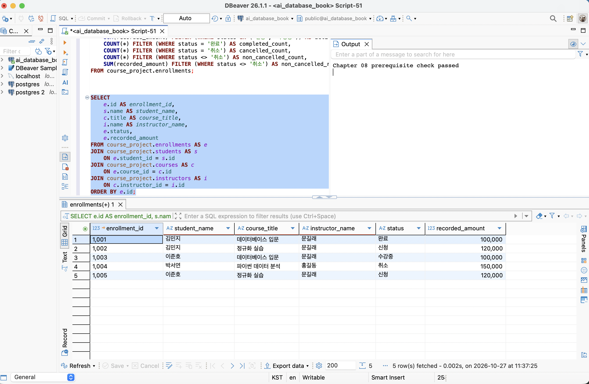
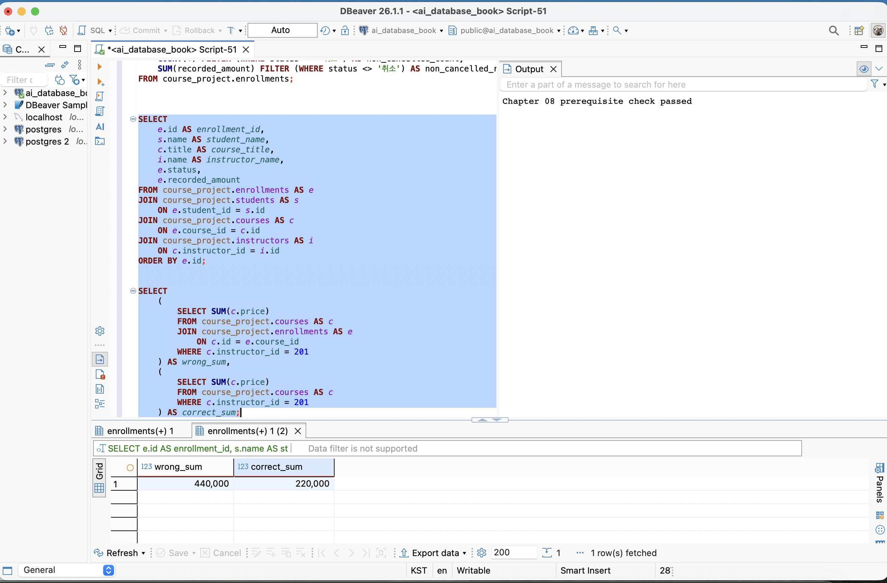
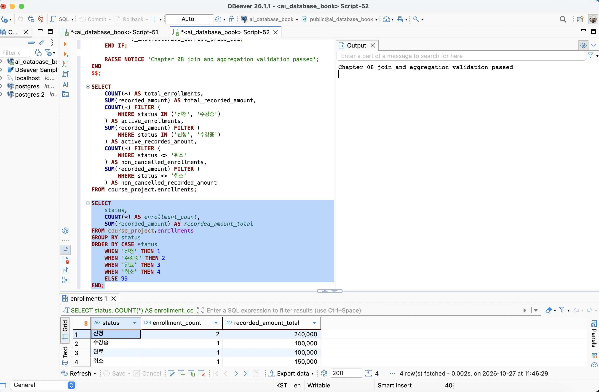

# Chapter 08 확장 실습 답안

> JOIN과 집계로 서비스 질문에 답하기
>
> 작성 상태: 사전 검사 통과, 다중 JOIN 5행, 과대 집계 비교, 최종 자동 검증 통과를 본인 DBeaver 캡처로 확인했다. 증거 화면은 3장을 사용하며 1절과 3절은 같은 사진을 참조한다. 실제 결과의 근거는 직접 캡처한 결과, 공식 00·03 검증 SQL 내부에서 확인한 값, 캡처된 상세 행의 수동 검산으로 구분한다. 아래 개별 SQL 모두를 별도로 실행했다는 의미는 아니다. 개인 프로젝트는 database-project의 청약 의사결정 노트로 변경했으며, 해당 프로젝트 문서의 미구현 상태에 따라 SQL 초안과 검산 계획을 제시한다.

```text
GitHub 계정: ssossocoder
과제 작성일: 2026-10-27
사용한 AI 도구: Codex
```

공식 자료: [답안 템플릿](https://github.com/GilbertMoon/ai-database-book/blob/main/assignments/chapter08/chapter08_answer_template.md), [실습 SQL](https://github.com/GilbertMoon/ai-database-book/tree/main/code/chapter08).
비밀번호·접속 URL·API Key·실제 개인정보는 기록하지 않는다. 아래 사람 이름은 공식 가상 Seed다.

# 1. Chapter 07 기준 상태 확인

## 1-1. 사전 검사 결과

실행 대상: 공식 `00_check_course_project.sql` 전체.

| 항목 | 기준/예상값 | 실제 결과 |
| --- | ---: | ---: |
| students | 3 | 3 |
| instructors | 2 | 2 |
| courses | 3 | 3 |
| enrollments | 5 | 5 |
| 전체 신청 건수 / recorded_amount | 5 / 590000 | 5 / 590000 |
| 활성 신청 건수 / recorded_amount | 3 / 340000 | 3 / 340000 |
| 취소 제외 건수 / recorded_amount | 4 / 440000 | 4 / 440000 |

검증 메시지: `Chapter 08 prerequisite check passed`
활성은 `신청·수강중`, 취소 제외는 `신청·수강중·완료`다.

### 기준값이 다르면 그대로 진행하면 안 되는 이유

Chapter 07 변경 전에는 신청이 4건이고 상태와 금액도 다르다. 기준 상태가 다르면 JOIN 방식의 차이인지 데이터 차이인지 구별하기 어렵다. 사전 검사는 행 수뿐 아니라 제약조건, 고아 관계, 활성 중복, 특정 신청의 상태·기록 금액도 확인한다.

### 증거 화면

아래 화면 오른쪽 Output에서 `Chapter 08 prerequisite check passed` 메시지를 확인했다. 이 사진은 3절의 다중 JOIN 결과 화면과 동일하며, 사전 검사 통과 증거로 함께 사용한다.



# 2. 업무 질문을 SQL보다 먼저 정의하기

## 질문 A

```text
업무 질문: 각 신청은 어느 학생이 어느 강사의 어떤 강의에 남긴 이력인가?
결과 한 행: 신청 한 건(enrollments.id).
포함 상태: 신청, 수강중, 완료, 취소 모두.
제외 상태: 없음.
JOIN할 테이블: enrollments, students, courses, instructors.
JOIN 경로: e.student_id → s.id, e.course_id → c.id, c.instructor_id → i.id.
선택: INNER JOIN.
이유: 신청을 기준으로 필수 부모를 연결하며 FK가 보장된 기준 상태다.
예상 행 수: 5행. 학생 수가 아니라 신청 건수다.
```

## 질문 B

```text
업무 질문: 강의별 취소 제외 신청 수, 고유 학생 수, 신청 시 기록 금액은 얼마인가?
결과 한 행: 강의 한 개(courses.id).
포함 상태: 신청, 수강중, 완료.
제외 상태: 취소.
JOIN할 테이블: courses, enrollments.
JOIN 경로: c.id → e.course_id, 취소 제외 조건은 ON.
집계 대상: COUNT(e.id), COUNT(DISTINCT e.student_id), SUM(e.recorded_amount).
예상 결과: 301=2건/2명/200000, 302=2건/2명/240000, 303=0건/0명/0.
```

## 질문 C

```text
업무 질문: 모든 학생을 남겨 취소 제외 신청 수를 확인할 수 있는가?
결과 한 행: 학생 한 명(students.id).
포함 상태: 신청, 수강중, 완료.
제외 상태: 취소.
0건인 부모도 보여야 하는가: 예. students에서 LEFT JOIN한다.
NULL 해석: 연결된 취소 제외 신청이 없다는 뜻이며 학생이 없다는 뜻이 아니다.
예상 결과: 101 김민지=2, 102 이준호=2, 103 박서연=0.
```

# 3. INNER JOIN과 다중 JOIN

## 3-1. 신청 한 건마다 학생 이름과 강의 제목 조회

예상: 신청 한 건이 한 행이며 5행이다. `enrollments → students`, `enrollments → courses`로 연결한다.

```sql
SELECT e.id AS enrollment_id, s.name AS student_name,
       c.title AS course_title, e.status
FROM course_project.enrollments AS e
INNER JOIN course_project.students AS s ON e.student_id = s.id
INNER JOIN course_project.courses AS c ON e.course_id = c.id
ORDER BY e.id;
```

실제 확인 행 수: 5행, 예상과 일치. 3-2의 다중 JOIN 캡처에서 같은 신청 5건을 확인했고, 최종 검증의 INNER JOIN 건수도 5건으로 통과했다. 이 3-1 SELECT의 별도 실행 화면은 없다.

학생은 여러 강의를 신청할 수 있다. 학생 이름이 반복되어도 신청 ID가 다르면 다른 사건이다. 이름만 보고 DISTINCT로 제거하면 정상 신청 이력이 사라질 수 있다.

## 3-2. 학생·강의·강사까지 연결

결과 한 행은 여전히 신청 한 건이다. 강사는 `e.course_id → c.id → c.instructor_id → i.id`로 찾는다.

```sql
SELECT e.id AS enrollment_id, s.name AS student_name,
       c.title AS course_title, i.name AS instructor_name,
       e.status, e.recorded_amount, e.enrolled_at
FROM course_project.enrollments AS e
JOIN course_project.students AS s ON e.student_id = s.id
JOIN course_project.courses AS c ON e.course_id = c.id
JOIN course_project.instructors AS i ON c.instructor_id = i.id
ORDER BY e.id;
```

| 신청 ID | 학생 | 강의 | 강사 | 상태 | 기록 금액(실제 캡처) |
| --- | --- | --- | --- | --- | ---: |
| 1001 | 김민지 | 데이터베이스 입문 | 문길래 | 완료 | 100000 |
| 1002 | 김민지 | 정규화 실습 | 문길래 | 신청 | 120000 |
| 1003 | 이준호 | 데이터베이스 입문 | 문길래 | 수강중 | 100000 |
| 1004 | 박서연 | 파이썬 데이터 분석 | 홍길동 | 취소 | 150000 |
| 1005 | 이준호 | 정규화 실습 | 문길래 | 신청 | 120000 |

실제 행 수: 5행으로 예상과 일치했다. 캡처에서는 `enrolled_at`을 제외한 신청 ID·학생·강의·강사·상태·기록 금액을 조회했다.

### 증거 화면

학생·강의·강사를 연결한 다중 JOIN 결과에서 신청 ID 1001~1005의 신청 이력 5행을 확인했다.


# 4. LEFT JOIN과 0건 표현

## 4-1. 강의별 취소 제외 신청 수

한 행은 강의 한 개다. 강의 303의 예상 신청 수·고유 학생 수·기록 금액은 모두 0이다.

```sql
SELECT c.id AS course_id, c.title,
       COUNT(e.id) AS enrollment_count,
       COUNT(DISTINCT e.student_id) AS student_count,
       COALESCE(SUM(e.recorded_amount), 0) AS recorded_amount_total
FROM course_project.courses AS c
LEFT JOIN course_project.enrollments AS e
  ON c.id = e.course_id AND e.status <> '취소'
GROUP BY c.id, c.title
ORDER BY c.id;
```

예상과 실제 검증 결과는 다음과 같이 일치했다. 근거는 03 검증 SQL의 강의별 신청 수·고유 학생 수·금액 검사 통과이며, 이 SELECT의 별도 결과 캡처는 없다.

| 강의 ID | 실제 신청 수 | 실제 고유 학생 수 | 실제 기록 금액 |
| --- | ---: | ---: | ---: |
| 301 | 2 | 2 | 200000 |
| 302 | 2 | 2 | 240000 |
| 303 | 0 | 0 | 0 |

## 4-2. COUNT 대상 비교

```sql
SELECT c.id, COUNT(*) AS joined_rows, COUNT(e.id) AS enrollment_count,
       COUNT(DISTINCT e.student_id) AS student_count
FROM course_project.courses AS c
LEFT JOIN course_project.enrollments AS e
  ON c.id = e.course_id AND e.status <> '취소'
WHERE c.id = 303
GROUP BY c.id;
```

예상과 실제 검증 결과 모두 `COUNT(*)=1`, `COUNT(e.id)=0`, `COUNT(DISTINCT e.student_id)=0`이다. 근거는 03 검증 SQL의 강의 303 COUNT 비교 검사 통과다.

LEFT JOIN은 연결된 자식이 없어도 오른쪽 열을 NULL로 채운 부모 행을 남긴다. COUNT(*)는 이 행도 센다. 자식 PK인 e.id는 실제 신청에서 NULL이 아니므로 COUNT(e.id)는 실제 신청만 센다. 고유 학생 수는 재신청 이력 수와 다를 수 있으므로 별도로 계산한다.

# 5. LEFT JOIN에서 ON과 WHERE 조건 비교

## 5-1. 조건을 ON에 둔 경우

```sql
SELECT s.id, s.name, COUNT(e.id) AS non_cancelled_count
FROM course_project.students AS s
LEFT JOIN course_project.enrollments AS e
  ON s.id = e.student_id AND e.status <> '취소'
GROUP BY s.id, s.name
ORDER BY s.id;
```

예상: 학생 3명, 박서연 포함(0건). 실제 검증 학생 수: 3명(03의 ON 조건 검사 통과). 다중 JOIN 캡처에서 박서연의 신청은 취소 1건뿐이므로 취소 제외 조건을 ON에 두면 0건으로 남는다. 학생별 건수는 김민지 2, 이준호 2, 박서연 0이며 상세 캡처와 대조했다.

## 5-2. 조건을 WHERE에 둔 경우

```sql
SELECT s.id, s.name, COUNT(e.id) AS non_cancelled_count
FROM course_project.students AS s
LEFT JOIN course_project.enrollments AS e ON s.id = e.student_id
WHERE e.status <> '취소'
GROUP BY s.id, s.name
ORDER BY s.id;
```

예상: 학생 2명, 박서연 제외. 실제 검증 학생 수: 2명(03의 WHERE 조건 검사 통과). 상세 캡처에서 취소 제외 신청이 있는 학생은 김민지·이준호이고 각각 2건이다. 취소만 있는 박서연은 제외되므로 예상과 일치한다.

## 5-3. 차이 설명

ON은 연결할 신청을 취소 제외로 제한하고 모든 학생을 보존한다. WHERE는 JOIN을 마친 뒤 조건을 만족하지 않는 행을 제거한다. 박서연은 취소 신청만 있어 WHERE에서 그 행이 제거된다. 신청 자체가 없는 학생도 e.status가 NULL이므로 `NULL <> '취소'`가 TRUE가 되지 않아 제거된다. 따라서 이 조건에서는 ON=3명, WHERE=2명이다.

# 6. 신청이 없는 학생 찾기 — 두 방법 비교

여기서 ‘없는 신청’은 **취소 제외 신청 이력**이다. 전체 신청이 전혀 없는 학생과 구분한다.

## 방법 1. LEFT JOIN ... IS NULL

```sql
SELECT s.id, s.name
FROM course_project.students AS s
LEFT JOIN course_project.enrollments AS e
  ON s.id = e.student_id AND e.status <> '취소'
WHERE e.id IS NULL
ORDER BY s.id;
```

## 방법 2. NOT EXISTS

```sql
SELECT s.id, s.name
FROM course_project.students AS s
WHERE NOT EXISTS (
  SELECT 1 FROM course_project.enrollments AS e
  WHERE e.student_id = s.id AND e.status <> '취소'
)
ORDER BY s.id;
```

두 방법 모두 예상 결과는 `103 / 박서연` 한 명이다. 실제 검증 결과: LEFT JOIN 방식 1명, NOT EXISTS 방식 1명으로 03 검증을 통과했다. 캡처된 신청 5행에서 김민지·이준호는 취소 제외 신청을 가지고 박서연은 취소만 가지므로, 상세 결과와 대조하면 두 방식의 대상도 박서연으로 일치한다. 각 anti-join SELECT의 별도 결과 캡처는 없다.
공통 의미는 학생별로 조건에 맞는 신청이 한 건도 존재하지 않는다는 것이다. 취소 제외 조건을 제거하면 전체 신청이 없는 학생을 찾으며, 현재 Seed의 예상 결과는 0명이다.

# 7. 기본 집계 검산

```sql
SELECT COUNT(*) AS total_count, SUM(recorded_amount) AS total_amount,
       COUNT(*) FILTER (WHERE status IN ('신청', '수강중')) AS active_count,
       SUM(recorded_amount) FILTER (WHERE status IN ('신청', '수강중')) AS active_amount,
       COUNT(*) FILTER (WHERE status <> '취소') AS non_cancelled_count,
       SUM(recorded_amount) FILTER (WHERE status <> '취소') AS non_cancelled_amount,
       COUNT(*) FILTER (WHERE status = '취소') AS cancelled_count,
       SUM(recorded_amount) FILTER (WHERE status = '취소') AS cancelled_amount,
       ROUND(AVG(recorded_amount), 2) AS total_avg,
       ROUND(AVG(recorded_amount) FILTER (WHERE status <> '취소'), 2) AS non_cancelled_avg
FROM course_project.enrollments;
```

| 분석 범위 | 예상 건수 | 실제 건수 | 예상 금액 | 실제 금액 | 일치? |
| --- | ---: | --- | ---: | --- | --- |
| 전체 신청 | 5 | 5 | 590000 | 590000 | 일치 |
| 활성 신청 | 3 | 3 | 340000 | 340000 | 일치 |
| 취소 제외 | 4 | 4 | 440000 | 440000 | 일치 |
| 취소 | 1 | 1 | 150000 | 150000 | 일치 |

실제 건수·금액의 근거: 전체·활성·취소 제외는 00·03 자동 검증 통과, 취소 1건/150000은 최종 상태별 결과 캡처다. 위 통합 FILTER SELECT를 별도로 실행한 화면은 없다.

## 7-1. 전체 평균

예상 평균: 118000.00. 실제 확인 평균: 118000.00으로 일치했다. 00 사전 검사가 AVG=118000.00을 확인했고, 캡처된 실제 금액 합계 590000을 5건으로 나눈 값도 같다.

## 7-2. 취소 제외 평균

예상 평균: 110000.00. 실제 데이터로 수동 검산한 평균: 440000 / 4 = 110000.00으로 일치했다. 취소 제외 4건의 금액은 모두 NULL이 아니므로 건수로 나누어 검산할 수 있다. 이 AVG SELECT의 별도 실행 화면은 없다.

recorded_amount는 신청 당시 기록한 금액이다. 결제 승인·환불·수수료·정산 이력을 포함하지 않으므로 실제 회계 매출로 부를 수 없다. 현재 courses.price를 합산하면 과거 신청 금액과도 달라질 수 있다.

# 8. GROUP BY, HAVING, FILTER

## 8-1. 상태별 신청 건수

```sql
SELECT status, COUNT(*) AS enrollment_count,
       SUM(recorded_amount) AS recorded_amount_total
FROM course_project.enrollments
GROUP BY status
ORDER BY CASE status WHEN '신청' THEN 1 WHEN '수강중' THEN 2
                    WHEN '완료' THEN 3 WHEN '취소' THEN 4 END;
```

예상: 신청 2건/240000, 수강중 1건/100000, 완료 1건/100000, 취소 1건/150000.
실제 결과: 신청 2건/240000, 수강중 1건/100000, 완료 1건/100000, 취소 1건/150000으로 예상과 일치했다(11절 최종 검증 캡처의 상태별 결과 표). 실제 검산: 2+1+1+1=5건, 240000+100000+100000+150000=590000.

## 8-2. 강의별 취소 제외 신청 수와 금액

```sql
SELECT c.id, c.title,
       COUNT(e.id) FILTER (WHERE e.status <> '취소') AS non_cancelled_count,
       COALESCE(SUM(e.recorded_amount) FILTER (WHERE e.status <> '취소'), 0)
         AS non_cancelled_amount
FROM course_project.courses AS c
LEFT JOIN course_project.enrollments AS e ON c.id = e.course_id
GROUP BY c.id, c.title
ORDER BY c.id;
```

예상: 301=2건/200000, 302=2건/240000, 303=0건/0.
FILTER는 각 집계에 적용되므로 강의 행은 유지된다. 실제 데이터에 대한 03 검증 결과는 301=2건/200000, 302=2건/240000, 303=0건/0으로 예상과 일치했다. 검증 SQL은 동일한 취소 제외 범위를 ON 조건으로 적용한다. 합계 2+2+0=4건, 200000+240000+0=440000으로 전체 취소 제외 기준과 같다. 위 FILTER SELECT의 별도 실행 화면은 없다.

## 8-3. HAVING 사용

```sql
SELECT c.id, c.title, COUNT(e.id) AS non_cancelled_count
FROM course_project.courses AS c
JOIN course_project.enrollments AS e ON c.id = e.course_id
WHERE e.status <> '취소'
GROUP BY c.id, c.title
HAVING COUNT(e.id) >= 2
ORDER BY c.id;
```

예상 강의 수: 2개(301, 302), 각각 2건. 실제 검증 강의 수: 2개로 예상과 일치했다(03의 HAVING 검사 통과). 같은 검증에서 301·302가 각각 취소 제외 2건, 303이 0건임을 확인했다.
WHERE는 집계할 행을 제한하고 HAVING은 집계가 끝난 그룹을 제한한다.

# 9. 과대 집계 오류 직접 관찰

## 9-1. 신청까지 JOIN해서 잘못 집계한 결과

```sql
SELECT i.id, i.name, SUM(c.price) AS wrong_course_price_sum
FROM course_project.instructors AS i
JOIN course_project.courses AS c ON i.id = c.instructor_id
JOIN course_project.enrollments AS e ON c.id = e.course_id
WHERE i.id = 201
GROUP BY i.id, i.name;
```

예상 잘못된 합계: 440000. 실제 비교 조회 결과: 440000으로 예상과 일치했다(9절 증거 화면의 wrong_sum). 아래 통합 비교 SELECT와 03 검증에서 확인한 값이다.

## 9-2. 강의 수준에서 올바르게 집계

```sql
SELECT i.id, i.name, COALESCE(SUM(c.price), 0) AS course_price_sum
FROM course_project.instructors AS i
LEFT JOIN course_project.courses AS c ON i.id = c.instructor_id
WHERE i.id = 201
GROUP BY i.id, i.name;
```

예상 올바른 합계: 220000. 실제 비교 조회 결과: 220000으로 예상과 일치했다(9절 증거 화면의 correct_sum). 아래 통합 비교 SELECT와 03 검증에서 확인한 값이다.

## 9-3. 왜 두 결과가 달라졌나요?

강사 201의 강의는 JOIN 전 2행(301, 302)이다. 두 강의에 신청이 각각 2건 있어 신청 JOIN 후 4행이 된다. SUM(c.price)는 100000과 120000을 각각 두 번 더한다. 강의 가격 합계가 질문이므로 신청을 연결하지 않고 강의 수준에서 합산한다. 신청 지표도 필요하면 강의별로 먼저 신청을 집계한 뒤 연결한다.

SUM(DISTINCT c.price)는 가격 값만 중복 제거한다. 서로 다른 강의 두 개가 모두 100000이면 올바른 합계 200000 대신 100000이 되므로 일반적인 해결책이 아니다.

### 증거 화면

같은 강사 201에 대해 신청 JOIN을 포함한 합계와 강의만 집계한 합계를 한 번에 조회했다. 실제 비교 결과는 `wrong_sum = 440000`, `correct_sum = 220000`으로 예상과 일치했다.

```sql
SELECT
    (SELECT SUM(c.price)
     FROM course_project.courses AS c
     JOIN course_project.enrollments AS e ON c.id = e.course_id
     WHERE c.instructor_id = 201) AS wrong_sum,
    (SELECT SUM(c.price)
     FROM course_project.courses AS c
     WHERE c.instructor_id = 201) AS correct_sum;
```



# 10. 상세 결과 ↔ 집계 결과 교차 검산

선택한 course_id: 302. 강의 제목: 정규화 실습. 상세·집계 모두 취소 제외 범위를 사용한다.

## 10-1. 상세 신청 행 조회

```sql
SELECT e.id, e.student_id, e.status, e.recorded_amount
FROM course_project.enrollments AS e
WHERE e.course_id = 302 AND e.status <> '취소'
ORDER BY e.id;
```

예상 상세: 1002/101/신청/120000, 1005/102/신청/120000.
실제 상세 확인: 3절 다중 JOIN 캡처에서 정규화 실습의 신청 1002·1005를 확인했다. 이 두 신청은 각각 김민지(101)·이준호(102)의 신청 상태 이력이며 기록 금액은 각 120000이다. 학생 ID와 강의 ID 매핑은 Chapter 07 Seed를 참조했다. 선택한 상세 SELECT의 별도 화면 대신 해당 캡처의 두 행을 대조했다.

실제 상세 행 수: 2행. 금액 직접 합산: 120000+120000=240000.

## 10-2. 집계 SQL

```sql
SELECT COUNT(*) AS enrollment_count,
       COALESCE(SUM(recorded_amount), 0) AS recorded_amount_total
FROM course_project.enrollments
WHERE course_id = 302 AND status <> '취소';
```

예상: 2건/240000. 실제 데이터 검증 결과: 2건/240000으로 일치했다(03의 강의 302 검사 통과). 위 SELECT의 별도 실행 화면은 없다.

## 10-3. 비교

실제 상세 캡처의 정규화 실습 2행과 자동 검증의 COUNT=2가 일치한다. 상세 금액을 직접 더한 240000과 자동 검증의 SUM=240000도 일치한다. 상태 범위는 양쪽 모두 취소 제외다. 다르면 상태 조건, 강의 ID, JOIN으로 신청 ID가 반복되는지, 실제 데이터가 기준 상태인지 점검한다.

# 11. 자동 완료 게이트

실행 대상: 공식 `03_join_aggregation_validation.sql` 전체.
최종 검증 메시지: `Chapter 08 join and aggregation validation passed`.

### 증거 화면

최종 자동 검증 통과 메시지와 상태별 신청 건수·기록 금액을 확인했다. 신청은 2건/240000, 수강중은 1건/100000, 완료는 1건/100000, 취소는 1건/150000으로, 합계는 5건/590000이다.



자동 검증은 정해진 Seed와 기준값의 일치 여부를 확인한다. 다른 데이터에서도 업무 의미가 맞는지, 0건 부모를 보존해야 하는지, 완료를 활성에 넣어도 되는지까지 대신 판단하지는 않는다. 작성한 SQL의 결과 단위와 포함 범위를 사람이 설명하고 상세 행으로 검산해야 한다.


# 12. 개인 프로젝트 업무 질문 3개 만들기

## 프로젝트 변경과 근거

개인 프로젝트를 기존 사주 기록 노트에서 **`database-project` 저장소의 ‘청약 의사결정 노트’**로 변경했다. 12절은 이 새 프로젝트의 기획안·ERD를 기준으로 다시 작성했다. 앞의 1~11절은 공통 실습인 수강신청 DB의 실제 실행 결과다.

- [프로젝트 저장소](https://github.com/ssossocoder/database-project)
- [기획안과 테이블 명세](https://github.com/ssossocoder/database-project/blob/main/database-project/01_proposal/proposal.md)
- [ERD 원본](https://github.com/ssossocoder/database-project/blob/main/database-project/docs/erd/proposal-erd.mmd)
- [기존 업무 SQL 초안](https://github.com/ssossocoder/database-project/blob/main/database-project/database/proposal-queries.sql)

이 서비스는 청약 공고·주택형·공급 물량·참고 거래를 연결하고, 회원이 관심 공고와 판단 노트를 기록하는 서비스다. 이번 질문은 Chapter 08의 JOIN·집계 개념에 맞춰 공급 물량과 개인 기록을 중심으로 정했다.

현재 프로젝트 문서에는 **DB 생성·데이터 적재·SQL 실행이 미완료**로 기록되어 있다. API 표본 호출을 완료한 사실은 DB SQL 실행을 완료했다는 뜻이 아니다. 따라서 아래는 실제 테이블·컬럼 설계에 근거한 SQL 초안이며 **전부 DB 미실행**이다. 교수자 템플릿의 미구현 프로젝트 예외에 따라 예상 결과와 검산 방법을 작성한다.

## 질문별 업무 정의

| 질문 ID | 업무 질문 | 결과 한 행 | 포함/제외 범위 | JOIN 경로 | 집계 대상 | 검산 방법 |
| --- | --- | --- | --- | --- | --- | --- |
| P08-Q01 | 활성 공고별 주택형 수와 확인된 공급 물량은 얼마인가? | 공고 한 개 | is_active=true, 주택형·물량 없는 공고도 유지; 비활성 제외 | announcement → unit_type → allocation | 고유 주택형 수, 공급 행 수, household_count 합계 | 공고별 주택형과 공급 세부유형을 따로 나열하여 합계 비교 |
| P08-Q02 | 회원별 관심 공고 수와 작성 노트 수는 몇 건인가? | 회원 한 명 | 모든 회원·관심 기록·노트; 공고 활성 여부로 개인 기록을 제거하지 않음 | app_user → watchlist → user_note | 고유 watchlist.id 수, user_note.id 수 | 회원의 관심 ID를 먼저 세고 각 관심 기록의 노트를 따로 합산 |
| P08-Q03 | 특정 회원이 아직 관심 목록에 넣지 않은 활성 공고는 무엇인가? | 공고 한 개 | 활성 공고 중 해당 회원의 관심 기록이 없는 것; 다른 회원의 관심 여부 무관 | announcement ↔ watchlist.app_user_id, app_user.id | 해당 회원의 연결 존재 여부, 결과 공고 수 | 활성 공고 ID 집합에서 해당 회원이 저장한 공고 ID 집합을 빼서 비교 |

## 예상 검산용 가상 데이터

아래는 추후 DB 구현 시 검증할 **가상 Seed 계획**이며 API에서 받은 실제 공고·회원·공급 수량이 아니다. A·B·C는 공고 설명용 기호다.

- 공고 A·B는 활성, C는 비활성이다.
- A의 주택형은 A1·A2 두 개다. 공급 세부유형은 A1=일반 6·특별 세부유형 4, A2=일반 5로 총 15세대다.
- B의 주택형은 B1 한 개이고 공급 물량은 일반 20세대다.
- C는 주택형 C1·공급 7세대가 있지만 질문 1·3의 활성 범위에서는 제외한다.
- 회원 1은 A를 저장하고 그 관심 기록에 노트 2개를 작성한다. 회원 2는 A·B를 저장하고 노트는 없다. 회원 3은 관심 기록·노트가 없다.
- 같은 회원·공고의 관심 기록은 기획안의 UNIQUE(app_user_id, announcement_id)로 중복 방지할 계획이다.

## 12-1. 질문 1 SQL — 활성 공고별 주택형·공급 물량

```sql
SELECT a.id AS announcement_id, a.name,
       COUNT(DISTINCT u.id) AS unit_type_count,
       COUNT(al.id) AS allocation_row_count,
       COUNT(al.household_count) AS known_allocation_count,
       SUM(al.household_count) AS known_household_sum
FROM announcement AS a
LEFT JOIN unit_type AS u ON u.announcement_id = a.id
LEFT JOIN allocation AS al ON al.unit_type_id = u.id
WHERE a.is_active = TRUE
GROUP BY a.id, a.name
ORDER BY a.id;
```

```text
예상 결과:
A = 주택형 2 / 공급 행 3 / 물량 확인 행 3 / 확인된 공급 합계 15
B = 주택형 1 / 공급 행 1 / 물량 확인 행 1 / 확인된 공급 합계 20
C = 비활성이므로 결과에 없음
실제 결과: DB 미실행.
검산 계획: A1의 6+4=10, A2의 5를 더하면 A=15, B1=20이다.
활성 범위의 확인된 공급 합계는 15+20=35다.
```

공급 세부유형을 연결하면 같은 주택형이 반복되므로 주택형 수는 COUNT(DISTINCT u.id)로 센다. 공급이 없는 공고는 LEFT JOIN으로 유지하며 공급 행 수는 0이다. household_count가 미확인인 NULL을 0세대로 오해하지 않도록 SUM에 COALESCE를 적용하지 않았다. known_household_sum은 **확인된 값만 합친 수치**이며, allocation_row_count와 known_allocation_count가 다르면 전체 물량으로 단정하지 않는다. 공급 데이터가 전혀 없거나 모두 NULL이면 합계는 NULL이다.

기획안처럼 allocation에 공급 합계 행과 그 구성 세부유형을 동시에 중복 적재하지 않는다는 전제가 필요하다. 경쟁률·가점 스냅샷까지 같은 쿼리에 연결하면 공급 행이 반복될 수 있으므로, 이 질문에서는 연결하지 않는다.

## 12-2. 질문 2 SQL — 회원별 관심 공고·노트 수

```sql
SELECT u.id AS app_user_id,
       COUNT(DISTINCT w.id) AS watchlist_count,
       COUNT(n.id) AS note_count
FROM app_user AS u
LEFT JOIN watchlist AS w ON w.app_user_id = u.id
LEFT JOIN user_note AS n ON n.watchlist_id = w.id
GROUP BY u.id
ORDER BY u.id;
```

```text
예상 결과:
회원 1 = 관심 공고 1 / 노트 2
회원 2 = 관심 공고 2 / 노트 0
회원 3 = 관심 공고 0 / 노트 0
실제 결과: DB 미실행.
검산 계획: watchlist에서 회원별 기록을 먼저 세면 1·2·0건이다.
각 관심 기록에 연결된 user_note를 별도로 세면 2·0·0건이다.
관심 합계 3건, 노트 합계 2건과 집계 결과의 합을 비교한다.
```

관심 공고 하나에 노트가 2개면 JOIN 결과에서 같은 watchlist.id가 두 번 나온다. 따라서 COUNT(w.id) 대신 COUNT(DISTINCT w.id)를 사용한다. 노트는 이 JOIN 경로에서 한 번씩 연결되므로 COUNT(n.id)로 센다. COUNT(*)를 쓰면 관심 기록이 없는 회원도 한 건으로 셀 수 있어 사용하지 않는다.

이 쿼리는 익명 ID만 반환하는 검증·운영용 전체 집계 초안이다. 실제 회원 화면에는 서버에서 인증한 회원 ID로 범위를 제한해야 한다. 가상 테스트에서 개인정보·비밀번호 해시·노트 본문을 출력하지 않는다.

## 12-3. 질문 3 SQL — 아직 관심 목록에 없는 활성 공고

아래 params의 1은 검산용 가상 회원 ID다. 실제 회원 화면에서는 이 값을 사용자가 임의로 입력하게 하지 않고 서버 인증에서 얻은 회원 ID를 바인드한다.

```sql
WITH params AS (
    SELECT 1 AS target_app_user_id
)
SELECT a.id AS announcement_id, a.name, a.application_start_date
FROM announcement AS a
CROSS JOIN params AS p
WHERE a.is_active = TRUE
  AND EXISTS (
      SELECT 1 FROM app_user AS u
      WHERE u.id = p.target_app_user_id
  )
  AND NOT EXISTS (
      SELECT 1 FROM watchlist AS w
      WHERE w.announcement_id = a.id
        AND w.app_user_id = p.target_app_user_id
  )
ORDER BY a.application_start_date, a.id;
```

```text
예상 결과:
회원 1로 조회하면 B 한 행. A는 이미 저장했고 C는 비활성이라 제외한다.
회원 2로 조회하면 0행. 활성 공고 A·B를 모두 저장했기 때문이다.
회원 3으로 조회하면 A·B 두 행. 관심 기록이 없어도 회원은 존재한다.
실제 결과: DB 미실행.
검산 계획: 활성 집합 {A,B}에서 회원 1의 관심 집합 {A}를 빼면 {B}다.
회원 2가 B를 저장했더라도 회원 1의 조회에서 B가 사라지면 안 된다.
```

NOT EXISTS 내부에서 공고 ID와 회원 ID를 모두 비교한다. 공고 ID만 비교하면 다른 회원이 저장한 공고까지 제외하는 오류가 생긴다. EXISTS로 대상 회원의 존재도 확인해 존재하지 않는 회원 ID를 ‘관심 기록 0건인 회원’과 구분한다. 실제 캡처는 DB 구현·가상 Seed 입력 후 SQL과 결과 표를 함께 확보하며, 미실행 상태에서는 결과 이미지를 만들지 않는다.

# 13. AI를 JOIN·집계 리뷰어로 활용

## 13-1. AI 검토에 사용한 질문

이번 답안 작성 요청을 다음 검토 기준으로 구체화했다.

```text
Chapter 07 최종 course_project 데이터와 database-project의 청약 의사결정 노트 설계를 기준으로
JOIN·집계 SQL을 검토한다. 각 결과 한 행의 의미와 상태 범위를 먼저 정하고,
0건 부모 보존, COUNT 대상, ON/WHERE 차이, 1:N·N:M 과대 집계,
상세 행과 집계의 교차 검산을 확인한다.
본인 DB 실행·캡처 사실을 만들지 않고 예상값과 실제 결과를 구분한다.
개인 프로젝트는 기존 키 이름을 쓰고 미확정 정책은 가정으로 명시한다.
```

## 13-2. 작성 SQL과 AI 검토 비교

아래는 AI와 함께 작성한 초안의 검토 기록이다. 별도의 사전 작성 SQL이나 실제 실행이 있었다는 의미는 아니다. 본인 최종 판단은 제출 전에 확인해야 한다.

| 검토 항목 | 작성 초안/검토 대상 | AI 검토·제안 | 최종 초안 선택 | 이유 |
| --- | --- | --- | --- | --- |
| 결과 한 행 | 학생 이름이 반복되는 신청 상세 | 신청 ID 기준 확인 | 상세=신청 한 건 | 정상 이력을 DISTINCT로 없애지 않음 |
| 상태 범위 | 활성과 취소 제외 | 완료 포함 여부 구분 | 활성 3, 취소 제외 4 | 서로 다른 업무 범위 |
| JOIN 경로 | 신청에서 강사 조회 | courses 경유 | e→c→i | 직접 연결할 강사 FK가 신청에 없음 |
| INNER/LEFT 선택 | 0건 강의 집계 | courses 기준 LEFT | LEFT 및 ON 조건 | 강의 303 유지 |
| COUNT 대상 | COUNT(*) | COUNT(e.id) 제안 | 자식 PK COUNT | NULL 확장 행 제외 |
| 과대 집계 위험 | 신청 JOIN 뒤 SUM(c.price) | 강의 수준 합산 | 신청 JOIN 제거 | 반복된 강의 가격 합산 방지 |
| 상세 검산 방법 | 합계 숫자만 확인 | 강의 302 상세 대조 | 1002·1005와 2건/240000 비교 | 같은 조건의 원본에서 재확인 |

### AI가 만든 SQL에서 확인한 위험

SUM(DISTINCT price)는 같은 가격의 다른 강의를 지울 수 있다. 청약 프로젝트에서는 한 주택형의 여러 공급유형을 연결하면 주택형이 반복되므로 고유 주택형 ID를 센다. 회원별 관심 공고에 노트를 연결할 때도 관심 기록이 노트 수만큼 반복되므로 COUNT(DISTINCT w.id)를 사용한다. 공급 합계와 세부유형을 중복 적재하거나 경쟁률 스냅샷을 함께 연결하여 물량을 반복 합산하지 않는지 확인한다. 또한 물량 미확인 NULL과 실제 0세대를 구분한다.

### 실행 성공만으로 정답이라고 할 수 없는 이유

문법이 맞아도 잘못된 상태 범위, 사라진 0건 부모, 반복 합산은 오류 없이 숫자를 반환한다. 업무 질문·결과 단위·포함 범위를 검토하고 상세 ID와 합계를 비교해야 한다.

# 14. 최종 성찰

아래는 본인 검토가 필요한 성찰 초안이다.

1. JOIN SQL을 작성하기 전에 가장 먼저 정해야 하는 것은 업무 질문, 결과 한 행의 의미와 포함할 상태 범위다.
2. LEFT JOIN에서 COUNT(*) 대신 COUNT(child.id)를 검토하는 이유는 자식이 없는 부모의 NULL 확장 행을 실제 사건으로 세지 않기 위해서다.
3. ON과 WHERE 조건 위치가 중요한 이유는 연결할 대상을 제한하는 것과 연결 뒤 행을 제거하는 것이 부모 보존 여부를 다르게 만들기 때문이다.
4. 여러 1:N 관계를 JOIN한 뒤 바로 SUM하면 부모나 자식 행이 반복되어 같은 금액이 여러 번 합산될 수 있다.
5. 집계 결과를 신뢰하기 전에는 같은 조건의 상세 ID·행 수·금액을 직접 나열하여 COUNT·SUM과 대조한다.

# 15. 제출 체크리스트

- [x] 본인 저장소의 지정 경로에 답안 파일을 작성했다.
- [x] 업무 질문마다 결과 한 행과 포함 범위를 정의했다.
- [x] INNER·다중·LEFT JOIN SQL을 작성했다.
- [x] COUNT 대상, ON/WHERE, anti-join 두 방식의 차이를 설명했다.
- [x] 전체·활성·취소 제외 예상값을 계산했다.
- [x] GROUP BY·HAVING·FILTER와 과대 집계 수정 SQL을 작성했다.
- [x] 상세·집계 교차 검산 SQL을 작성했다.
- [x] 개인 프로젝트 업무 질문 3개와 SQL 초안·검산 계획을 작성했다.
- [x] AI 검토 기록을 작성하고 실행 성공과 의미 검증을 구분했다.
- [x] 본인 DB에서 00 사전 검사 통과를 확인했다.
- [x] 본인 DB에서 JOIN·COUNT·ON/WHERE·anti-join을 실행했다.
- [x] 본인 DB에서 기본 집계·그룹 집계·과대 집계·상세 검산을 실행했다.
- [x] 실제 캡처·자동 검증·수동 검산을 근거로 결과와 일치 여부를 구분해 기록했다.
- [x] 03 자동 완료 게이트 통과를 확인했다.
- [x] 핵심 증거 화면 3장을 확보하고 답안의 해당 절에 연결했다(1절·3절은 같은 사진 사용).
- [ ] 변경한 청약 프로젝트의 가정·AI 검토·성찰을 본인이 최종 확인했다.
- [x] 캡처까지 포함해 비밀번호·개인정보가 없는지 확인했다.
- [x] GitHub 웹에서 최종 Markdown·증거 표시를 확인했다.
- [x] 실행·캡처 반영 후 최종 제출본을 commit/push했다.

# 16. LMS 제출 URL

```text
https://github.com/ssossocoder/ai-database-study/blob/main/assignments/chapter08/chapter08_answer.md
```

실제 결과와 증거 화면 연결을 로컬 답안에 반영했다. 개별 SQL의 별도 실행 확인, 개인 프로젝트·성찰 검토, GitHub 이미지 표시 및 최종 커밋·푸시 여부는 체크리스트에 따라 확인한 뒤 위 파일 화면 URL을 LMS에 제출한다.
