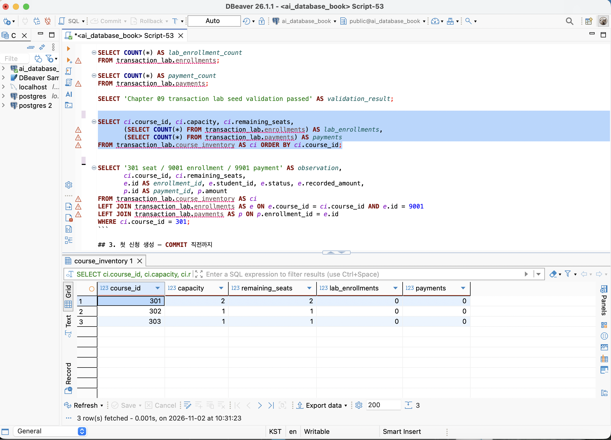
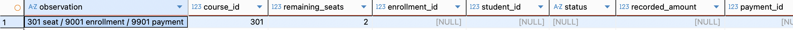
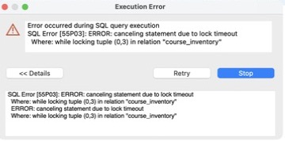

# Chapter 09 확장 실습 답안

> **과제:** 트랜잭션으로 데이터 정합성 지키기
> **사용 방법:** 이 파일을 내려받아 본인의 GitHub 저장소에 `chapter09_answer.md`라는 이름으로 저장한 뒤 실습하면서 바로 작성합니다.
> **제출 방법:** LMS에는 파일을 직접 업로드하지 않고, **본인 GitHub 저장소의 `chapter09_answer.md` 파일 URL**을 제출합니다.

---

## 제출 전 주의

이 파일과 캡처 화면에는 실제 비밀번호, 전체 DB 접속 URL, API Key, 개인정보를 기록하지 않습니다.

```text
GitHub 계정 또는 별칭: ssossocoder
과제 작성일: 2026-11-02
사용한 AI 도구: Codex
```

---

# 1. 시작 환경과 Chapter 07·08 기준 상태 확인

다음을 실행하거나 Chapter 09의 `01_transaction_lab_schema.sql` 사전 검사를 확인합니다.

```sql
SELECT current_database();
SELECT current_user;
SELECT current_schema();
SHOW search_path;
SHOW transaction_read_only;
```

| 확인 항목 | 실제 결과 | 의미 |
| --- | --- | --- |
| `current_database()` | ai_database_book | 실습 DB 연결 |
| `current_user` | postgres | SQL 실행 역할 |
| `current_schema()` | public | 기본 이름 해석 스키마 |
| `search_path` | "$user", public | 스키마 탐색 순서 |
| `transaction_read_only` | off | 변경 가능 |

Chapter 07·08 기준값:

```text
students = 3
instructors = 2
courses = 3
enrollments = 5
전체 recorded_amount = 590000
활성 = 3 / 340000
취소 제외 = 4 / 440000
```

### 기준 상태가 다르면 Chapter 09를 계속 진행하면 안 되는 이유

```text
기준 데이터가 다르면 외래키 참조 대상, 강의 가격, 신청 건수와 금액이 달라져 이후 검증의 비교 기준이 깨진다. 기존 데이터의 문제와 트랜잭션 처리 오류를 구별할 수 없으므로 기준 상태를 먼저 맞춰야 한다.
실제 확인: students 3, instructors 2, courses 3, enrollments 5, 전체 590000, 활성 3/340000, 취소 제외 4/440000으로 기준과 일치했다.
```

---

# 2. `transaction_lab` 스키마 생성

실행 파일:

```text
code/chapter09/01_transaction_lab_schema.sql
```

## 2-1. 생성 전 예상

```text
생성될 스키마: transaction_lab
생성될 테이블 3개: course_inventory, enrollments, payments

course_inventory 한 행의 의미: 강의 한 개의 정원과 남은 좌석 정보.
enrollments 한 행의 의미: 이번 실습에서 발생한 학생의 강의 신청 한 건.
payments 한 행의 의미: 실습 신청 한 건에 연결된 결제 기록 한 건.
```

## 2-2. 생성 결과

```text
통과 메시지: 최초 스키마 생성 시의 통과 문자열은 별도 기록하지 않았다.
구조 확인 결과: information_schema.tables 조회에서 transaction_lab의 course_inventory, enrollments, payments가 3행 반환되었다.
공식 03~06 검증과 최종 정합성 검증도 정상 통과했다.
```

기대 메시지:

```text
Chapter 09 transaction lab schema validation passed
```

### Chapter 07·08의 `course_project`와 별도 `transaction_lab`을 사용하는 이유

```text
course_project는 이전 장의 기준 데이터이고 transaction_lab은 이번 장의 변경 대상이다. 별도 스키마를 사용하면 원래 신청 이력과 실습 신청을 구별하면서 기존 학생·강의는 FK로 참조할 수 있다. 스키마 분리 자체가 쓰기 금지 권한을 보장하지는 않으므로 마지막에 원본의 건수와 금액도 다시 검사했다.
```

### 증거 화면

권장 경로:

```text
assignments/chapter09/images/step02_schema.png
```

`여기에 transaction_lab 구조가 보이는 핵심 화면을 삽입하세요.`


transaction_lab에 course_inventory, enrollments, payments 세 테이블이 조회되었다.

---

# 3. 초기 좌석과 기준 데이터 입력

실행 파일:

```text
code/chapter09/02_transaction_lab_seed.sql
```

## 3-1. 실행 전 예상

```text
course 301 remaining_seats 예상: 2
course 302 remaining_seats 예상: 1
course 303 remaining_seats 예상: 1
lab enrollments 예상 행 수: 0
payments 예상 행 수: 0
```

## 3-2. 실제 결과

```text
course 301 remaining_seats: 2
course 302 remaining_seats: 1
course 303 remaining_seats: 1
lab enrollments 행 수: 0
payments 행 수: 0
통과 메시지: 기존 초기 데이터 검증 통과
검증 방법: 이미 입력된 데이터를 대상으로 공식 02의 초기 상태 검증 DO 블록을 재실행했다. INSERT는 다시 실행하지 않았다.
```

기대 초기 상태(템플릿 기재값):

```text
course 301 / 302 / 303 remaining_seats = 3 / 0 / 0
lab enrollments = 0
payments = 0
```

### 예상과 실제가 다른 경우 원인

```text
템플릿의 기대 초기 상태는 3/0/0으로 기재되어 있지만, 공식 02_transaction_lab_seed.sql의 INSERT와 검증 조건은 2/1/1이다. 공식 03도 강의 301의 시작 좌석 2를 요구한다. 실제 조회값 2/1/1은 실행 SQL 기준과 일치한다. 따라서 실제 파일을 기준으로 초기 2/1/1, 최종 1/0/1을 기록했다.
```

---

### 증거 화면



초기 좌석은 301·302·303 순서로 2·1·1이며, 신청과 결제 전체 건수는 각각 0이다. 전체 건수 하위 쿼리이므로 각 강의 행에 같은 0이 반복된다.

# 4. 첫 번째 정상 COMMIT 추적

실행 파일:

```text
code/chapter09/03_commit_transaction.sql
```

이 실습은 학생 101이 강의 301을 신청하는 하나의 업무 단위를 추적합니다.

## 4-1. 업무 단위 정의

```text
이 트랜잭션에서 함께 성공해야 하는 변경 1: 강의 301의 남은 좌석 1 감소.
변경 2: 학생 101의 신청 9001 생성.
변경 3: 신청 9001에 연결된 결제 9901 생성.

하나라도 실패하면 전체를 취소해야 하는 이유: 좌석만 차감되면 신청 없는 좌석 점유가 되고, 신청만 생성되면 결제 누락이나 초과 수용이 생기기 때문이다.
```

## 4-2. 상태 변화 기록

| 시점 | course 301 남은 좌석 | lab enrollment 9001 | payment 9901 | 설명 |
| --- | ---: | --- | --- | --- |
| BEGIN 전 | 2 | 없음(NULL) | 없음(NULL) | 초기 좌석 2, 신청·결제 전체 0건 |
| 트랜잭션 내부 | 1 | 101/301/수강중/100000 | 9001/100000 | COMMIT 전 같은 세션에서 조회 |
| COMMIT 후 | 1 | 유지 | 유지 | 첫 COMMIT 검증 통과, 이후 ROLLBACK 후에도 유지 |



## 4-3. COMMIT 조건

```text
좌석 UPDATE 기대 영향 행 수: 1행
실제 영향 행 수: 좌석 2→1로 1행 변경. 신청 9001과 결제 9901도 각각 1행 생성.
신청 생성 기대 행 수: 1행 / 실제 1행
결제 생성 기대 행 수: 1행 / 실제 1행
recorded_amount와 payment.amount 일치 여부: 모두 100000으로 일치.
최종 COMMIT 판단: 좌석·신청·결제 연결 검증 통과 후 COMMIT.
실제 통과 메시지: Chapter 09 first commit validation passed
```

기대 메시지:

```text
Chapter 09 first commit validation passed
```

### SQL 오류가 없었다는 사실만으로 COMMIT하면 안 되는 이유

```text
조건부 UPDATE는 조건에 맞는 좌석이 없으면 오류 없이 0행을 변경할 수 있다. 따라서 SQL 문법 오류가 없다는 사실만으로 업무 성공을 판단할 수 없다. 좌석 확보 여부, 신청·결제 생성 건수, 두 금액과 연결 관계까지 확인해야 한다.
```

### 증거 화면

권장 경로:

```text
assignments/chapter09/images/step04_commit.png
```

`여기에 COMMIT 후 좌석·신청·결제 관계를 확인할 수 있는 화면을 삽입하세요.`


신청 9001은 학생 101·강의 301의 수강중 신청이며, 신청 금액과 결제 9901의 금액은 모두 100000이다. 잔여 좌석은 1이고 matched는 true이다. 첫 COMMIT 당시와 이후 재조회 결과가 일치했다.

---

# 5. ROLLBACK으로 전체 원상복구 확인

실행 파일:

```text
code/chapter09/04_rollback_transaction.sql
```

## 5-1. ROLLBACK 전 예상

```text
트랜잭션 안에서 임시로 바뀔 값: 강의 302 좌석 1→0, 학생 102의 신청 9002와 결제 9902 생성.
ROLLBACK 후 다시 돌아와야 할 값: 강의 302 좌석 1, 임시 신청 9002와 결제 9902 없음.
이미 이전 파일에서 COMMIT된 9001/9901은 유지되어야 하는가: 유지되어야 한다. 이전에 확정한 업무는 이후 트랜잭션의 ROLLBACK 대상이 아니다.
```

## 5-2. 실제 결과

```text
ROLLBACK 후 course 301 상태: 남은 좌석 1 유지.
ROLLBACK 후 course 302 상태: 남은 좌석 1로 복구.
ROLLBACK 후 lab enrollments 행 수: 1
ROLLBACK 후 payments 행 수: 1
9001 존재 여부: 존재
9901 존재 여부: 존재
9002 / 9902 존재 여부: 없음 / 없음
통과 메시지: Chapter 09 rollback validation passed
```

기대 메시지:

```text
Chapter 09 rollback validation passed
```

## 5-3. ROLLBACK과 IDENTITY

```text
ROLLBACK은 현재 트랜잭션의 미확정 INSERT·UPDATE·DELETE를 취소한다. 이전에 COMMIT한 변경까지 취소하지 않는다. PostgreSQL IDENTITY에 사용되는 시퀀스의 nextval로 이미 할당한 자동 번호는 보통 ROLLBACK으로 회수되지 않으므로 결번이 생길 수 있다. PK의 목적은 고유 식별이며 연속적인 업무 순번을 보장하는 것이 아니다.

04는 자동 번호를 발급받는 대신 **9002/9902를 명시 입력**한다. 따라서 04 실행만으로 자동 번호 결번을 관찰했다고 말할 수 없다. 05에서 같은 ID를 다시 쓰는 것은 취소된 명시 ID를 재사용하는 사례다. 05의 `ALTER ... RESTART WITH`는 별도 명시적 조정이며 nextval의 ROLLBACK 특성과 구분한다.
```

---

# 6. 두 번째 COMMIT과 좌석 부족 0행 관찰

실행 파일:

```text
code/chapter09/05_commit_and_sold_out.sql
```

## 6-1. 두 번째 정상 COMMIT

```text
생성된 enrollment id: 9002
학생 id: 103
course id: 302
recorded_amount: 120000
payment id: 9902
payment amount: 120000
강의 302 남은 좌석: 0
04의 학생 102 임시 신청은 취소되었고, 이번에는 학생 103의 신청이 확정되었다.
```

## 6-2. 좌석 부족 시도

```text
좌석 확보 UPDATE 기대 영향 행 수: 0행
실제 영향 행 수: 0행
후속 enrollment 생성 행 수: 0행
후속 payment 생성 행 수: 0행
9003 / 9903 최종 존재 건수: 0 / 0
검증 근거: 조건부 UPDATE의 CTE 연결, 빈 RETURNING 결과, 후속 행 부재 및 공식 검증 통과.
통과 메시지: Chapter 09 sold-out validation passed
```

기준상 좌석 부족 시 생성되지 않아야 하는 ID:

```text
9003
9903
```

### `UPDATE 0`이 SQL 실패가 아니라 업무상 실패일 수 있는 이유

```text
UPDATE 0은 조건에 맞는 행이 없다는 정상적인 SQL 실행 결과이다. 하지만 좌석 확보가 신청 업무의 선행 조건이므로, 확보한 좌석이 0이면 업무상 신청에 실패한 것이다.
```

### 영향 행 수가 0인데 신청과 결제를 계속 생성하면 어떤 정합성 문제가 생기나요?

```text
좌석을 확보하지 못했는데 별도의 VALUES로 신청과 결제를 넣으면 좌석 없는 신청과 결제가 생겨 정원을 초과할 수 있다. 공식 SQL은 좌석 확보 RETURNING 행을 신청과 결제의 입력으로 연결하므로 앞 단계가 0행이면 후속 INSERT도 0행이다.
```

---

# 7. 주 실습 최종 정합성 검증

실행 파일:

```text
code/chapter09/06_transaction_validation.sql
```

## 7-1. lab 최종 상태

| 항목 | 기대값 | 실제값 | 일치? |
| --- | ---: | ---: | --- |
| course_inventory 행 수 | 3 | 3 | 일치 |
| lab enrollments 행 수 | 2 | 2 | 일치 |
| payments 행 수 | 2 | 2 | 일치 |
| course 301 remaining | 1 | 1 | 일치 |
| course 302 remaining | 0 | 0 | 일치 |
| course 303 remaining | 1 | 1 | 일치 |

## 7-2. 주요 행

```text
9001 = student 101 / course 301 / amount 100000 / payment 9901
실제: 학생 101, 강의 301, 수강중, 신청 금액 100000, 결제 9901의 금액 100000, 남은 좌석 1.

9002 = student 103 / course 302 / amount 120000 / payment 9902
실제: 학생 103, 강의 302, 수강중, 신청 금액 120000, 결제 9902의 금액 120000, 남은 좌석 0.

9003·9903 = 존재하지 않아야 함
실제: 둘 다 없음.

강의 303: 남은 좌석 1, 연결된 신청과 결제 없음.
신청과 결제가 있는 두 행의 matched는 모두 true이다.
```

## 7-3. 보호 대상 확인

```text
course_project.enrollments 행 수: 5
전체 recorded_amount: 590000
활성 건수/금액: 3 / 340000
취소 제외 건수/금액: 4 / 440000
최종 통과 메시지: Chapter 09 main transaction validation passed
선택 실습 후에도 공식 06의 최종 검증 DO 블록을 재실행하여 같은 결과를 확인했다.
```

기대값:

```text
course_project.enrollments = 5
전체 = 590000
활성 = 3 / 340000
취소 제외 = 4 / 440000
```

최종 기대 메시지:

```text
Chapter 09 main transaction validation passed
```

### transaction_lab 실습 후에도 course_project 기준 상태를 다시 검사하는 이유

```text
lab의 상태가 정상이어도 원본 스키마를 잘못 수정했다면 실습 조건을 지킨 것이 아니다. 원본의 건수와 상태별 금액이 이전 장 기준과 같은지 다시 확인하여 실습 변경이 transaction_lab에 한정되었음을 검증했다. lab에서는 capacity - remaining_seats와 수강중 신청 수, 결제 존재 여부, 신청·결제 금액 일치를 함께 확인했다.
```

---

### 증거 화면

권장 경로:

```text
assignments/chapter09/images/step07_validation.png
```


최종 검증에서 원본 데이터 보존, 좌석·신청·결제 정합성, 9003·9903 부재가 확인되었다. 선택 실습을 마친 후에도 같은 검증을 다시 통과했다.

# 8. ACID를 이번 실습으로 설명

교과서 정의를 그대로 복사하지 말고 이번 좌석·신청·결제 사례로 작성합니다.

```text
Atomicity: 좌석 차감·신청·결제를 모두 확정하거나 모두 취소한다. 04에서 임시 신청 9002와 결제 9902는 ROLLBACK 뒤 남지 않았다.

Consistency: 좌석이 음수가 아니고 정원을 넘지 않으며, 수강중 신청 수와 사용 좌석 수가 일치하고 신청 금액과 결제 금액이 같아야 한다. 최종 검증에서 이 조건들이 유지되었다.

Isolation: 다른 세션이 같은 강의 303 행을 잠그려고 할 때 앞선 세션의 잠금 해제를 기다렸다. READ COMMITTED에서 미확정 변경은 다른 세션에 노출되지 않으며, 변경 시 필요한 행 잠금으로 경쟁을 조정한다.

Durability: COMMIT한 9001/9901은 이후 04의 ROLLBACK과 선택 실습의 ROLLBACK 뒤에도 유지되었다. 실제 서버 장애 복구는 이번 실습의 검증 범위가 아니다.
```

### Atomicity와 Consistency가 같은 뜻이 아닌 이유

```text
Atomicity는 여러 변경을 전부 적용하거나 전부 취소하는 성질이고, Consistency는 확정 결과가 업무 규칙을 만족하는 성질이다. 좌석을 줄이지 않고 신청과 결제만 원자적으로 저장해도 좌석 규칙은 깨질 수 있다. 따라서 올바른 SQL, 제약조건, 최종 검증이 함께 필요하다.
```

---

# 9. 선택 실습 — 두 세션 Lock 대기 관찰

실행 파일:

```text
code/chapter09/07_concurrency_two_sessions.sql
```

가능하면 DBeaver에서 **서로 다른 두 연결 세션**으로 수행합니다.

## 9-1. 내 환경

```text
실제 두 세션 실습 수행 / 절차 분석만 수행: 실제 두 세션 실습 수행.
Session A pg_backend_pid(): 14431
Session B pg_backend_pid(): 14225
transaction_isolation: read committed
lock_timeout: Session B의 트랜잭션에서 SET LOCAL로 5s 설정 후 SHOW로 확인.
```

## 9-2. 시간 순서 기록

| 순서 | Session A | Session B | 관찰 |
| ---: | --- | --- | --- |
| 1 | BEGIN 후 303 FOR UPDATE | 대기 | A(14431)가 행 잠금 획득 |
| 2 | 트랜잭션 유지 | BEGIN, lock_timeout 5s, 303 FOR UPDATE | B(14225)가 대기 후 55P03 오류 |
| 3 | ROLLBACK | 오류 상태를 ROLLBACK | 잠금 해제 및 오류 상태 종료 |
| 4 | 종료 | 새 트랜잭션에서 재시도 후 ROLLBACK | B 잠금 획득 성공, 303 좌석 1 유지 |

```text
먼저 Lock을 획득한 세션: Session A (14431)
대기한 세션: Session B (14225)
A가 COMMIT/ROLLBACK한 뒤 B에서 일어난 일: B는 먼저 5초 대기 후 lock timeout(55P03)으로 실패했다. B를 ROLLBACK하고 A도 ROLLBACK한 뒤, B에서 새 트랜잭션으로 재시도하자 잠금을 획득하고 강의 303의 남은 좌석 1을 조회했다. 마지막에 B도 ROLLBACK했다.
```

### Lock 대기와 Deadlock의 차이

```text
Lock 대기는 한 세션이 다른 세션이 가진 잠금의 해제를 기다리는 것이다. Deadlock은 둘 이상의 세션이 서로의 잠금을 기다리는 순환 구조이다. 이번 관찰은 A의 잠금을 기다린 B의 lock timeout이며 Deadlock이 아니다.
```

### `SELECT ... FOR UPDATE`가 모든 UPDATE 앞에 항상 필요한 것은 아닌 이유

```text
조건부 UPDATE 자체도 수정할 행에 필요한 잠금을 얻는다. 따라서 모든 UPDATE 앞에 FOR UPDATE가 필요한 것은 아니다. 먼저 잠근 상태를 읽고 여러 후속 판단과 변경을 수행할 때 FOR UPDATE가 유용하다.
```

### 증거 화면

실제 수행했다면 권장 경로:

```text
assignments/chapter09/images/step09_lock.png
```



A가 강의 303 행을 잠근 동안 B에서 55P03 lock timeout 오류가 발생했다.

---

# 10. 선택 실습 — 취소와 좌석 복구

실행 파일:

```text
code/chapter09/08_cancel_and_restore.sql
```

```text
9001 취소 성공 행 수: 1행
course 301 좌석 변화: 1→2
같은 취소를 다시 시도한 행 수: 0행
두 번째 좌석 복구 행 수: 0행
payment 9901 유지 여부: 유지, 금액 100000
최종 ROLLBACK 후 원상복구 여부: 9001 수강중, 301 좌석 1로 복구. 신청·결제 각각 2행 유지.
통과 메시지: Chapter 09 cancel rollback validation passed
```

기대 흐름:

```text
9001 수강중 → 취소 1행
course 301 remaining 1 → 2
같은 취소 재시도 → 0행
추가 좌석 복구 → 0행
마지막 ROLLBACK → 주 실습 기준으로 복구
```

### 같은 취소를 두 번 처리해도 좌석이 두 번 증가하지 않아야 하는 이유

```text
이미 취소된 신청을 다시 처리할 때 좌석까지 늘리면 실제 정원보다 많은 좌석이 판매 가능 상태가 된다. 취소 성공 UPDATE의 RETURNING 행만 좌석 복구 입력으로 전달해야 한다. 결제 이력 보존과 외부 환불은 별도 업무이다.
```

---

# 11. 선택 실습 — 오류 상태와 SAVEPOINT

실행 파일:

```text
code/chapter09/09_error_and_savepoint.sql
```

## 11-1. 일반 오류 후 트랜잭션 상태

```text
발생시킨 오류: 학생 101·강의 301의 수강중 신청 중복 INSERT로 uq_transaction_enrollments_active 위반(23505).
오류 이후 다음 SQL 실행 결과: SELECT에서 current transaction is aborted(25P02) 발생.
전체 ROLLBACK이 필요한 이유: 오류 상태의 트랜잭션에서는 일반 SQL을 계속 실행할 수 없고, 저장점이 없으므로 전체를 취소해야 한다. ROLLBACK 후 임시 좌석 차감이 취소되어 강의 301 좌석은 1로 복구되었다.
```

## 11-2. SAVEPOINT 사용

```text
SAVEPOINT 이름: before_duplicate_enrollment
오류 발생 위치: 임시 좌석 차감 이후 동일 학생·강의의 수강중 신청 INSERT(23505).
ROLLBACK TO SAVEPOINT 후 상태: 강의 301 remaining_seats 1, 신청 9003 존재 건수 0.
이후 계속 실행할 수 있었는가: SELECT가 정상 실행되어 복구 상태를 조회했다. RELEASE SAVEPOINT 후 전체 ROLLBACK으로 종료했다.
```

### SAVEPOINT가 전체 ROLLBACK과 다른 점

```text
SAVEPOINT는 같은 트랜잭션의 특정 시점 이후 변경만 취소하고 트랜잭션을 계속할 수 있게 한다. 전체 ROLLBACK은 현재 트랜잭션의 모든 미확정 변경을 취소하고 트랜잭션을 끝낸다. 저장점 이전 변경이 자동으로 COMMIT되는 것은 아니다.
```

---

# 12. 개인 프로젝트 트랜잭션 시나리오 설계

Chapter 07에서 시작한 개인 프로젝트를 사용합니다.

Chapter 08에서 사용한 **청약 의사결정 노트**를 이어서 설계한다. Chapter 07 당시의 사주 기록 노트에서 프로젝트를 변경한 사항은 Chapter 08 답안에 기록했다. [기획안](https://github.com/ssossocoder/database-project/blob/main/database-project/01_proposal/proposal.md)의 app_user·announcement·watchlist·user_note 관계를 사용한다. 여기의 컬럼명은 구현 전 설계 후보이며 SQL은 미실행 초안이다.

둘 이상의 변경이 함께 성공해야 하는 업무를 **하나** 선택합니다.

예:

```text
예약 생성 + 좌석 차감
주문 생성 + 재고 차감
대여 생성 + 대여 가능 상태 변경
답변 등록 + 질문 상태 변경
```

## 12-1. 업무 정의

```text
시나리오 ID: P09-T01
업무 이름: 새 관심 공고와 최초 판단 노트 함께 저장
사용자 행동: 관심 목록에 없는 활성 공고에 저장 이유를 입력하고 저장한다.
원자성 이유: 이 동작의 성공은 관심 기록 1건과 입력한 최초 노트 1건이
함께 보존되는 것이다. 노트가 실패했다면 새 관심 기록만 남기지 않는다.
범위: 이미 관심 목록에 있는 공고에 노트를 추가하는 기능은 별도 업무다.
```

## 12-2. 트랜잭션 설계표

| 항목 | 내 설계 |
| --- | --- |
| BEGIN 전 확인 상태 | 서버 인증 회원 ID, 비어 있지 않은 노트 내용, 대상 공고 ID |
| 잠금/경쟁 가능 데이터 | 공고 활성 상태, 같은 회원·공고의 동시 관심 등록 |
| 변경 1 | watchlist 1행 INSERT |
| 기대 영향 행 수 | 1행. 고유 충돌이면 기존 행을 덮어쓰지 않고 실패 처리 |
| 변경 2 | RETURNING 받은 watchlist.id로 user_note INSERT |
| 기대 영향 행 수 | 1행 |
| 추가 변경 | 없음. 공식 청약 접수나 공급 물량 차감은 하지 않음 |
| COMMIT 전 검증 | 신규 관심 기록의 소유자·공고, 신규 노트의 연결·내용·각 1행 확인 |
| COMMIT 조건 | 인증·활성 조건 충족, INSERT 각 1행, 검증 성공 |
| ROLLBACK 조건 | 비활성/없는 공고, 중복 관심, 노트 제약 위반, 검증 실패, DB 오류 |

공고는 트랜잭션 안에서 FOR SHARE로 읽어 활성 상태 변경을 막는다. 조회만 하고 잠그지 않으면 활성 확인 직후 다른 세션이 비활성화할 수 있다. 같은 회원·공고의 중복은 UNIQUE(app_user_id, announcement_id)로 최종 차단한다. 존재하지 않는 관심 행을 FOR UPDATE로 조회하는 것만으로 동시 INSERT가 차단되지는 않는다.

## 12-3. 실패 시나리오

최소 두 개 작성합니다.

```text
실패 1: 노트의 NOT NULL·길이·FK 등 제약 위반.
어느 단계에서 발생: watchlist INSERT 이후 user_note 저장.
남으면 안 되는 부분 상태: 노트 없는 신규 관심 기록만 남는 상태.
ROLLBACK 후 기대 상태: 신규 관심·노트 모두 0건, 기존 데이터 유지.

실패 2: 같은 회원이 두 세션에서 같은 공고를 동시에 저장.
어느 단계에서 발생: UNIQUE(app_user_id, announcement_id) 검사.
남으면 안 되는 부분 상태: 중복 관심 등록 또는 실패 요청의 노트가 기존 관심에 붙는 상태.
ROLLBACK 후 기대 상태: 한 요청의 관심·노트 각 1건만 남고 다른 요청은 전체 취소.

실패 3: 공고가 없거나 비활성.
어느 단계에서 발생: 공고 잠금 조회.
남으면 안 되는 부분 상태: 비활성 공고에 대한 신규 관심·노트.
ROLLBACK 후 기대 상태: 신규 기록 없음.
```

## 12-4. SQL 초안

아래는 바인드 변수와 애플리케이션의 행 수 검사를 포함한 의사 SQL이며, 개인 프로젝트 DB에서 실행한 결과는 아니다.

```sql
BEGIN;

SELECT id, is_active
FROM announcement
WHERE id = :announcement_id
FOR SHARE;
-- 앱: 정확히 1행이며 is_active=true가 아니면 ROLLBACK 후 종료.

INSERT INTO watchlist (app_user_id, announcement_id)
VALUES (:authenticated_user_id, :announcement_id)
RETURNING id;
-- 앱: 1행 확인, 반환값을 :new_watchlist_id에 저장.
-- UNIQUE 충돌 등 예외이면 ROLLBACK. 기존 행 ID로 노트를 붙이지 않는다.

INSERT INTO user_note (watchlist_id, content)
VALUES (:new_watchlist_id, :note_content)
RETURNING id;
-- 앱: 1행 확인, 반환값을 :new_note_id에 저장.

SELECT w.id, w.app_user_id, w.announcement_id, n.id AS note_id, n.content
FROM watchlist AS w
JOIN user_note AS n ON n.watchlist_id = w.id
WHERE w.id = :new_watchlist_id
  AND w.app_user_id = :authenticated_user_id
  AND w.announcement_id = :announcement_id
  AND n.id = :new_note_id
  AND n.content = :note_content;
-- 앱: 정확히 1행과 기대값 확인. 성공하면 아래 COMMIT, 아니면 ROLLBACK.
COMMIT;
-- 모든 예외 처리 경로: ROLLBACK 후 연결 반환.
```

---

status·created_at 같은 필수 열은 실제 DDL에 기본값을 정의하거나 INSERT에 추가해야 한다. 인증 ID는 서버에서 전달하며 사용자가 보낸 임의 회원 ID를 신뢰하지 않는다. 네트워크 장애로 COMMIT 응답을 못 받은 경우 재요청 정책은 별도 설계가 필요하다.

# 13. AI를 트랜잭션 리뷰어로 활용

AI에게 완성 SQL부터 요구하지 않습니다.

## 13-1. 사용한 프롬프트

```text
리뷰 범위: 공식 SQL의 업무 경계, 영향 행 수, COMMIT/ROLLBACK 조건, 두 세션 경쟁, 신청·결제·좌석 정합성 및 개인 프로젝트 트랜잭션 설계를 검토했다. 개인 프로젝트는 구현 전이므로 SQL 설계의 논리 검토와 실습 DB 실행 검증을 구분했다.
```

권장 질문 요소:

```text
1. 하나의 업무 단위가 어디까지인지
2. BEGIN 전 확인할 상태
3. 경쟁 가능 데이터와 잠금 필요성
4. 각 변경의 기대 영향 행 수
5. 여러 테이블 최종 정합성 검증
6. COMMIT 조건
7. ROLLBACK 조건
8. 동시 실행 위험
을 먼저 검토한 뒤 PostgreSQL 초안을 제안하도록 요청
```

## 13-2. AI 제안 검토

| AI 제안 | 판단 | 논리 검증 | 판단 이유 |
| --- | --- | --- | --- |
| 관심·노트를 하나의 트랜잭션으로 처리 | 수용 | 노트 실패 시 관심도 취소 | 이번 버튼의 성공 범위를 충족 |
| 조회 후 없으면 INSERT만 수행 | 수정 | 두 세션이 모두 없음으로 읽을 수 있음 | UNIQUE로 최종 중복 차단 |
| 모든 SELECT에 FOR UPDATE | 거절 | 공고 활성 상태에는 FOR SHARE로도 변경 차단 | 필요한 대상과 목적에 맞춰 잠금 선택 |
| 충돌 시 기존 관심에 노트를 추가 | 거절 | 신규 저장 요청의 범위가 기존 기록 수정으로 바뀜 | 중복 안내 후 별도 노트 추가 동작 사용 |
| COMMIT 응답 유실에도 자동 재시도 | 보류 | 성공 여부가 불분명할 수 있음 | 요청 식별자·중복 처리 정책 먼저 설계 |

### AI SQL에서 확인한 가장 중요한 위험

```text
가장 중요한 위험은 0행이나 고유 충돌을 무시하고 후속 INSERT를 진행하거나 별도 연결에서 COMMIT하는 것이다. 같은 연결의 같은 트랜잭션에서 각 반환 행과 최종 FK 연결을 확인해야 한다. 개인 프로젝트의 중복 관심 등록은 UNIQUE 제약으로 최종 차단해야 한다.
```

### “오류가 없으면 COMMIT”만으로 부족한 이유

```text
SQL 오류가 없어도 선행 조건을 충족하지 못한 UPDATE 0행일 수 있고, 신청과 결제의 금액이나 연결이 잘못될 수 있다. DB 오류 유무 외에 영향 행 수와 업무 규칙을 검증한 뒤 COMMIT해야 한다.
```

---

# 14. 최종 성찰

아래 문장은 본인의 말로 작성합니다.

```text
1. 트랜잭션은 여러 SQL을 단순히 묶는 것이 아니라 함께 성공해야 하는 업무의 범위와 취소 기준을 정하는 것이다.
2. 좌석 확보 0행, 후속 결제 실패, 최종 연결 검증 실패가 전체 취소가 필요한 대표 상황이다.
3. 조건부 UPDATE의 영향 행 수는 SQL이 실행되었는지뿐 아니라 업무의 선행 조건을 확보했는지 알려 준다.
4. FK와 CHECK가 개별 값과 참조를 지켜도 좌석·신청·결제의 여러 변경을 함께 확정해 주지는 않으므로 트랜잭션이 필요하다.
5. Lock은 같은 좌석이나 상태를 동시에 판단하고 변경하는 요청 사이의 경쟁을 조정한다. 잠금 대기 시간을 줄이도록 트랜잭션을 짧게 유지해야 한다.
6. AI SQL은 BEGIN/COMMIT 유무보다 업무 경계, 영향 행 수, 실패 시 남을 부분 상태와 동시 요청을 먼저 확인하겠다.
```

---

# 15. 제출 체크리스트

- [x] `chapter09_answer.md`를 본인 저장소에 만들었다.
- [x] Chapter 07·08 기준 상태를 확인했다.
- [x] `transaction_lab` 스키마와 초기 데이터를 만들었다.
- [x] 정상 COMMIT의 전·중·후 상태를 기록했다.
- [x] ROLLBACK 후 부분 변경이 남지 않는지 확인했다.
- [x] ROLLBACK과 IDENTITY 번호의 차이를 설명했다.
- [x] 좌석 부족 시 영향 행 수 0을 관찰했다.
- [x] 영향 행 수 0일 때 후속 행이 생성되지 않음을 확인했다.
- [x] `06_transaction_validation.sql` 최종 검증을 통과했다.
- [x] `course_project`가 변경되지 않았음을 확인했다.
- [x] ACID를 이번 실습 사례로 설명했다.
- [x] Lock 실습 또는 두 세션 절차 분석을 수행했다.
- [x] 개인 프로젝트 트랜잭션 시나리오를 작성했다.
- [x] AI 제안의 COMMIT/ROLLBACK/영향 행 수 검증을 확인했다.
- [ ] 핵심 캡처는 3~4장 정도로 정리했다.
- [ ] 캡처에 비밀번호·개인정보가 없다.
- [ ] GitHub 웹에서 Markdown과 이미지가 정상적으로 보인다.
- [x] 최종 파일을 commit/push했다.

---

# 16. LMS 제출 URL

아래 형식의 **본인 GitHub 파일 URL**을 LMS에 제출합니다.

```text
https://github.com/<본인-GitHub-ID>/<본인-저장소>/blob/main/assignments/chapter09/chapter09_answer.md
```

내 제출 URL:

```text
https://github.com/ssossocoder/ai-database-study/blob/main/assignments/chapter09/chapter09_answer.md
```

> 교수자 템플릿 URL, 저장소 메인 URL, Raw URL이 아니라 **작성 완료된 본인의 `chapter09_answer.md` 파일 화면 URL**을 제출합니다.
