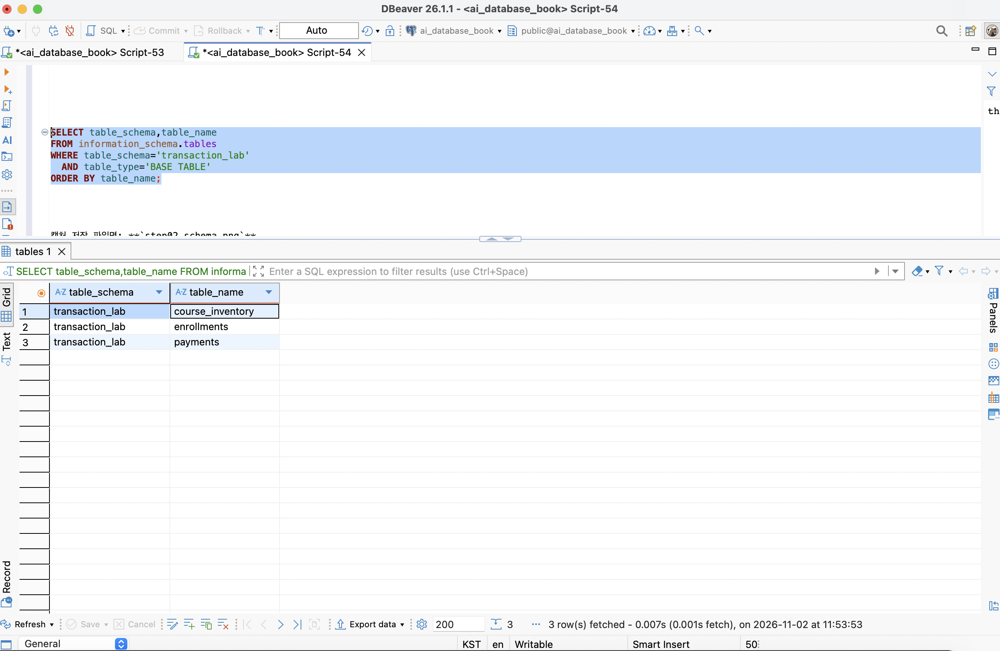
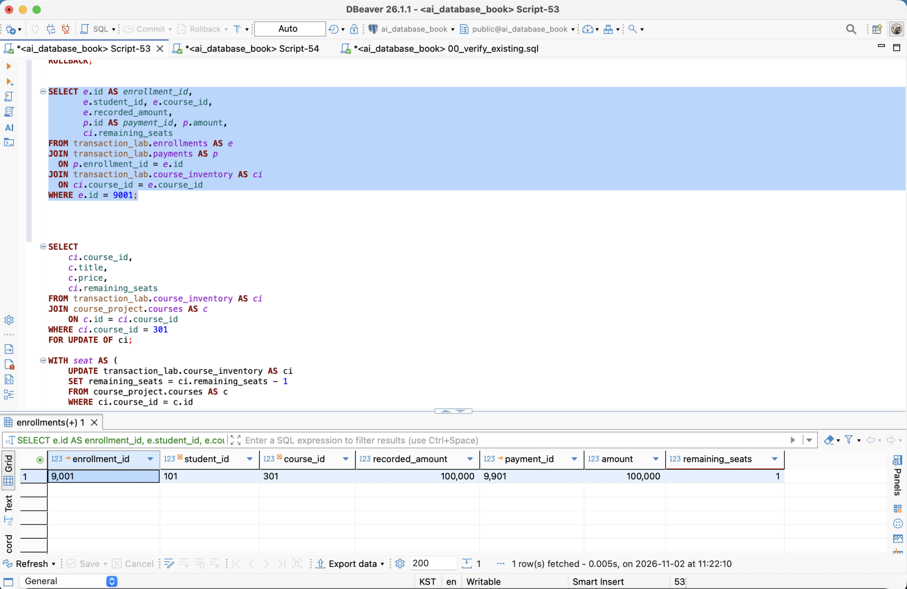
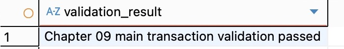

# Chapter 09 확장 실습 답안

> 트랜잭션으로 데이터 정합성 지키기
>
> 작성 상태: 공식 SQL을 읽고 이론·개인 프로젝트 설계·AI 리뷰 초안을 작성했다. **본인 DBeaver에서의 Chapter 09 실행과 캡처는 아직 하지 않았다.** 아래 ‘예상’은 SQL 분석값이며 ‘실행 후 입력’은 실제 결과를 확인한 뒤 채운다. 성찰과 설계 선택도 제출 전에 본인이 읽고 수정한다.

```text
GitHub 계정: ssossocoder
과제 작성일: 2026-11-02
사용한 AI 도구: Codex
```

공식 [답안 템플릿](https://github.com/GilbertMoon/ai-database-book/blob/main/assignments/chapter09/chapter09_answer_template.md)과 [실습 SQL](https://github.com/GilbertMoon/ai-database-book/tree/main/code/chapter09)을 기준으로 작성했다. 실행 순서·캡처 위치와 확인 SQL은 별도로 제공받은 실습 자료를 참고한다. 공식 실행 파일은 위 실습 SQL 링크에서 내려받는다. 이 저장소에는 답안과 증거 이미지만 관리한다.

**공식 자료의 불일치:** 템플릿 3절과 공식 README는 초기 좌석을 `3/0/0`으로 설명하지만, 실제 `02_transaction_lab_seed.sql`의 INSERT와 검증은 `2/1/1`이다. `03`도 301의 시작 좌석 2를 요구한다. 따라서 이 답안은 실제 실행 파일을 기준으로 초기 `2/1/1`, 최종 `1/0/1`을 사용한다. SQL을 템플릿 수치에 맞춰 임의 수정하지 않는다.

비밀번호·전체 접속 URL·API Key·실제 개인정보는 기록하지 않는다.

# 1. 시작 환경과 Chapter 07·08 기준 상태 확인

```sql
SELECT current_database(), current_user, current_schema();
SHOW search_path;
SHOW transaction_read_only;
```

| 확인 항목 | 실제 결과 | 의미 |
| --- | --- | --- |
| current_database() | 실행 후 입력 | ai_database_book 연결 여부 |
| current_user | 실행 후 입력 | 실행 역할과 권한 확인 |
| current_schema() | 실행 후 입력 | 기본 이름 해석 스키마 |
| search_path | 실행 후 입력 | 스키마 탐색 순서 |
| transaction_read_only | 실행 후 입력 | off여야 변경 가능 |

Chapter 08에서 확인한 기준은 학생 3 / 강사 2 / 강의 3 / 신청 5, 전체 기록 금액 590000, 활성 3건/340000, 취소 제외 4건/440000이다. **현재 DB도 같은지는 01의 사전 게이트로 다시 확인한다.**

기준이 다르면 결과 차이가 트랜잭션 때문인지 시작 데이터 때문인지 구분할 수 없다. 특히 1001=완료, 1004=취소, 1005=신청 등 상세 상태도 맞아야 한다. 게이트에서 실패하면 다음 파일로 넘어가지 않고 원인을 확인한다.

# 2. transaction_lab 스키마 생성

실행: `code/chapter09/01_transaction_lab_schema.sql` 전체.

## 2-1. 생성 전 예상

- 스키마: transaction_lab.
- course_inventory: 강의 한 개의 정원과 남은 좌석 한 행.
- enrollments: 이번 실습에서 발생한 학생의 강의 신청 한 건.
- payments: 실습 신청 한 건에 연결된 결제 기록 한 건.

## 2-2. 생성 결과

실제 결과: **실행 후 입력**.
기대 메시지: `Chapter 09 transaction lab schema validation passed`.

course_project는 이전 장의 기준 데이터이고 transaction_lab은 이번 장의 변경 대상이다. 별도 스키마를 사용하면 원래 신청 이력과 실습 신청을 구별하면서 기존 학생·강의는 FK로 참조할 수 있다. 스키마 분리 자체가 쓰기 금지 권한을 보장하는 것은 아니므로 마지막에 원본 보존도 검사한다.

증거 예정: `images/step02_schema.png`. 촬영 후 아래 코드를 이미지로 삽입한다.

```markdown

```

# 3. 초기 좌석과 기준 데이터 입력

실행: `code/chapter09/02_transaction_lab_seed.sql` 전체.

| 항목 | 예상 | 실제 결과 |
| --- | ---: | --- |
| 301 remaining_seats | 2 | 실행 후 입력 |
| 302 remaining_seats | 1 | 실행 후 입력 |
| 303 remaining_seats | 1 | 실행 후 입력 |
| lab enrollments | 0 | 실행 후 입력 |
| payments | 0 | 실행 후 입력 |

기대 메시지: `Chapter 09 transaction lab seed validation passed`.
실제 메시지: **실행 후 입력**.

차이가 있다면 다른 연결에서 조회했는지, 02가 COMMIT되었는지, 이미 03 이후를 실행했는지 확인한다. 템플릿의 3/0/0과 다르다는 사실만으로 오류로 판단하지 않는다.

# 4. 첫 번째 정상 COMMIT 추적

실행: `code/chapter09/03_commit_transaction.sql`.

## 4-1. 업무 단위 정의

학생 101의 강의 301 신청을 위해 ① 남은 좌석 1 감소 ② 신청 9001 생성 ③ 신청에 연결된 결제 9901 생성을 함께 확정한다. 좌석만 차감하면 신청 없는 좌석 점유가 되고, 신청만 생성하면 결제 누락과 초과 수용이 생길 수 있어 하나라도 실패하면 모두 취소한다.

## 4-2. 상태 변화 기록

아래는 **예상값**이다. 실제로는 실행 안내의 경계에서 멈춰 조회한다.

| 시점 | 301 남은 좌석 예상 | 9001 예상 | 9901 예상 | 실제 결과 |
| --- | ---: | --- | --- | --- |
| BEGIN 전 | 2 | 없음 | 없음 | 실행 후 입력 |
| 트랜잭션 내부 | 1 | 101/301/수강중/100000 | 9001/100000 | 실행 후 입력 |
| COMMIT 후 | 1 | 유지 | 유지 | 실행 후 입력 |

## 4-3. COMMIT 조건

좌석 UPDATE·신청 INSERT·결제 INSERT는 각각 1행이어야 한다. recorded_amount와 payment.amount는 100000으로 같아야 한다. 공식 SQL은 seat의 RETURNING 결과에서만 신청을 만들고 그 신청에서만 결제를 만든다. 마지막 INSERT의 결과만 보고 내부 UPDATE 행 수를 직접 읽었다고 기록하지 않고, 전후 좌석·생성 행·검증 블록으로 함께 확인한다.

실제 영향 행 수/금액 일치/COMMIT 판단: **실행 후 입력**.
기대 메시지: `Chapter 09 first commit validation passed`.

조건부 UPDATE가 0행이어도 SQL 문법은 정상이다. SQL 오류 유무에 더해 업무상 좌석 확보와 신청·결제 연결까지 검증한 뒤 COMMIT해야 한다.

증거 예정: `images/step04_commit.png`.

```markdown

```

# 5. ROLLBACK으로 전체 원상복구 확인

실행: `code/chapter09/04_rollback_transaction.sql`.

## 5-1. ROLLBACK 전 예상

이번에는 **강의 302** 좌석을 1→0으로 줄이고 학생 102의 임시 신청 9002와 결제 9902를 만든다. ROLLBACK하면 302 좌석은 1, 임시 신청·결제는 0건으로 돌아온다. 이전 트랜잭션에서 COMMIT한 9001/9901과 강의 301 좌석 1은 유지된다.

## 5-2. 실제 결과

| 항목 | 예상 | 실제 |
| --- | --- | --- |
| 301 좌석 | 1 유지 | 실행 후 입력 |
| 302 좌석 | 1로 복구 | 실행 후 입력 |
| lab enrollments / payments | 1 / 1 | 실행 후 입력 |
| 9001 / 9901 | 존재 / 존재 | 실행 후 입력 |
| 9002 / 9902 | 없음 / 없음 | 실행 후 입력 |

기대 메시지: `Chapter 09 rollback validation passed`.
실제 메시지: **실행 후 입력**.

## 5-3. ROLLBACK과 IDENTITY

ROLLBACK은 현재 트랜잭션의 미확정 INSERT·UPDATE·DELETE를 취소한다. 이전에 COMMIT한 변경까지 취소하지 않는다. PostgreSQL IDENTITY에 사용되는 시퀀스의 nextval로 이미 할당한 자동 번호는 보통 ROLLBACK으로 회수되지 않으므로 결번이 생길 수 있다. PK의 목적은 고유 식별이며 연속적인 업무 순번을 보장하는 것이 아니다.

04는 자동 번호를 발급받는 대신 **9002/9902를 명시 입력**한다. 따라서 04 실행만으로 자동 번호 결번을 관찰했다고 말할 수 없다. 05에서 같은 ID를 다시 쓰는 것은 취소된 명시 ID를 재사용하는 사례다. 05의 `ALTER ... RESTART WITH`는 별도 명시적 조정이며 nextval의 ROLLBACK 특성과 구분한다.

# 6. 두 번째 COMMIT과 좌석 부족 0행 관찰

실행: `code/chapter09/05_commit_and_sold_out.sql` 전체.

## 6-1. 두 번째 정상 COMMIT

예상: 신청 9002 / 학생 103 / 강의 302 / recorded_amount 120000 / 결제 9902 / amount 120000. 04의 학생 102 임시 신청과 구분한다.
실제: **실행 후 입력**.

## 6-2. 좌석 부족 시도

302의 남은 좌석이 0이므로 `remaining_seats > 0`을 만족하는 행이 없다. seat CTE는 0행이고 이를 입력으로 받는 신청 9003과 결제 9903도 각각 0행이다.

| 항목 | 예상 | 실제 |
| --- | ---: | --- |
| 좌석 확보 UPDATE | 0행 | 실행 후 입력 |
| 후속 enrollment INSERT | 0행 | 실행 후 입력 |
| 후속 payment INSERT | 0행 | 실행 후 입력 |
| 9003 / 9903 존재 건수 | 0 / 0 | 실행 후 입력 |

기대 메시지: `Chapter 09 sold-out validation passed`.

UPDATE 0은 ‘조건에 맞는 행 없음’이라는 정상 실행 결과다. 그러나 좌석 확보 업무는 실패했다. 이때 별도 VALUES로 신청·결제를 계속 넣으면 좌석 없이 신청과 결제만 생긴다. 공식 SQL은 CTE 연결과 검증으로 이를 막고 좌석 부족 시도를 ROLLBACK한다.

# 7. 주 실습 최종 정합성 검증

실행: `code/chapter09/06_transaction_validation.sql` 전체.

## 7-1. lab 최종 상태

| 항목 | 기대값 | 실제값 | 일치? |
| --- | ---: | --- | --- |
| course_inventory | 3 | 실행 후 입력 | 미확인 |
| lab enrollments | 2 | 실행 후 입력 | 미확인 |
| payments | 2 | 실행 후 입력 | 미확인 |
| 301 remaining | 1 | 실행 후 입력 | 미확인 |
| 302 remaining | 0 | 실행 후 입력 | 미확인 |
| 303 remaining | 1 | 실행 후 입력 | 미확인 |

## 7-2. 주요 행

- 9001: 학생 101 / 강의 301 / 수강중 / 100000 / 결제 9901·100000.
- 9002: 학생 103 / 강의 302 / 수강중 / 120000 / 결제 9902·120000.
- 9003·9903: 존재하지 않아야 한다.

실제 상세 행 대조: **실행 후 입력**.

## 7-3. 보호 대상 확인

기대: course_project.enrollments 5건, 전체 590000, 활성 3건/340000, 취소 제외 4건/440000.
실제: **실행 후 입력**.
기대 메시지: `Chapter 09 main transaction validation passed`.
실제 메시지: **실행 후 입력**.

lab만 정상이어도 원본 스키마를 잘못 수정했다면 실습 조건을 지킨 것이 아니다. 원본의 건수와 상태별 금액도 다시 확인한다. lab에서는 강의별 `capacity - remaining_seats = 수강중 신청 수`, 수강중 신청의 결제 존재, 두 기록 금액의 일치를 함께 확인한다.

증거 예정: `images/step07_validation.png`.

```markdown

```

# 8. ACID를 이번 실습으로 설명

- **Atomicity:** 좌석 차감·신청·결제를 모두 확정하거나 모두 취소한다. 04의 임시 신청과 결제가 ROLLBACK 후 남지 않는 사례다.
- **Consistency:** 좌석이 음수가 아니며 정원을 넘지 않고, 수강중 신청 수가 사용 좌석과 같으며 신청 금액과 결제 금액이 일치하는 업무 규칙을 지킨다.
- **Isolation:** 같은 좌석에 두 세션이 접근할 때 행 잠금으로 변경을 조정한다. READ COMMITTED에서는 다른 세션의 미확정 변경은 읽지 못하며 조건부 UPDATE가 좌석의 최신 조건을 확인한다.
- **Durability:** 정상적으로 COMMIT된 9001/9901은 다음 트랜잭션의 ROLLBACK 뒤에도 남는다. 실제 장애 후 보존은 DB의 WAL·동기화 설정 등 운영 조건에도 달려 있으며 이번 실습에서 장애 복구까지 검증한 것은 아니다.

Atomicity는 변경들의 전부 또는 전무를 뜻하고 Consistency는 확정된 결과가 업무 규칙에 맞는지를 뜻한다. 좌석을 빼지 않고 신청·결제만 원자적으로 넣어도 좌석 규칙은 깨질 수 있다. 올바른 SQL·제약조건·검증이 함께 필요하다.

# 9. 선택 실습 — 두 세션 Lock 대기 관찰

실행 자료: `code/chapter09/07_concurrency_two_sessions.sql`.

## 9-1. 내 환경

현재 상태: **두 세션 절차 분석만 수행, 실제 Lock 관찰 미수행**.
예상 격리 수준: READ COMMITTED. 실제 `SHOW transaction_isolation`: 실행 시 입력.
Session B 설정: `SET LOCAL lock_timeout = '5s'`. 실제 값: 실행 시 입력.

## 9-2. 시간 순서 기록

| 순서 | Session A | Session B | 예상 관찰 |
| ---: | --- | --- | --- |
| 1 | BEGIN 후 303 FOR UPDATE | 대기 | A가 행 잠금 획득 |
| 2 | 트랜잭션 유지 | BEGIN, timeout 설정, 같은 행 FOR UPDATE | B가 A 종료 대기 |
| 3 | ROLLBACK | 대기 또는 timeout | 5초 안에 A 종료 시 B 잠금 획득, 초과 시 오류 |
| 4 | 종료 | 정상 재개면 ROLLBACK, 오류여도 ROLLBACK | 잠금 해제, 303 좌석 1 유지 |

A의 잠금을 기다리는 것은 Lock 대기다. 서로가 가진 잠금을 기다리는 순환 구조가 생겨야 Deadlock이다. 단순 대기를 Deadlock으로 기록하지 않는다.

조건부 UPDATE도 수정 대상 행에 필요한 잠금을 얻으므로 모든 UPDATE 앞에 FOR UPDATE를 둘 필요는 없다. 먼저 잠근 상태를 읽고 후속 판단을 이어갈 때 유용하다. 이 실습에서는 좌석만 차감하고 COMMIT하는 확장 예제를 실행하지 않는다. 신청·결제가 없으면 최종 정합성이 깨지기 때문이다.

실제 수행 시 증거: `images/step09_lock.png`. 서로 다른 연결인지 `pg_backend_pid()`로 확인한다.

# 10. 선택 실습 — 취소와 좌석 복구

실행 자료: `code/chapter09/08_cancel_and_restore.sql`. **현재 SQL 분석만 수행했다.**

예상: 9001 수강중→취소 1행, 301 좌석 1→2, 같은 취소 재시도 0행, 두 번째 좌석 복구 0행, 결제 9901은 유지. 마지막 ROLLBACK 뒤 9001은 수강중, 좌석은 1로 복구한다.
실제 결과/메시지: 미수행.
기대 메시지: `Chapter 09 cancel rollback validation passed`.

취소 성공 UPDATE의 RETURNING 행만 좌석 복구로 전달해야 한다. 이미 취소된 신청의 재요청에도 좌석을 늘리면 정원보다 많이 판매할 수 있다. 결제 이력 보존과 실제 외부 환불 처리는 구분한다.

# 11. 선택 실습 — 오류 상태와 SAVEPOINT

실행 자료: `code/chapter09/09_error_and_savepoint.sql`. **현재 SQL 분석만 수행했다.**

## 11-1. 일반 오류 후 트랜잭션 상태

예상 오류: 학생 101·강의 301의 수강중 신청을 중복 INSERT하여 활성 고유 인덱스 위반(23505).
오류 후 일반 SELECT 예상: 트랜잭션이 aborted 상태여서 25P02 오류. 자동 저장점 기능 없이 수행한다는 전제다.
복구 지점이 없으면 전체 ROLLBACK으로 임시 좌석 감소까지 취소한다.
실제 오류/복구: 미수행.

## 11-2. SAVEPOINT 사용

저장점 `before_duplicate_enrollment`를 좌석 차감 전에 만든다. 좌석을 차감하고 중복 INSERT로 오류를 낸 뒤 `ROLLBACK TO SAVEPOINT before_duplicate_enrollment`를 실행한다. 예상: 301 좌석 1, 9003 없음, 이후 SELECT 실행 가능. RELEASE 후 전체 ROLLBACK으로 종료한다.

SAVEPOINT는 같은 트랜잭션의 특정 시점 이후만 되돌린다. 전체 ROLLBACK은 트랜잭션 전체를 끝낸다. 저장점 이전 변경이 자동 확정되는 것은 아니다.
실제 실행 가능 여부: 미수행.

# 12. 개인 프로젝트 트랜잭션 시나리오 설계

Chapter 08에서 사용한 **청약 의사결정 노트**를 이어서 설계한다. Chapter 07 당시의 사주 기록 노트에서 프로젝트를 변경한 사항은 Chapter 08 답안에 기록했다. [기획안](https://github.com/ssossocoder/database-project/blob/main/database-project/01_proposal/proposal.md)의 app_user·announcement·watchlist·user_note 관계를 사용한다. 여기의 컬럼명은 구현 전 설계 후보이며 SQL은 미실행 초안이다.

## 12-1. 업무 정의

```text
시나리오 ID: P09-T01
업무 이름: 새 관심 공고와 최초 판단 노트 함께 저장
사용자 행동: 관심 목록에 없는 활성 공고에 저장 이유를 입력하고 저장한다.
원자성 이유: 이 동작의 성공은 관심 기록 1건과 입력한 최초 노트 1건이
함께 보존되는 것이다. 노트가 실패했다면 새 관심 기록만 남기지 않는다.
범위: 이미 관심 목록에 있는 공고에 노트를 추가하는 기능은 별도 업무다.
```

## 12-2. 트랜잭션 설계표

| 항목 | 내 설계 |
| --- | --- |
| BEGIN 전 확인 상태 | 서버 인증 회원 ID, 비어 있지 않은 노트 내용, 대상 공고 ID |
| 잠금/경쟁 가능 데이터 | 공고 활성 상태, 같은 회원·공고의 동시 관심 등록 |
| 변경 1 | watchlist 1행 INSERT |
| 기대 영향 행 수 | 1행. 고유 충돌이면 기존 행을 덮어쓰지 않고 실패 처리 |
| 변경 2 | RETURNING 받은 watchlist.id로 user_note INSERT |
| 기대 영향 행 수 | 1행 |
| 추가 변경 | 없음. 공식 청약 접수나 공급 물량 차감은 하지 않음 |
| COMMIT 전 검증 | 신규 관심 기록의 소유자·공고, 신규 노트의 연결·내용·각 1행 확인 |
| COMMIT 조건 | 인증·활성 조건 충족, INSERT 각 1행, 검증 성공 |
| ROLLBACK 조건 | 비활성/없는 공고, 중복 관심, 노트 제약 위반, 검증 실패, DB 오류 |

공고는 트랜잭션 안에서 FOR SHARE로 읽어 활성 상태 변경을 막는다. 조회만 하고 잠그지 않으면 활성 확인 직후 다른 세션이 비활성화할 수 있다. 같은 회원·공고의 중복은 UNIQUE(app_user_id, announcement_id)로 최종 차단한다. 존재하지 않는 관심 행을 FOR UPDATE로 조회하는 것만으로 동시 INSERT가 차단되지는 않는다.

## 12-3. 실패 시나리오

1. 관심 INSERT 이후 노트 저장이 NOT NULL·길이·FK 등 제약 위반으로 실패한다. 관심만 남으면 안 되므로 전체 ROLLBACK한다. 신규 관심·노트는 0건이고 기존 데이터는 유지되어야 한다.
2. 같은 회원이 두 세션에서 같은 공고를 동시에 새로 저장한다. UNIQUE 제약으로 한 트랜잭션만 성공한다. 다른 세션은 충돌 처리 후 전체 ROLLBACK한다. 최종 신규 관심 1건과 성공 요청의 노트 1건만 남아야 한다.
3. 공고가 없거나 이미 비활성이다. 잠금 조회 단계에서 중단하고 ROLLBACK한다. 신규 관심과 노트 모두 없어야 한다.

## 12-4. SQL 초안

아래는 **애플리케이션 제어 흐름을 포함한 의사 SQL**이다. `:name`은 바인드 변수이며 IF·행 수 검사·RETURNING 값 대입은 앱 코드에서 수행한다. 이 블록을 DBeaver에 통째로 붙여 실행하지 않는다. 실제 DDL에서 FK·UNIQUE·노트 비어 있음 방지 제약을 먼저 구현해야 한다.

```sql
BEGIN;

SELECT id, is_active
FROM announcement
WHERE id = :announcement_id
FOR SHARE;
-- 앱: 정확히 1행이며 is_active=true가 아니면 ROLLBACK 후 종료.

INSERT INTO watchlist (app_user_id, announcement_id)
VALUES (:authenticated_user_id, :announcement_id)
RETURNING id;
-- 앱: 1행 확인, 반환값을 :new_watchlist_id에 저장.
-- UNIQUE 충돌 등 예외이면 ROLLBACK. 기존 행 ID로 노트를 붙이지 않는다.

INSERT INTO user_note (watchlist_id, content)
VALUES (:new_watchlist_id, :note_content)
RETURNING id;
-- 앱: 1행 확인, 반환값을 :new_note_id에 저장.

SELECT w.id, w.app_user_id, w.announcement_id, n.id AS note_id, n.content
FROM watchlist AS w
JOIN user_note AS n ON n.watchlist_id = w.id
WHERE w.id = :new_watchlist_id
  AND w.app_user_id = :authenticated_user_id
  AND w.announcement_id = :announcement_id
  AND n.id = :new_note_id
  AND n.content = :note_content;
-- 앱: 정확히 1행과 기대값 확인. 성공하면 아래 COMMIT, 아니면 ROLLBACK.
COMMIT;
-- 모든 예외 처리 경로: ROLLBACK 후 연결 반환.
```

status·created_at 같은 필수 열은 실제 DDL에 기본값을 정의하거나 INSERT에 추가해야 한다. 인증 ID는 서버에서 전달하며 사용자가 보낸 임의 회원 ID를 신뢰하지 않는다. 네트워크 장애로 COMMIT 응답을 못 받은 경우 재요청 정책은 별도 설계가 필요하다.

# 13. AI를 트랜잭션 리뷰어로 활용

## 13-1. 사용한 프롬프트

실제 사용자는 공식 템플릿과 실행·캡처 SQL 및 작성 부분을 요청했다. 아래는 이번 AI 검토 내용을 재현하기 위한 **후속 리뷰 프롬프트 초안**이며 사용자가 직접 입력한 원문은 아니다.

```text
청약 의사결정 노트에서 새 관심 공고와 최초 노트를 함께 저장하려고 한다.
완성 SQL보다 먼저 업무 경계, 인증·활성 조건, 잠금과 동시 저장 위험,
각 INSERT의 기대 행 수, 두 테이블의 최종 연결 검증,
COMMIT/ROLLBACK 조건을 검토해 줘.
동일 회원·공고에는 UNIQUE 제약을 두고 노트 실패 시 관심도 취소하려 한다.
DB는 구현 전이므로 설계 후보와 실행 가능한 SQL을 구분해 설명해 줘.
```

## 13-2. AI 제안 검토

아래 판단은 AI와 작성한 검토 초안이며 본인의 최종 확인이 필요하다. 실제 DB 검증을 수행했다는 뜻은 아니다.

| AI 제안 | 선택 초안 | 논리 검증 | 판단 이유 |
| --- | --- | --- | --- |
| 관심·노트를 하나의 트랜잭션으로 처리 | 수용 | 노트 실패 시 관심도 취소 | 이번 버튼의 성공 범위를 충족 |
| 조회 후 없으면 INSERT만 수행 | 수정 | 두 세션이 모두 없음으로 읽을 수 있음 | UNIQUE로 최종 중복 차단 |
| 모든 SELECT에 FOR UPDATE | 거절 | 공고 활성 상태에는 FOR SHARE로도 변경 차단 | 필요한 대상과 목적에 맞춰 잠금 선택 |
| 충돌 시 기존 관심에 노트를 추가 | 거절 | 신규 저장 요청의 범위가 기존 기록 수정으로 바뀜 | 중복 안내 후 별도 노트 추가 동작 사용 |
| COMMIT 응답 유실에도 자동 재시도 | 보류 | 성공 여부가 불분명할 수 있음 | 요청 식별자·중복 처리 정책 먼저 설계 |

가장 중요한 위험은 0행이나 고유 충돌을 무시하고 후속 INSERT를 진행하거나, 별도 연결에서 COMMIT하는 것이다. 같은 연결의 같은 트랜잭션에서 각 반환 행과 최종 FK 연결을 확인해야 한다. 오류가 없다는 사실만으로 활성 상태·소유자·업무 성공을 보장하지 않는다.

# 14. 최종 성찰

다음은 본인 검토용 작성 초안이다. 실제 실습 후 자신의 관찰을 덧붙인다.

1. 트랜잭션은 여러 SQL을 단순히 묶는 것이 아니라 함께 성공해야 하는 업무의 범위와 취소 기준을 정하는 것이다.
2. 좌석 확보 0행, 후속 결제 실패, 최종 연결 검증 실패가 전체 취소가 필요한 대표 상황이다.
3. 조건부 UPDATE의 영향 행 수는 SQL이 실행되었는지뿐 아니라 업무의 선행 조건을 확보했는지 알려 준다.
4. FK와 CHECK가 개별 값과 참조를 지켜도 좌석·신청·결제의 여러 변경을 함께 확정해 주지는 않으므로 트랜잭션이 필요하다.
5. Lock은 같은 좌석이나 상태를 동시에 판단하고 변경하는 요청 사이의 경쟁을 조정한다. 잠금 대기 시간을 줄이도록 트랜잭션을 짧게 유지해야 한다.
6. AI SQL은 BEGIN/COMMIT 유무보다 업무 경계, 영향 행 수, 실패 시 남을 부분 상태와 동시 요청을 먼저 확인하겠다.

# 15. 제출 체크리스트

- [x] chapter09_answer.md를 본인 저장소 작업 폴더에 만들었다.
- [ ] 현재 Chapter 07·08 기준 상태를 확인했다.
- [ ] transaction_lab 스키마와 초기 데이터를 만들었다.
- [ ] 정상 COMMIT 전·중·후 실제 상태를 기록했다.
- [ ] ROLLBACK 뒤 임시 변경이 남지 않는지 확인했다.
- [x] ROLLBACK과 IDENTITY 자동 번호 및 명시 ID의 차이를 설명했다.
- [ ] 좌석 부족 UPDATE 0행을 실제 관찰했다.
- [ ] 후속 신청·결제가 0행임을 실제 확인했다.
- [ ] 06 최종 검증을 통과했다.
- [ ] course_project 보존을 실제 확인했다.
- [x] ACID를 실습 사례로 설명했다.
- [x] 두 세션 Lock 절차를 분석했다. 실제 수행 여부는 9절에 구분했다.
- [x] 개인 프로젝트 트랜잭션 시나리오 초안을 작성했다.
- [x] AI 리뷰에서 영향 행 수와 COMMIT/ROLLBACK 조건을 논리 검토했다.
- [ ] 핵심 캡처 3~4장을 삽입했다.
- [ ] 캡처의 비밀번호·접속 URL·개인정보 노출 여부를 확인했다.
- [ ] 본인이 설계·AI 판단·성찰을 읽고 수정했다.
- [ ] GitHub 웹에서 Markdown과 첨부 이미지 표시를 확인했다.
- [ ] 실제 결과와 캡처를 반영한 최종 파일을 commit/push했다.

# 16. LMS 제출 URL

실제 실행 결과와 캡처를 반영하여 최종 push한 뒤 다음 **답안 파일 URL**을 제출한다. 현재는 실행 전 초안이며 LMS 제출은 하지 않았다.

https://github.com/ssossocoder/ai-database-study/blob/main/assignments/chapter09/chapter09_answer.md
