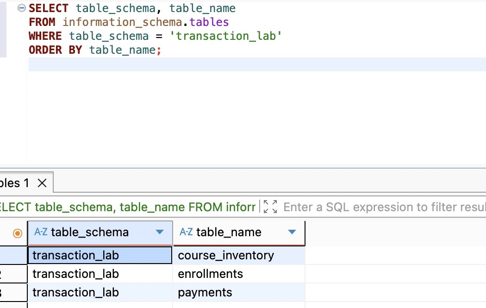
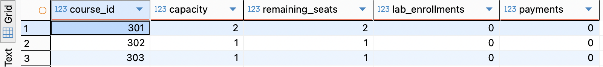
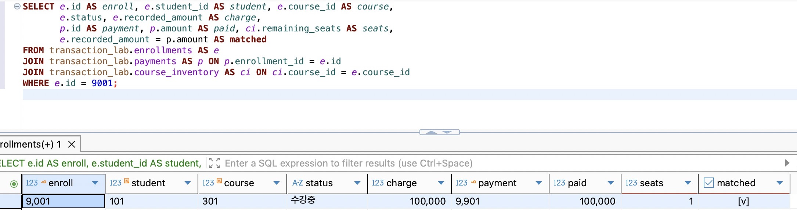
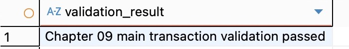

# Chapter 09 캡처 저장 및 Markdown 연결 방법

답안 파일: `assignments/chapter09/chapter09_answer.md`
이미지 폴더: `assignments/chapter09/images/`

이미지 파일 저장과 답안의 Markdown 이미지 연결은 완료된 상태다.
교수자 템플릿의 질문·절·증거 화면·체크리스트를 보존했다.
핵심 증거 4장과 추가 검증 증거를 구분했으며, 추가 증거는 답안의 접힌 영역에서 열 수 있다.

## 저장 파일과 화면 내용

| 구분 | 저장 파일명 | 화면 내용 |
| --- | --- | --- |
| 핵심 | `step02_schema.png` | transaction_lab의 세 테이블 구조 |
| 핵심 | `step03_seed.png` | 초기 좌석과 신청·결제 전체 건수 |
| 핵심 | `step04_commit.png` | COMMIT 후 좌석·신청·결제 관계 재조회 |
| 추가 | `step04_before_begin.png` | BEGIN 전 좌석 2와 신청·결제 없음 |
| 추가 | `step04_inside_transaction.png` | COMMIT 전 같은 세션에서 조회한 실제 행 |
| 추가 | `step04_commit_validation.png` | 첫 COMMIT 검증 통과 |
| 추가 | `step05_rollback.png` | 임시 변경 취소 및 이전 COMMIT 보존 검증 통과 |
| 추가 | `step06_sold_out.png` | 좌석 부족 처리 검증 통과 |
| 핵심 | `step07_validation.png` | 주 실습 최종 정합성 검증 통과 |
| 추가 | `step07_final_rows.png` | 최종 좌석·신청·결제 상세 |
| 추가 | `step07_project_preserved.png` | course_project 원본 집계 보존 |
| 추가 | `step09_lock.png` | 두 세션 잠금 대기 시간 초과 |
| 추가 | `step09_session_a.png` | 잠금 소유 세션 A |
| 추가 | `step09_session_b.png` | 다른 PID의 세션 B |
| 추가 | `step09_timeout_setting.png` | 세션 B의 lock_timeout 5s |
| 추가 | `step09_retry.png` | 잠금 해제 후 B의 재시도 결과 |
| 추가 | `step10_cancel.png` | 취소 재시도 및 ROLLBACK 원상복구 검증 통과 |
| 추가 | `step11_duplicate_error.png` | 중복 활성 신청 고유 제약 오류 23505 |
| 추가 | `step11_aborted.png` | 오류 후 일반 SELECT의 25P02 오류 |
| 추가 | `step11_savepoint.png` | SAVEPOINT 복구 후 좌석 1 및 신청 9003 0건 |

## VS Code에서 이미지 넣는 문법

답안 Markdown 파일에는 다음처럼 적는다. 아래 코드의 `!`가 이미지 표시를 뜻한다.
대괄호는 그림 설명, 소괄호는 **답안 파일 기준 상대 경로**다.

```markdown




```

이미지 문법을 ` ```markdown ` 코드 블록으로 감싸면 그림 대신 코드가 보인다.
실제 답안에서는 위 `` 줄 자체만 넣는다.

## 직접 캡처를 바꾸어 저장할 때

1. Mac에서 `Shift + Command + 4`를 누르고 필요한 SQL과 결과 표 영역을 선택한다.
2. 위쪽 보라색 표시와 마우스가 영역에 들어가지 않게 한다.
3. 캡처 파일을 위 표의 파일명으로 바꾼다. 확장자는 `.png`를 유지한다.
4. `assignments/chapter09/images/` 폴더에 넣어 같은 이름의 파일을 교체한다.
5. VS Code에서 `chapter09_answer.md`를 열고 `Shift + Command + V`로 미리보기를 확인한다.
6. 저장은 `Command + S`다. 이미지 경로는 `images/파일명.png`로 유지한다.

## 반영된 캡처 조건

- 스키마 구조: transaction_lab의 세 테이블을 확인할 수 있다.
- 초기 상태: 좌석 2·1·1, 신청·결제 각각 0건을 확인할 수 있다.
- COMMIT: 좌석·신청·결제의 ID, 학생, 금액과 일치 여부를 확인할 수 있다.
- 최종 검증: 공식 검증 통과 메시지와 최종 상세 행·원본 보존 집계가 있다.
- 두 세션: 서로 다른 PID, 5초 제한, 시간 초과, 잠금 해제 후 재시도 증거가 있다.
- 취소·SAVEPOINT: 통과 메시지, 실제 오류 코드와 복구 결과를 확인할 수 있다.
- 보라색 표시·마우스·접속 URL·비밀번호가 없도록 캡처의 필요한 영역만 사용했다.
- DB 값과 오류 문자열을 수정하지 않고 실제 캡처의 범위만 잘랐다.
