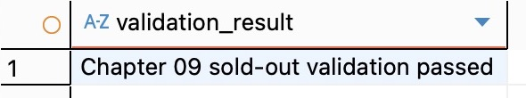

# Chapter 09 실행·캡처 안내

작성 파일은 [답안](chapter09_answer.md), 조회문은 [캡처 SQL](chapter09_capture.sql)이다. 아래대로 DBeaver에서 실행한 뒤 실제 결과만 답안에 옮긴다. 이 안내 작성 시점에는 Chapter 09 DB 실행을 하지 않았다.

## 1. 연결과 실행 방식

1. Chapter 07·08에서 사용한 PostgreSQL의 **ai_database_book**에 연결한다.
2. 진행 중인 다른 변경을 마무리한 새 SQL 에디터에서 시작한다. 각 파일의 BEGIN/COMMIT/ROLLBACK을 사용한다. DBeaver의 자동 오류 복구·자동 SAVEPOINT 설정은 선택 오류 실습 결과에 영향을 줄 수 있다.
3. 저장소의 `code/chapter09/`에 공식 SQL을 복사해 두었다. 파일을 열고 스크립트 실행 기능을 사용한다. 기본 단축키는 보통 Alt+X(맥 Option+X)이며 설정에 따라 다르므로 **SQL 스크립트 실행** 메뉴를 기준으로 한다. 선택한 SQL만 실행할 때는 실행 메뉴에서 선택 범위를 확인한다.
4. SQL 오류가 나오면 다음 파일로 넘어가지 않는다. 해당 연결에서 `ROLLBACK;`으로 오류 상태를 끝낸 뒤 원인을 확인한다. 오류를 무시하고 나머지 파일을 계속 실행하지 않는다.
5. 01~05는 순서와 시작 상태가 정해져 있으므로 성공한 파일을 무작정 반복하지 않는다. 이미 transaction_lab이 있으면 먼저 현재 상태를 조회한다. `reset_transaction_lab.sql`은 lab 데이터를 삭제하므로 처음부터 재실습하기로 결정한 경우에만 사용한다.

초기 좌석은 **실제 02 SQL의 2/1/1**이다. 공식 템플릿과 README의 3/0/0 설명은 실행 코드와 불일치한다. course_project나 공식 SQL을 3/0/0에 맞춰 변경하지 않는다.

## 2. 주 실습 순서와 멈출 위치

| 순서 | 열 파일 | 실행 및 기록 | 기대 결과 |
| --- | --- | --- | --- |
| 사전 | chapter09_capture.sql A | 환경·원본 집계 조회 | 원본 3/2/3/5, 590000·340000·440000 |
| 01 | 01_transaction_lab_schema.sql | 전체 실행 | schema validation passed |
| 02 | 02_transaction_lab_seed.sql | 전체 실행 후 캡처 SQL B | 좌석 2/1/1, 신청·결제 0/0 |
| 03 전 | chapter09_capture.sql C | 같은 연결에서 조회 | 301 좌석 2, 9001·9901 없음 |
| 03 중 | 03_commit_transaction.sql | **첫 COMMIT; 직전까지** 선택 실행 | 내부 좌석 1, 신청·결제 존재 |
| 03 기록 | chapter09_capture.sql C | 03을 실행한 같은 연결에서 조회 | 내부 상태를 답안 4-2에 기록 |
| 03 후 | 03_commit_transaction.sql | 남은 COMMIT;부터 파일 끝까지 실행 후 C 조회 | 좌석 1, 9001/9901/100000 |
| 04 전 | chapter09_capture.sql D | 같은 연결에서 조회 | 302 좌석 1, 9002·9902 없음 |
| 04 중 | 04_rollback_transaction.sql | **첫 ROLLBACK; 직전까지** 선택 실행 후 D 조회 | 302 좌석 0, 학생 102의 9002·9902 존재 |
| 04 후 | 04_rollback_transaction.sql | 남은 ROLLBACK;부터 끝까지 실행 후 D 조회 | 302 좌석 1, 임시 행 없음, 이전 9001·9901 유지 |
| 05 | 05_commit_and_sold_out.sql | 전체 실행, 좌석 부족 블록의 RETURNING 빈 결과·영향 행 수 확인 후 E 조회 | 최종 9002는 학생 103, 9003·9903 없음 |
| 06 | 06_transaction_validation.sql | 전체 실행 후 F와 A 원본 집계 조회 | main transaction validation passed |

03과 04는 **파일 내부 DO 블록의 세미콜론을 경계로 자르지 말고** 실제 최상위 COMMIT/ROLLBACK 직전에서 나눈다. 다른 에디터가 다른 세션이면 내부 미확정 변경이 보이지 않을 수 있으므로 같은 연결에서 C·D를 실행한다. 편하다면 C·D의 SELECT를 공식 파일의 해당 위치에 에디터상으로만 끼워 넣어 실행하고 공식 저장 파일은 그대로 둔다.

공식 05의 좌석 부족 시도는 `seat → new_enrollment → payments`로 연결된다. 마지막 INSERT의 영향 행 수 0을 내부 UPDATE의 직접 표시값과 혼동하지 않는다. UPDATE 0을 직접 관찰하려면 **05 성공 후** 다음 작은 블록을 추가 실행한다. 좌석 0이므로 변경은 없고 끝에 ROLLBACK한다. 이 추가 확인은 공식 CTE의 실행 결과 자체를 대신하지 않는다.

```sql
BEGIN;
UPDATE transaction_lab.course_inventory
SET remaining_seats = remaining_seats - 1
WHERE course_id = 302 AND remaining_seats > 0
RETURNING course_id, remaining_seats;
-- 반환 0행과 UPDATE 영향 행 수 0을 확인한다.
ROLLBACK;
```

## 3. 캡처 4장

| 파일 이름 | 촬영 시점 | 화면에 담을 내용 |
| --- | --- | --- |
| images/step02_schema.png | 02 직후 | transaction_lab의 세 테이블 트리, B의 좌석 2/1/1·0/0, 생성/Seed 통과 메시지 |
| images/step04_commit.png | 03 COMMIT 후 | C의 9001·9901·100000·남은 좌석 1과 첫 COMMIT 통과 메시지 |
| images/step06_sold_out.png | 05와 추가 UPDATE 0 확인 후 | UPDATE 영향 행 수 0·빈 RETURNING 또는 Output, E의 9003/9903=0·총 2/2 |
| images/step07_validation.png | 06 직후 | 최종 통과 메시지와 F의 좌석 1/0/1·seats_match=true, 가능하면 원본 집계 |

화면 한 장에 다 담기 어려우면 결과 창 높이를 조절하고 핵심 결과를 선택한다. 캡처 결과를 편집해 수치를 만들거나 통과 메시지를 SQL 상수로 출력해 대체하지 않는다. 04의 전·중·후는 답안에 실제 값을 기록하고 필요하면 추가 캡처한다.

스크린샷을 `assignments/chapter09/images/` 아래 위 이름으로 저장한다. 답안에 코드 블록으로 적힌 이미지 삽입 예시를 코드 블록 밖 실제 이미지 링크로 바꾼다. 6절에는 다음을 추가한다.

```markdown

```

## 4. 선택 실습

Lock을 실제 수행하려면 캡처 SQL G의 블록을 **서로 다른 연결 세션**에 나누어 실행한다. 에디터 탭만 두 개 여는 것으로는 충분하지 않으므로 `pg_backend_pid()`가 다른지 확인한다. A가 잠금 유지 → B가 대기 → 5초 timeout을 확인 → A ROLLBACK → B ROLLBACK 순서면 된다. B timeout 전에 A가 종료되면 B가 잠금을 얻는 정상 흐름이다. 답안에는 관찰한 흐름만 적는다.

08은 파일 전체 실행 후 취소 복구 메시지를 확인한다. 09는 의도적 오류 구문이 주석 처리되어 있으므로 주석을 해제한 해당 문장들을 단계별로 실행한다. 오류 뒤 ROLLBACK TO SAVEPOINT를 직접 실행해야 하며 전체 스크립트를 무시하고 계속 실행하지 않는다. 선택 실습 뒤 06을 다시 실행해 기준 상태 보존을 확인한다.

IDENTITY 결번까지 직접 확인하고 싶다면 lab 업무 테이블 대신 아래 **임시 테이블**로 확인한다. CREATE는 트랜잭션 밖에서 먼저 실행한다. 수동 커밋 모드이면 CREATE 직후 COMMIT을 실행해 생성부터 확정한다. nextval 할당은 보통 취소돼도 회수되지 않는다.

```sql
CREATE TEMP TABLE chapter09_identity_demo (
    id integer GENERATED ALWAYS AS IDENTITY PRIMARY KEY,
    memo text NOT NULL
);
COMMIT;
BEGIN;
INSERT INTO chapter09_identity_demo (memo) VALUES ('취소할 행') RETURNING id;
ROLLBACK;
BEGIN;
INSERT INTO chapter09_identity_demo (memo) VALUES ('남길 행') RETURNING id;
COMMIT;
SELECT * FROM chapter09_identity_demo;
DROP TABLE chapter09_identity_demo;
COMMIT;
```

새 임시 테이블이면 첫 번호 1은 취소되고 남은 행 번호는 2로 예상한다. 실측했다면 5-3에 결과를 추가한다. 자동 커밋에서는 트랜잭션 밖 COMMIT의 경고가 나올 수 있으나 데이터 오류는 아니다.

## 5. 내가 최종 작성·확인할 부분

- 답안의 **실행 후 입력**을 실제 환경·행 수·금액·메시지로 채운다. 기대값을 그대로 복사하지 말고 비교한다.
- 4절 전·중·후 및 5절 ROLLBACK 후 상태를 기록한다.
- 선택 실습은 실제 수행과 절차 분석을 구분한다. 미수행을 수행했다고 바꾸지 않는다.
- 12절 설계, 13절 AI 제안 선택, 14절 성찰을 본인이 검토해 자신의 판단으로 수정한다.
- 캡처 4장을 첨부하고 확인한 체크리스트만 체크한다.
- 실제 비밀번호·전체 접속 URL·개인정보가 없는지 확인한다.

실제 결과·캡처 반영 후 저장소 루트에서 다음을 실행한다. 기존 Chapter 06의 추적되지 않은 이미지는 이 과제 커밋에 포함하지 않는다.

```bash
git add assignments/chapter09 code/chapter09
git commit -m "9장 트랜잭션 실습 결과와 캡처 반영"
git push origin main
```

현재 브랜치가 main인지 먼저 확인한다. push 후 [본인 답안 파일](https://github.com/ssossocoder/ai-database-study/blob/main/assignments/chapter09/chapter09_answer.md)에서 이미지와 Markdown을 확인하고 그 URL을 LMS에 제출한다.
