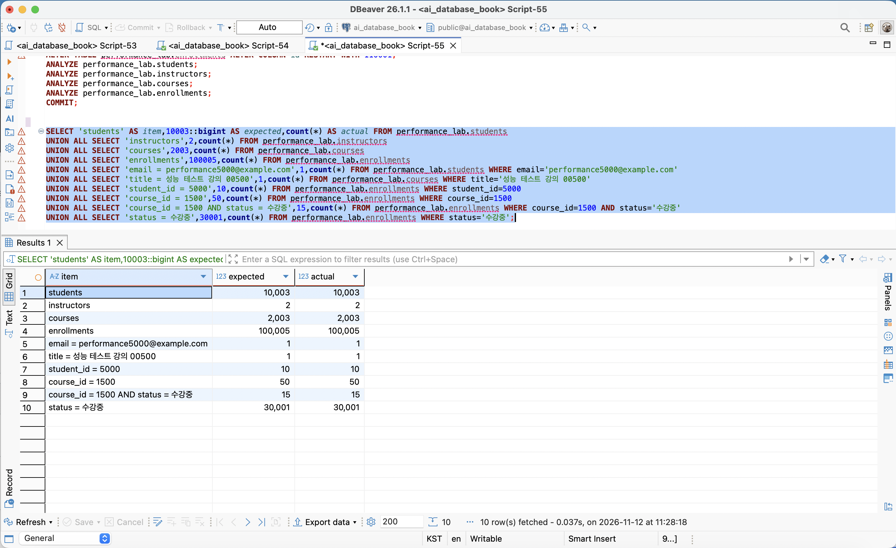
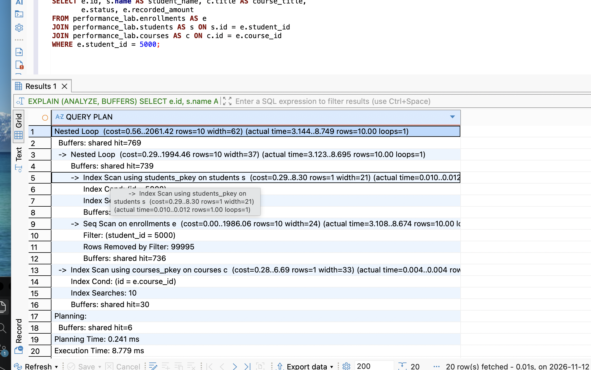
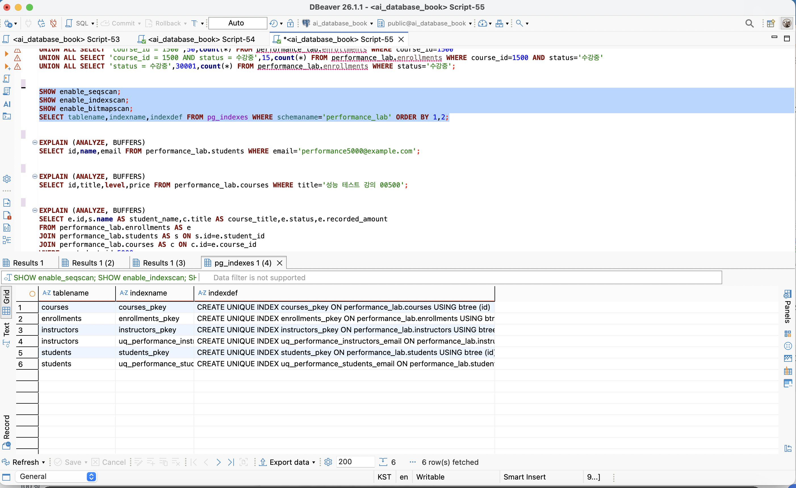
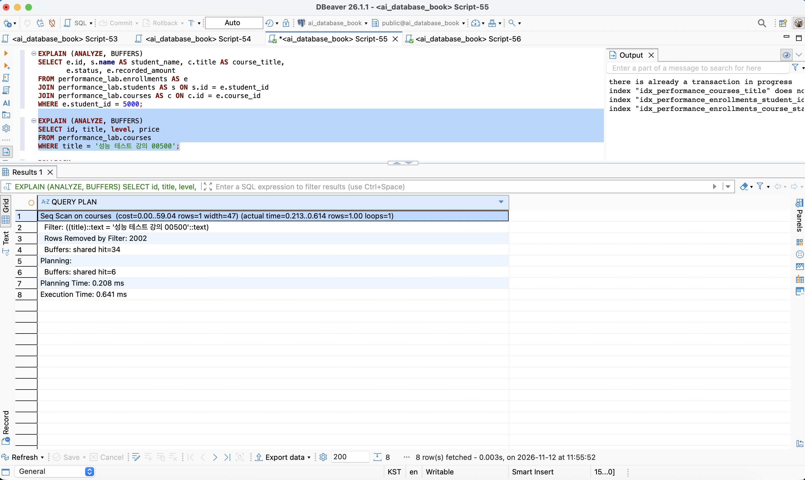
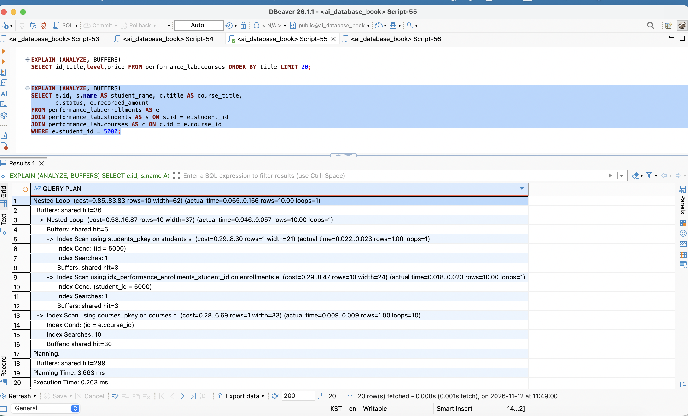
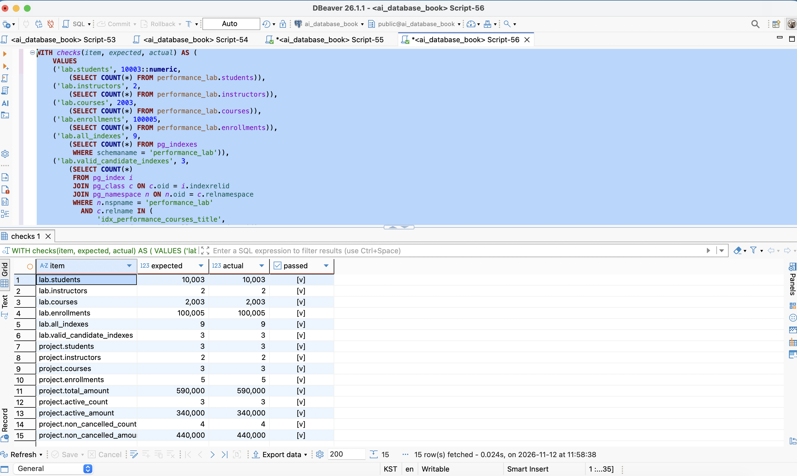

# Chapter 10 확장 실습 답안

```text
GitHub 계정 또는 별칭: ssossocoder
과제 작성일: 2026-11-12
사용한 AI 도구: Codex
```

# 1. PostgreSQL 버전과 시작 환경 확인

| 확인 항목 | 실제 결과 | 의미 |
| --- | --- | --- |
| PostgreSQL 버전 | PostgreSQL 18.6 / aarch64-apple-darwin24.6.0 / 64-bit | 과제의 기준 버전 16과 구별하여 해석 |
| `current_database()` | ai_database_book | 수강신청 실습 DB |
| `current_user` | postgres | 실행 역할 |
| `current_schema()` | public | 기본 스키마 |
| `search_path` | `"$user", public` | 이름을 해석하는 탐색 순서 |

확인 SQL:

```sql
SELECT version();
SELECT current_database();
SELECT current_user;
SELECT current_schema();
SHOW search_path;
```

### PostgreSQL 버전을 기록해야 하는 이유

같은 SQL도 버전별 최적화 기능에 따라 실행 계획이 달라질 수 있기 때문이다. 이번 서버는 PostgreSQL 18.6이므로 기준 버전 16과 구분해서 기록했다.

# 2. Chapter 07·08 기준 상태 확인

### 실제 확인 결과

실험 전후 원본 4개 테이블의 모든 행이 동일했다. 공식 최종 검증에서 명명 제약조건 15개와 NOT NULL 열 20개, 활성 신청 부분 고유 인덱스도 유지됨을 확인했다.

| 항목 | 기대값 | 실제값 |
| --- | --- | --- |
| students / instructors / courses / enrollments | 3 / 2 / 3 / 5 | 3 / 2 / 3 / 5 |
| 전체 recorded_amount | 590000 | 590000 |
| 활성 건수 / 금액 | 3 / 340000 | 3 / 340000 |
| 취소 제외 건수 / 금액 | 4 / 440000 | 4 / 440000 |
| 신청 1001 | 완료 / 100000 | 완료 / 100000 |
| 신청 1004 | 취소 / 150000 | 취소 / 150000 |
| 신청 1005 | 신청 / 120000 | 신청 / 120000 |

### 성능 실험을 기존 course_project에 대량 데이터를 넣지 않고 별도 스키마에서 하는 이유

기존 course_project에 대량 데이터를 넣으면 이전 장의 기준 건수·금액·분포가 바뀐다. 변경을 performance_lab에 한정하고 원본은 조회만 했다. 스키마 분리가 쓰기 금지를 보장하지는 않으므로 최종 검증에서도 원본의 상태를 다시 확인했다.

# 3. performance_lab 생성과 대량 데이터 확인

실행 순서:

```text
01_performance_lab_schema.sql
02_performance_lab_seed.sql
```

## 3-1. 생성 후 행 수

| 테이블 | 기대 행 수 | 실제 행 수 | 일치 여부 |
| --- | ---: | --- | --- |
| performance_lab.students | 10003 | 10003 | 일치 |
| performance_lab.instructors | 2 | 2 | 일치 |
| performance_lab.courses | 2003 | 2003 | 일치 |
| performance_lab.enrollments | 100005 | 100005 | 일치 |

## 3-2. 데이터 분포와 선택도

2026-11-12 11:28:18 DBeaver에서 실행한 규모·분포 요약의 expected와 actual을 비교했다. 네 테이블의 행 수와 여섯 조회 조건의 건수가 모두 일치했다. 아래 비율은 확인된 건수로 계산한 근삿값이다.

| 조건 | 기대 행 수 | 실제 행 수 | 해당 테이블 대비 실제 반환 비율 |
| --- | ---: | --- | ---: |
| email = performance5000@example.com | 1 | 1 | 약 0.010% |
| title = 성능 테스트 강의 00500 | 1 | 1 | 약 0.050% |
| student_id = 5000 | 10 | 10 | 약 0.010% |
| course_id = 1500 | 50 | 50 | 약 0.050% |
| course_id = 1500 AND status = 수강중 | 15 | 15 | 약 0.015% |
| status = 수강중 | 30001 | 30001 | 약 30.0% |

### 선택도가 낮은 조건과 많은 행을 반환하는 조건은 인덱스 판단에서 어떻게 다르게 볼 수 있나요?

소수 행을 반환하는 조건은 인덱스로 읽을 범위를 줄일 가능성이 크다. 많은 행을 반환하면 인덱스 탐색 뒤 테이블을 방문하는 비용이 커질 수 있으므로 Seq Scan과 실제 버퍼·시간을 비교한다.



# 4. 인덱스 생성 전 기준 계획 기록

`03_baseline_explain.sql`을 후보 인덱스가 없는 상태에서 먼저 실행했다. 자동 인덱스 6개 상태를 확인하고, 아래 세 SQL을 포함한 8개 조회의 최초 계획을 후보 생성 전에 저장했다.

## Query A — 강의 제목 정확 일치

- 업무 질문: 제목이 정확히 일치하는 강의의 ID·제목·등급·가격은 무엇인가?
- WHERE: title 정확 일치
- JOIN / ORDER BY / LIMIT: 없음
- 예상 반환 행 수: seed 기준 1행
- 실제 반환 행 수: 1행

```sql
EXPLAIN (ANALYZE, BUFFERS)
SELECT id, title, level, price
FROM performance_lab.courses
WHERE title = '성능 테스트 강의 00500';
```

## Query B — 학생별 신청과 학생·강의 정보

- 업무 질문: 학생 5000의 신청 내역과 학생명·강의명·상태·신청 금액은 무엇인가?
- WHERE: e.student_id = 5000
- JOIN: students PK, courses PK
- ORDER BY / LIMIT: 없음
- 예상 반환 행 수: seed 기준 10행
- 실제 반환 행 수: 10행

```sql
EXPLAIN (ANALYZE, BUFFERS)
SELECT e.id, s.name AS student_name, c.title AS course_title,
       e.status, e.recorded_amount
FROM performance_lab.enrollments AS e
JOIN performance_lab.students AS s ON s.id = e.student_id
JOIN performance_lab.courses AS c ON c.id = e.course_id
WHERE e.student_id = 5000;
```

## Query C — 특정 강의의 수강중 신청

- 업무 질문: 강의 1500에서 수강중인 신청 내역은 무엇인가?
- WHERE: course_id = 1500 AND status = 수강중
- JOIN / ORDER BY / LIMIT: 없음
- 예상 반환 행 수: seed 기준 15행
- 실제 반환 행 수: 15행

```sql
EXPLAIN (ANALYZE, BUFFERS)
SELECT id, student_id, course_id, status, recorded_amount
FROM performance_lab.enrollments
WHERE course_id = 1500 AND status = '수강중';
```

## 기준 계획 기록표

아래 시간은 터미널 반복 측정의 첫 회다. DBeaver 캡처의 단발 수치와 구분한다.

| 관찰 항목 | Query A | Query B | Query C |
| --- | --- | --- | --- |
| 주요 Scan / 계획 노드 | Seq Scan on courses | Nested Loop, 신청 Seq Scan, 학생·강의 PK Index Scan | Seq Scan on enrollments |
| estimated rows | 1 | 10 | 15 |
| actual rows / loops | 1 / 1 | 10 / 1 | 15 / 1 |
| Filter / Rows Removed by Filter | title 조건 / 2002 | student_id = 5000 / 99995 | course_id = 1500 AND status = 수강중 / 99990 |
| Index Cond / 사용 인덱스 | 없음 | 신청 테이블에는 없음; 학생 PK(id=5000), 강의 PK(id=e.course_id) | 없음 |
| 실행 Buffers shared hit / read | 34 / 0 | 769 / 0 | 736 / 0 |
| Planning Time | 0.005 ms | 0.062 ms | 0.008 ms |
| Execution Time | 0.072 ms | 2.413 ms | 2.885 ms |

### cost와 실제 실행 시간이 같은 개념이 아닌 이유

`cost`는 비용 매개변수로 계산한 상대적인 추정값이고, 실제 실행 시간의 ms 값이 아니다. estimated rows는 노드가 출력할 행 수의 추정치이며 actual rows와 구분한다. loops가 여러 번이면 표시된 actual rows·time이 반복당 평균이라는 점도 확인한다. [EXPLAIN 공식 문서](https://www.postgresql.org/docs/18/using-explain.html)

### EXPLAIN ANALYZE는 실제 SQL을 실행한다는 점을 왜 기억해야 하나요?

`EXPLAIN ANALYZE`는 SQL을 실제 실행하므로 변경문에 붙이면 데이터도 변경할 수 있다. 이번 비교는 SELECT에만 적용한다. 결과 데이터 대신 계획을 출력하므로 반환 데이터의 정합성은 별도 조회와 최종 Validation으로 확인한다.



<details>
<summary>추가 증거: 인덱스 목록과 제목 검색</summary>





</details>


DBeaver 캡처의 제목 검색은 0.641ms, JOIN은 10.771ms다. 캡처 재실행에서는 트랜잭션 안에서 후보 인덱스를 잠시 제외해 기준 상태를 재현하고 ROLLBACK으로 복원했다. 최초 기준 계획은 이 재현과 별도로 인덱스 생성 전에 확보했다. 캡처의 단발 시간과 본 측정의 반복값을 섞지 않았다.

# 5. 후보 인덱스를 만들기 전에 이유 작성

| 후보 인덱스 | 대응 조회 패턴 | 예상 이점 | 컬럼 순서 이유 | 예상 비용 / 단점 |
| --- | --- | --- | --- | --- |
| idx_performance_courses_title | 제목 정확 일치, ORDER BY title, LIMIT 20 | 제목 검색과 정렬 순서 활용 | 단일 검색·정렬 키 title | 추가 공간, 강의 INSERT 및 title 변경 시 유지 비용 |
| idx_performance_enrollments_student_id | 학생별 신청 조회와 JOIN | 전체 신청 중 학생 1명의 신청을 먼저 축소 | 필터 대상인 student_id | 신청 INSERT 및 student_id 변경 시 유지 비용 |
| idx_performance_enrollments_course_status | 강의별 신청, 특정 강의의 상태별 신청 | course_id와 두 조건을 모두 지원 | course_id 단독 조회도 있으므로 앞에 배치 | 추가 공간, 신청 INSERT와 status 변경 시 유지 비용 |

### “중요한 컬럼이므로 인덱스를 만든다”는 설명이 부족한 이유

“중요한 컬럼”이라는 이유만으로는 검색 빈도, 조건별 반환 비율, 기존 인덱스 중복, 정렬과 쓰기 비용을 설명하지 못한다. 실제 SQL의 필터와 접근 순서에 맞춰 판단해야 한다.

### (course_id, status)와 (status, course_id)가 항상 같은 효과가 아닌 이유

두 컬럼 모두 동등 조건이면 `(course_id, status)`와 `(status, course_id)`가 모두 유용할 수 있다. 그러나 course_id만 사용하는 조회까지 함께 지원하려는 목적에서는 전자가 자연스럽다. 후행 컬럼만 사용하는 조회는 선행 컬럼의 고유값 수와 Skip Scan의 비용에 따라서도 달라지므로 두 순서를 항상 동등하다고 보지 않는다.

# 6. 후보 인덱스 생성

기준 계획을 저장한 다음에만 다음 DDL을 실행했다.

```sql
CREATE INDEX idx_performance_courses_title
ON performance_lab.courses(title);

CREATE INDEX idx_performance_enrollments_student_id
ON performance_lab.enrollments(student_id);

CREATE INDEX idx_performance_enrollments_course_status
ON performance_lab.enrollments(course_id, status);
```

| 구분 | 생성 후 기대값 | 실제 확인 |
| --- | ---: | --- |
| PK·UNIQUE 자동 인덱스 | 6 | 6 |
| 후보 인덱스 | 3 | 3 |
| 전체 인덱스 | 9 | 9 |
| 후보 중 invalid / not ready | 0 | 0 |

### PRIMARY KEY나 UNIQUE가 이미 인덱스를 만들 수 있는데 같은 목적의 인덱스를 또 만들면 어떤 문제가 생기나요?

PK·UNIQUE가 제공하는 인덱스와 같은 목적의 인덱스를 추가하면 조회 이점은 중복되고 공간과 쓰기 유지 비용이 늘 수 있다. 예를 들어 학생 email은 UNIQUE 인덱스가 있으므로 같은 email 단일 인덱스를 추가할 이유부터 다시 확인한다.

# 7. 같은 SQL로 인덱스 후 재측정

03과 05의 8개 SELECT가 동일함을 확인했다. 같은 PostgreSQL 18.6 서버·DB·역할에서 별도 psql 세션을 사용했다. 각 SQL을 전후 1회 준비 실행한 뒤 5회 측정했다. 기준 측정 시각은 2026-11-12T11:41:37.412344+09:00, 사후 측정 시각은 2026-11-12T11:46:39.915744+09:00이다.

enable_seqscan/indexscan/bitmapscan은 모두 on, jit는 on, work_mem은 4MB, random_page_cost는 4였다. 모든 대상 테이블의 last_analyze와 last_autoanalyze가 전후 동일했다. 데이터·통계를 변경하거나 특정 Scan을 강제하지 않았다. 측정된 실행 shared read는 모두 0이므로 캐시에 올라온 데이터에 대한 비교로 해석한다.

## Query A 전후 비교

| 항목 | Before | After |
| --- | --- | --- |
| 주요 계획 노드 | Seq Scan | Index Scan: idx_performance_courses_title |
| actual rows | 1 | 1 |
| 실행 Buffers hit / read | 34 / 0 | 3 / 0 |
| Execution Time 1~5회 (ms) | 0.072 / 0.088 / 0.071 / 0.071 / 0.069 | 0.003 / 0.003 / 0.003 / 0.003 / 0.003 |
| Execution Time 중앙값 (ms) | 0.071 | 0.003 |
| Index Cond (신규 후보) | 없음 | ((title)::text = '성능 테스트 강의 00500'::text) |

## Query B 전후 비교

| 항목 | Before | After |
| --- | --- | --- |
| 주요 계획 노드 | Nested Loop + 신청 Seq Scan | Nested Loop + 신청 Index Scan |
| actual rows | 10 | 10 |
| 실행 Buffers hit / read | 769 / 0 | 36 / 0 |
| Execution Time 1~5회 (ms) | 2.413 / 2.567 / 2.269 / 2.248 / 2.245 | 0.028 / 0.018 / 0.025 / 0.017 / 0.015 |
| Execution Time 중앙값 (ms) | 2.269 | 0.018 |
| Index Cond (신규 후보) | 없음 | (student_id = 5000) |

## Query C 전후 비교

| 항목 | Before | After |
| --- | --- | --- |
| 주요 계획 노드 | Seq Scan | Bitmap Heap Scan + Bitmap Index Scan |
| actual rows | 15 | 15 |
| 실행 Buffers hit / read | 736 / 0 | 17 / 0 |
| Execution Time 1~5회 (ms) | 2.885 / 3.089 / 2.971 / 2.814 / 2.801 | 0.008 / 0.008 / 0.012 / 0.009 / 0.008 |
| Execution Time 중앙값 (ms) | 2.885 | 0.008 |
| Index Cond (신규 후보) | 없음 | ((course_id = 1500) AND ((status)::text = '수강중'::text)) |

A는 버퍼가 34→3, B는 JOIN 전체에서 769→36, C는 736→17로 줄었다. B의 신청 테이블 자체는 736→3 버퍼로 줄었으며 강의 PK 조회 10회는 유지했다. C는 일반 Index Scan 대신 Bitmap 접근이 선택되었지만 접근량과 시간이 줄어 개선으로 판단했다.

8개 조회 모두 전후 행 수와 정렬된 JSON 결과의 MD5 지문이 일치했다. 지문 비교만을 완전한 증명으로 삼지 않고 동일 SQL, 데이터 변경 없음, 원본 전체 행 비교, 공식 Validation 결과를 함께 확인했다.

### Index Scan으로 바뀌었다는 사실만으로 성공이라고 할 수 없는 이유

Index Scan으로 바뀌었다는 사실만으로 성공을 판정하지 않았다. 상위 노드의 Buffers에 하위 작업이 포함될 수 있어 노드별 값을 단순 합산하지 않았다. shared read를 디스크 장치의 물리 읽기 횟수와 같다고 보지도 않았다.

## 전체 8개 SQL 반복 측정값

| 조회 | Before 1~5회 (ms) | After 1~5회 (ms) | 중앙값 Before → After (ms) |
| --- | --- | --- | --- |
| 이메일 | 0.007 / 0.008 / 0.007 / 0.004 / 0.003 | 0.011 / 0.004 / 0.005 / 0.004 / 0.003 | 0.007 → 0.004 |
| 제목 A | 0.072 / 0.088 / 0.071 / 0.071 / 0.069 | 0.003 / 0.003 / 0.003 / 0.003 / 0.003 | 0.071 → 0.003 |
| 학생별 JOIN B | 2.413 / 2.567 / 2.269 / 2.248 / 2.245 | 0.028 / 0.018 / 0.025 / 0.017 / 0.015 | 2.269 → 0.018 |
| 강의 단독 | 2.568 / 2.648 / 2.471 / 2.428 / 2.434 | 0.028 / 0.019 / 0.024 / 0.019 / 0.019 | 2.471 → 0.019 |
| 강의+상태 C | 2.885 / 3.089 / 2.971 / 2.814 / 2.801 | 0.008 / 0.008 / 0.012 / 0.009 / 0.008 | 2.885 → 0.008 |
| 상태 단독 | 5.022 / 4.778 / 4.742 / 4.813 / 4.705 | 4.942 / 4.914 / 5.077 / 4.729 / 4.765 | 4.778 → 4.914 |
| 전체 정렬 | 0.574 / 0.528 / 0.516 / 0.509 / 0.512 | 0.204 / 0.196 / 0.195 / 0.194 / 0.183 | 0.516 → 0.195 |
| 정렬+LIMIT | 0.242 / 0.231 / 0.230 / 0.228 / 0.231 | 0.010 / 0.010 / 0.006 / 0.006 / 0.006 | 0.231 → 0.006 |



DBeaver 사후 JOIN 캡처는 10행, shared hit 36, Execution Time 0.263ms, Planning Time 3.663ms다. 계획 수립 시간과 실행 시간을 구분한다. 터미널 JOIN 5회 중앙값 0.018ms와 캡처 단발 시간도 별도 기록으로 유지한다.

# 8. status 단독 조회와 Seq Scan 해석

```sql
EXPLAIN (ANALYZE, BUFFERS)
SELECT id, student_id, course_id, status
FROM performance_lab.enrollments
WHERE status = '수강중';
```

| 항목 | Before | After |
| --- | --- | --- |
| 주요 노드 | Seq Scan | Seq Scan |
| estimated rows | 29961 | 29961 |
| actual rows | 30001 | 30001 |
| Rows Removed by Filter | 70004 | 70004 |
| 실행 Buffers hit / read | 736 / 0 | 736 / 0 |
| Execution Time 중앙값 (ms) | 4.778 | 4.914 |

### 인덱스가 존재해도 PostgreSQL이 Seq Scan을 선택할 수 있는 이유

수강중 조건은 약 30%를 반환하도록 설계되어 있다. 행들이 넓게 분포하면 인덱스를 찾은 뒤 많은 테이블 페이지를 방문하기보다 테이블을 순차적으로 읽는 편이 쌀 수 있다. 따라서 인덱스가 있어도 Seq Scan을 선택하는 것은 합리적일 수 있다.

### “Seq Scan = 나쁜 계획”이라고 단정하면 안 되는 이유

이번처럼 전체의 약 30%를 반환하는 경우 순차 접근이 합리적일 수 있다. 실제 status 단독 계획에서도 버퍼 감소나 반복 시간 개선은 없었다.

### PostgreSQL 16과 18 이상에서 복합 B-tree 후행 컬럼 조건의 계획이 다를 수 있는 이유

PostgreSQL 16과 18은 후행 조건의 최적화 가능성이 다르다. 18에서도 선행 course_id의 고유값이 많거나 반환 범위가 넓으면 Skip Scan보다 다른 접근이 유리할 수 있다. 이번 18.6 서버에서는 전후 모두 Seq Scan을 관찰했고 Skip Scan은 선택되지 않았다. 버퍼가 736으로 같고 중앙값도 4.778→4.914ms여서 이 조회의 개선을 주장하지 않는다.

# 9. ORDER BY와 LIMIT에서 인덱스 관찰

```sql
EXPLAIN (ANALYZE, BUFFERS)
SELECT id, title, level, price
FROM performance_lab.courses
ORDER BY title;

EXPLAIN (ANALYZE, BUFFERS)
SELECT id, title, level, price
FROM performance_lab.courses
ORDER BY title
LIMIT 20;
```

| 조건 / 지표 | Before | After |
| --- | --- | --- |
| ORDER BY title | Seq Scan → Sort(quicksort) | title Index Scan, Sort 없음 |
| actual rows | 2003 | 2003 |
| Buffers hit / read | 34 / 0 | 49 / 0 |
| Execution Time 중앙값 (ms) | 0.516 | 0.195 |
| ORDER BY title LIMIT 20 | Seq Scan → Sort(top-N heapsort) → Limit | title Index Scan → Limit, Sort 없음 |
| actual rows | 20 | 20 |
| Buffers hit / read | 34 / 0 | 3 / 0 |
| Execution Time 중앙값 (ms) | 0.231 | 0.006 |

### LIMIT이 있을 때 PostgreSQL이 전체 정렬보다 인덱스 순서를 활용하는 것이 유리할 수 있는 이유

title B-tree가 정렬 순서를 제공하면 별도 Sort를 생략하고 LIMIT에 필요한 행에서 멈출 수 있다. 전체 반환에서는 순차 읽기 후 정렬이 더 저렴할 수도 있다. 실제 계획의 Sort 유무, Sort Method, 사용 인덱스, Limit 하위 노드의 actual rows·Buffers를 비교했다. [인덱스와 정렬 공식 문서](https://www.postgresql.org/docs/18/indexes-ordering.html)


### 실제 계획에서 Sort 노드 또는 Index Scan을 어떻게 확인했나요?

LIMIT 전에는 강의 2003행을 읽어 상위 20개를 골랐지만 인덱스 후에는 정렬 순서대로 20행을 읽고 멈췄다. 전체 정렬은 시간이 줄어도 Buffers가 34→49로 늘었다. 인덱스의 효과를 버퍼 감소 하나로 일반화하지 않았다.

# 10. 인덱스 검토

## 10-1. 인덱스별 판단

통계 관찰 시점: 2026-11-12T11:47:07.492953+09:00

| 인덱스 | 크기 / 사용 관찰 | 유지 / 보류 / 제거 | 판단 근거 |
| --- | --- | --- | --- |
| idx_performance_courses_title | 122,880 bytes (120 KiB), idx_scan=27 | 유지 | 제목 검색과 정렬·LIMIT에 사용 |
| idx_performance_enrollments_student_id | 958,464 bytes (936 KiB), idx_scan=13 | 유지 | 학생별 JOIN의 버퍼 접근 감소 |
| idx_performance_enrollments_course_status | 983,040 bytes (960 KiB), idx_scan=45 | 유지 | 강의 단독·복합 조건의 Bitmap 접근에 사용 |

후보 3개는 모두 valid=true, ready=true였으며 추가 공간은 합계 2,064,384 bytes, 약 1.97MiB였다. 사용 통계에는 실습 조회와 검증 SQL이 포함되어 있다.

### idx_scan = 0이라는 이유 하나만으로 인덱스를 삭제하면 안 되는 이유

통계 초기화 시점과 관찰 기간을 함께 확인해야 하고, 제약조건이나 드물지만 중요한 조회에 쓰일 수 있기 때문이다. 이번 stats_reset은 NULL이어서 초기화 시각을 임의로 가정하지 않았다. idx_scan을 사용자 SQL 횟수와 항상 같은 값으로 해석하지 않았다.

### 외래키 자식 컬럼 인덱스가 무결성 자체의 필수 조건은 아니지만 성능상 필요할 수 있는 이유

FK는 인덱스가 없어도 참조 무결성을 검사한다. 자식 인덱스는 JOIN과 부모 삭제·키 변경 시 자식 검색을 줄일 수 있다. 기존 인덱스의 선두 컬럼과 실제 조회 조건을 확인한 뒤 판단한다.

### 인덱스를 많이 만들었을 때 생기는 쓰기·저장 비용

추가 인덱스는 공간을 사용하고 INSERT·DELETE와 키 컬럼 UPDATE에서 유지 비용과 WAL·백업 부담을 만든다. 특히 status를 포함한 후보는 상태 변경 시에도 관리된다. 저장 공간은 실측했지만 쓰기 지연 시간은 별도 측정하지 않았으므로 쓰기 성능 수치를 만들지 않았다.

# 11. 자동 완료 게이트

공식 07_result_validation.sql의 최종 검증을 통과했다. DBeaver 검증 요약에서도 15개 항목이 모두 true였다.

| 검증 대상 | 실제 결과 | 판정 |
| --- | --- | --- |
| performance_lab 행 수 | 10003 / 2 / 2003 / 100005 | 통과 |
| 이메일 / 제목 / 학생 / 강의 / 복합 / 전체 수강중 결과 | 1 / 1 / 10 / 50 / 15 / 30001 | 통과 |
| 신청 / 수강중 / 완료 / 취소 분포 | 30002 / 30001 / 20001 / 20001 | 통과 |
| 활성 신청 중복 | 0건 | 통과 |
| 신청 금액과 강의 가격 불일치 | 0건 | 통과 |
| 생성 분포 | 성능 학생당 10건, 성능 강의당 50건 | 통과 |
| 인덱스 | 전체 9개, 후보 3개, 후보 모두 valid / ready | 통과 |
| 원본 보존 | 3 / 2 / 3 / 5행, 전체 590000, 활성 3 / 340000, 취소 제외 4 / 440000; 구조 기준 유지 | 통과 |

최종 검증 결과:

```text
Chapter 10 performance result validation passed
```

### 실행 계획 비교와 별도로 결과 행 동일성을 검증해야 하는 이유

빨라져도 조건 누락이나 JOIN 변경으로 결과가 달라지면 올바른 최적화가 아니기 때문이다. 동일 SQL을 유지하고 결과 건수·정렬된 결과 지문·원본 전체 행 비교와 공식 Validation을 함께 확인했다.



# 12. 인덱스 만능론 반박

## 주장 1

선택한 주장: B. 인덱스를 만들었는데 Seq Scan이면 실패다.

나의 반박: 많은 행과 페이지를 읽는 조건에서는 Seq Scan이 합리적일 수 있다.

실행 계획 근거: status 단독 조회는 30001행, 전후 모두 Seq Scan과 shared hit 736이었다. 중앙값도 4.778→4.914ms로 개선되지 않았다. 이 SQL에 대해서는 인덱스 효과를 주장하지 않았다.

## 주장 2

선택한 주장: D. 실행 시간이 한 번이라도 빨라졌으면 효과가 입증됐다.

나의 반박: 캐시·부하·계획 수립 등의 영향을 받으므로 반복 측정과 접근량을 함께 봐야 한다.

실행 계획 근거: 이메일 조회는 전후 같은 UNIQUE Index Scan과 3개 버퍼를 사용했는데도 중앙값이 0.007→0.004ms로 달랐다. 새 후보와 무관한 대조군에서도 미세한 시간 차이가 있었다. A·B·C에서는 5회 반복 시간과 함께 Index Cond, 버퍼 감소와 결과 동일성을 확인해 판단했다.

# 13. 개인 프로젝트 조회 패턴과 인덱스 후보

Chapter 08·09의 **청약 의사결정 노트**를 이어서 설계한다. [개인 프로젝트 기획안](https://github.com/ssossocoder/database-project/blob/main/database-project/01_proposal/proposal.md)의 회원·관심 공고·노트 관계를 기준으로 검토했다.

기획안은 구현 전 설계이므로 아래 SQL의 `created_at` 등은 확정 DDL의 컬럼명이 아닌 설계 후보이다. 실제 저장 구조와 기존 인덱스를 확인한 뒤 적용한다.

| ID | 반복 조회 질문 | WHERE | JOIN | ORDER BY / LIMIT | 예상 반환 비율 | 후보 인덱스 |
| --- | --- | --- | --- | --- | --- | --- |
| P10-Q01 | 로그인 회원이 최근 저장한 관심 공고 20개는? | w.app_user_id = 인증 회원 | announcement PK | w.created_at DESC, w.id DESC / 20 | 회원별 편차에 따라 측정 필요 | watchlist(app_user_id, created_at DESC, id DESC) |
| P10-Q02 | 내 관심 공고 하나에 최근 작성한 노트 20개는? | w.id = 대상 관심 ID, w.app_user_id = 인증 회원 | user_note.watchlist_id = w.id | n.created_at DESC, n.id DESC / 20 | 관심 공고별 노트 수에 따라 측정 필요 | user_note(watchlist_id, created_at DESC, id DESC) |

## 후보 1 — 회원별 최근 관심 목록

```sql
-- 구현 전 설계 SQL: 실제 프로젝트 DB에서 실행한 결과가 아님
SELECT w.id, w.announcement_id, w.created_at
FROM watchlist AS w
JOIN announcement AS a ON a.id = w.announcement_id
WHERE w.app_user_id = :authenticated_user_id
ORDER BY w.created_at DESC, w.id DESC
LIMIT 20;

CREATE INDEX idx_watchlist_user_created_id
ON watchlist(app_user_id, created_at DESC, id DESC);
```

회원 ID 동등 조건을 선두에 두고 그 범위에서 최신순으로 읽도록 설계했다. id는 생성 시각이 같은 행의 순서를 일정하게 만든다. 계획된 UNIQUE(app_user_id, announcement_id)도 회원별 필터를 지원할 수 있지만 created_at 정렬을 그대로 제공하지는 않는다. 기존 고유 인덱스와 비교하여 정렬 생략 효과가 실제로 필요한지 확인한다.

추가 공간과 관심 등록·삭제 시 유지 비용이 발생한다. **현재 판단은 후보로 보류**이다. 회원별 관심 목록이 매우 작다면 기존 고유 인덱스와 소규모 정렬로 충분할 수 있다.

## 후보 2 — 관심 공고별 최근 노트

```sql
-- 구현 전 설계 SQL: 실제 프로젝트 DB에서 실행한 결과가 아님
SELECT n.id, n.watchlist_id, n.content, n.created_at
FROM watchlist AS w
JOIN user_note AS n ON n.watchlist_id = w.id
WHERE w.id = :watchlist_id
  AND w.app_user_id = :authenticated_user_id
ORDER BY n.created_at DESC, n.id DESC
LIMIT 20;

CREATE INDEX idx_user_note_watchlist_created_id
ON user_note(watchlist_id, created_at DESC, id DESC);
```

watchlist_id 동등 조건 다음에 최신순 키를 배치했다. watchlist PK 조회와 회원 소유 조건은 유지한다. 인덱스가 권한 검사를 대신하지는 않는다. 긴 content는 정렬 키나 INCLUDE에 넣지 않고 테이블에서 필요한 행의 내용을 읽는 안을 우선 검토한다.

추가 공간과 노트 INSERT·삭제·키 컬럼 변경 시 유지 비용이 발생한다. **현재 판단은 후보로 보류**이다. 실제 노트 수와 정렬 비용을 먼저 측정한다.

## 데이터가 적을 때의 검증 계획

- 규모 후보: watchlist 10만 건, user_note 30만 건에서 시작하고 실제 예상 운영 규모도 함께 비교한다. 이는 적재 완료 건수가 아닌 실험 계획이다.
- 분포: 관심 목록이 적은 회원과 많은 회원, 노트가 0·1·수십·수천 건인 관심 공고, 동일 생성 시각을 가진 행을 포함한다.
- 비교 SQL: 위 P10-Q01·Q02를 동일한 바인드 값과 SELECT로 전후 비교한다.
- 지표: 실제 결과·정렬 순서, Scan·Sort·Index Cond, estimated/actual rows, Buffers, 반복 시간, 인덱스 크기, 필요한 경우 대표 쓰기 비용.
- 현재 상태: DDL 확정과 데이터 적재·실행 계획 확보 전이므로 두 후보 모두 성능 채택 보류. 계획을 유도하려고 enable_seqscan을 끄지 않는다.

# 14. AI를 실행 계획 리뷰어로 활용

## 14-1. AI에게 전달한 정보

| 항목 | 내용 |
| --- | --- |
| 업무 질문 | 제목 검색, 학생별 신청 JOIN, 강의·상태별 신청, 정렬·LIMIT |
| PostgreSQL 버전 | 18.6 |
| 테이블 행 수 | 10003 / 2 / 2003 / 100005 |
| 분포 | 학생별 10건, 강의별 50건, 복합 조건 15건, 수강중 30001건 |
| 기존 인덱스 | PK·UNIQUE 6개 |
| SQL | 4·8·9절의 동일 SELECT |
| EXPLAIN 핵심 결과 | A hit 34→3, B 769→36, C 736→17; status 단독 Seq Scan 유지 |

## 14-2. AI 제안 검토

| AI 제안 | 수용 / 수정 / 보류 / 거절 | 실제 계획/데이터 근거 | 최종 판단 |
| --- | --- | --- | --- |
| courses(title) | 수용 | A Index Scan, hit 34→3; LIMIT Sort 제거 | 실습 유지 |
| enrollments(student_id) | 수용 | B 신청 Seq Scan→Index Scan, JOIN hit 769→36 | 실습 유지 |
| enrollments(course_id,status) | 수용 | C 두 조건이 Bitmap Index Cond에 반영, hit 736→17 | 강의 단독 조회도 지원하는 순서 유지 |
| students(email) 추가 | 거절 | 이미 UNIQUE 인덱스 사용, 전후 같은 3개 버퍼 | 중복 생성하지 않음 |
| status 단독 인덱스 | 보류 | 30001행, 후보 생성 후에도 Seq Scan | 추가 유지 비용을 정당화할 별도 근거 미확보 |
| 모든 조회가 빨라진다는 해석 | 수정 | status 중앙값 4.778→4.914ms, 버퍼 동일 | SQL별로 효과 구분 |
| 개인 프로젝트 복합 인덱스 2개 | 보류 | 조회·정렬에는 대응하나 프로젝트 DDL·분포 미확정 | 13절 검증 계획 후 판단 |

### AI가 제안한 인덱스 중 만들지 않기로 한 것이 있다면 이유

email 단일 인덱스는 UNIQUE와 중복되어 추가하지 않았다. status 단독 인덱스는 반환 비율이 약 30%이며 추가 공간과 상태 갱신 비용을 정당화할 별도 근거가 없어 보류했다.

### AI가 PostgreSQL 버전이나 데이터 분포를 무시하고 단정한 내용이 있었나요?

후행 컬럼을 절대 사용할 수 없다는 단정은 채택하지 않았다. 18의 Skip Scan 가능성은 인정하되 이번 status 단독 실측은 Seq Scan이었다. 버전·분포와 실제 계획에 맞춰 판단했다.

### AI가 만든 인덱스 제안을 실제 계획 없이 채택하면 위험한 이유

중복 인덱스와 불필요한 쓰기 부담, 정렬 조건 불일치를 놓칠 수 있기 때문이다. 이번에는 실제 계획·반복 측정·결과 동일성을 대조한 뒤 실습 후보를 유지했다.

# 15. 최종 성찰

1. 인덱스 필요성을 판단할 때 먼저 확인할 것은 실제 반복 조회의 조건과 반환 비율, 기존 실행 계획이다.
2. 같은 SQL의 전후를 비교할 때 통제할 것은 데이터·바인드 값·SELECT·통계·플래너 설정이며 캐시와 부하의 영향도 기록해야 한다.
3. Seq Scan은 많은 행과 페이지를 읽는 작업에서 합리적일 수 있으므로 노드 이름만으로 나쁜 계획이라고 할 수 없다.
4. 한 번의 시간보다 계획·Buffers·행 수를 함께 봐야 실제 접근량 변화와 측정 편차를 구분할 수 있다.
5. 개인 프로젝트 후보는 조회 조건과 정렬에는 대응하지만 실제 DDL·분포·실행 계획이 없으므로 운영 적용을 보류했다.

# 16. 제출 체크리스트

- [x] `chapter10_answer.md`를 본인 저장소에 만들었다.
- [x] PostgreSQL 버전을 기록했다.
- [x] Chapter 07·08 기준 상태를 확인했다.
- [x] `performance_lab`의 10003 / 2 / 2003 / 100005 기준을 확인했다.
- [x] `03_baseline_explain.sql`을 후보 인덱스 생성 전에 실행했다.
- [x] 기준 실행 계획을 최소 3개 기록했다.
- [x] 후보 인덱스 3개의 근거를 먼저 작성했다.
- [x] 동일 SQL의 인덱스 전후 계획을 비교했다.
- [x] 실행 시간뿐 아니라 Scan, actual rows, Buffers, Index Cond를 확인했다.
- [x] `status` 단독 조건의 계획을 해석했다.
- [x] `ORDER BY`와 `LIMIT` 계획을 확인했다.
- [x] 인덱스 만능론 주장 2개를 반박했다.
- [x] `07_result_validation.sql`로 최종 상태를 확인했다.
- [x] 개인 프로젝트의 반복 조회 2개와 인덱스 후보를 작성했다.
- [x] AI 제안을 실제 실행 계획과 비교했다.
- [x] 핵심 캡처 4장과 추가 증거 2장을 정리했다.
- [x] 캡처에 비밀번호·개인정보가 없다.
- [x] GitHub 웹에서 Markdown과 이미지가 정상적으로 보인다.
- [x] 최종 답안을 commit/push했다.

---

# 17. LMS 제출 URL

내 제출 URL:

https://github.com/ssossocoder/ai-database-study/blob/main/assignments/chapter10/chapter10_answer.md
